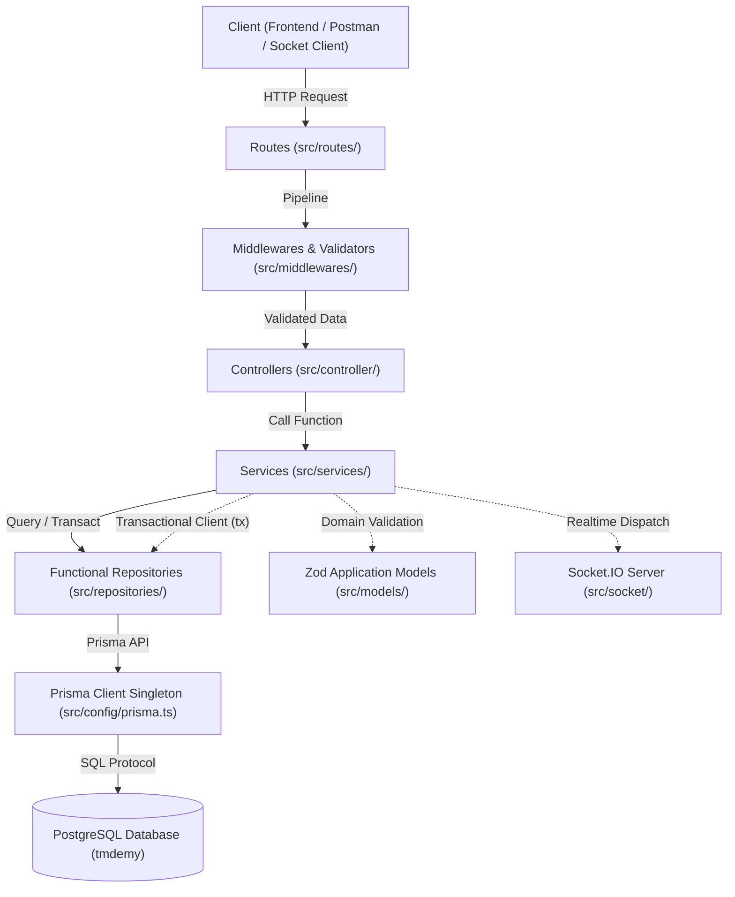
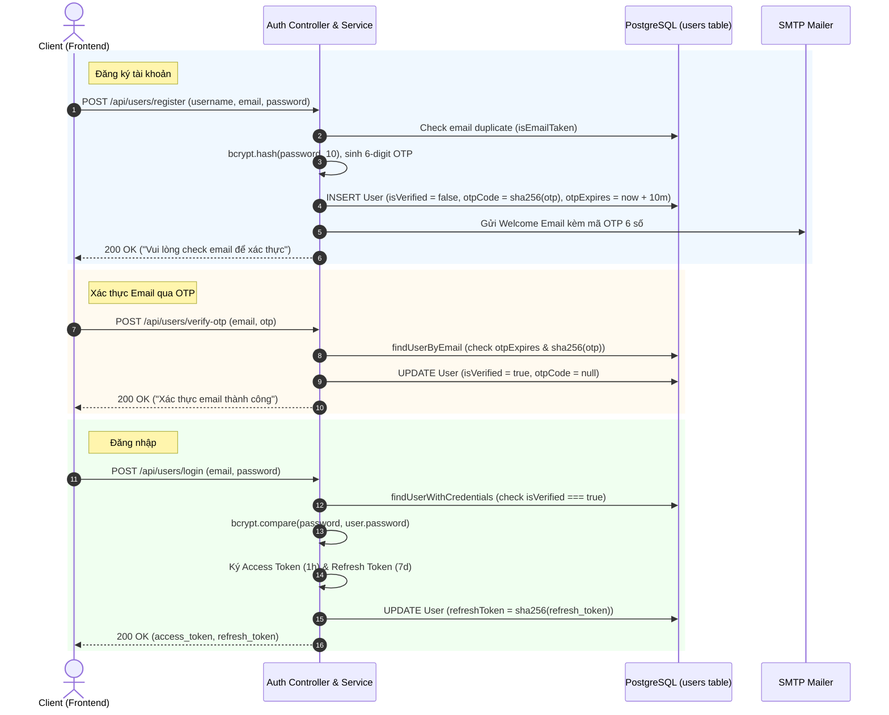
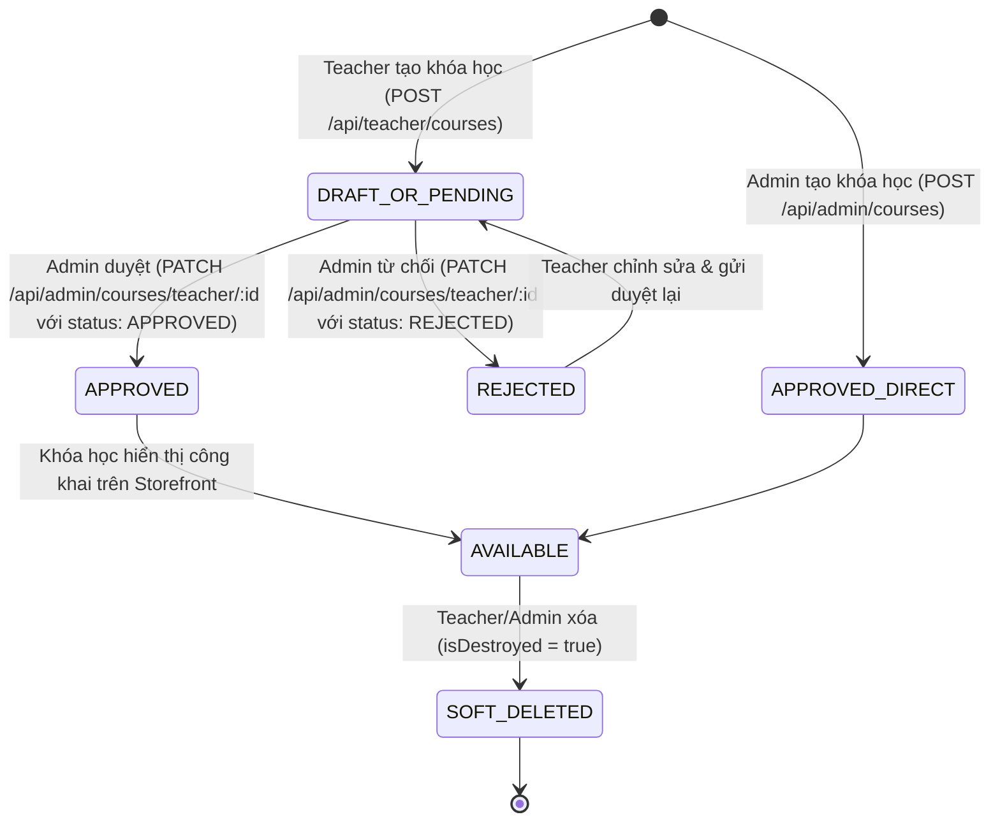
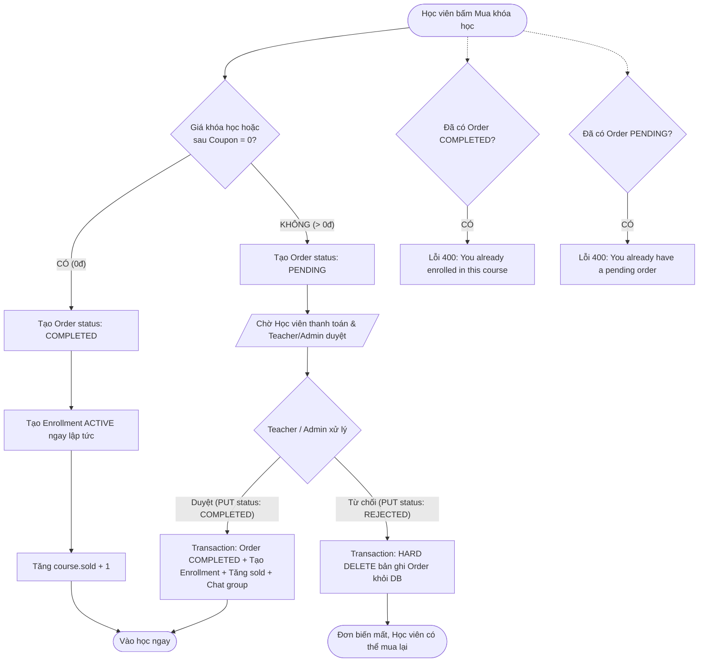
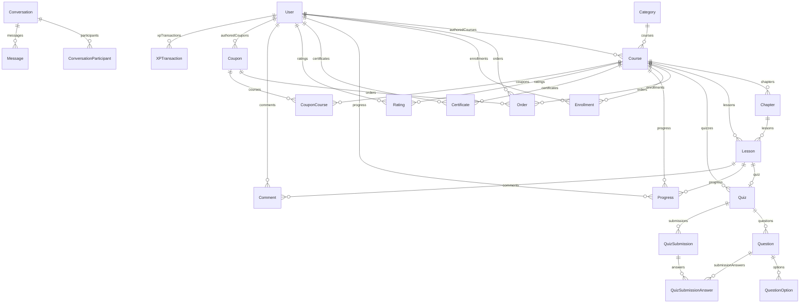
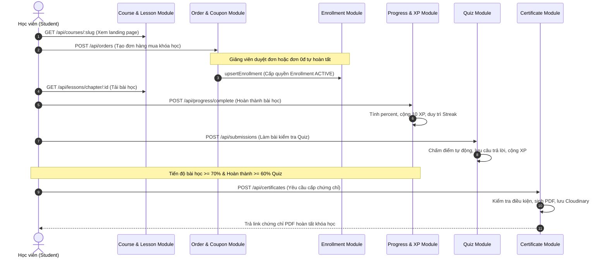

# TMDEMY — COMPLETE BACKEND BUSINESS LOGIC & SYSTEM ARCHITECTURE HANDBOOK

> **Document Version**: 1.0.0 (Comprehensive Baseline)  
> **Target Audience**: Frontend Engineers, AI Assistants, Backend Maintainers, System Architects  
> **Classification Tagging**:  
> - `[FACT]`: Đã xác minh 100% từ source code thực tế.  
> - `[DOCUMENTATION]`: Dẫn xuất từ tài liệu thiết kế và ADR migration của dự án.  
> - `[INFERENCE]`: Suy luận kỹ thuật từ luồng dữ liệu nhiều module.  
> - `[NOT VERIFIED]`: Chưa đủ bằng chứng chạy thực tế hoặc phụ thuộc môi trường ngoài.  
> - `[BACKEND GAP]`: Chưa có implementation hoặc thiếu hụt tính năng so với yêu cầu chuẩn.  

---

## MỤC LỤC TỔNG QUAN

1. [Project Discovery](#1-project-discovery)
2. [Backend Architecture](#2-backend-architecture)
3. [Authentication & Authorization](#3-authentication--authorization)
4. [User Management & Gamification](#4-user-management--gamification)
5. [Course Management Module](#5-course-management-module)
6. [Learning Management Subsystem](#6-learning-management-subsystem)
7. [Commerce Subsystem: Order, Coupon & Enrollment](#7-commerce-subsystem-order-coupon--enrollment)
8. [Student Features & Experience](#8-student-features--experience)
9. [Teacher Features & Isolation](#9-teacher-features--isolation)
10. [Admin Backoffice Features](#10-admin-backoffice-features)
11. [Social, Communication & Interaction](#11-social-communication--interaction)
12. [Realtime & WebRTC Architecture (Socket.IO)](#12-realtime--webrtc-architecture-socketio)
13. [Analytics & Statistics Engine](#13-analytics--statistics-engine)
14. [Database & Data Relationships (Prisma ERD)](#14-database--data-relationships-prisma-erd)
15. [Master REST API Catalog](#15-master-rest-api-catalog)
16. [Cross-Module Business Workflows](#16-cross-module-business-workflows)
17. [Error Handling & Security Architecture](#17-error-handling--security-architecture)
18. [Backend Gaps, Inconsistencies & Limitations](#18-backend-gaps-inconsistencies--limitations)
19. [Source Traceability Index](#19-source-traceability-index)

---

## 1. PROJECT DISCOVERY

`[FACT]` Dựa trên việc phân tích trực tiếp cấu trúc cây thư mục, `package.json`, và mã nguồn khởi chạy của hệ thống TMDEMY E-Learning Backend:

* **Backend Framework**: Express.js 5.1.0 (`express@^5.1.0`).
* **Runtime & Language**: Node.js, TypeScript 5.8.3 (`strict: true`), thực thi qua `nodemon` + `tsx` ở môi trường development và biên dịch qua `tsc` + `tsc-alias` cho production.
* **Package Manager**: npm (dựa trên sự hiện diện của `package-lock.json`).
* **Primary Target Database**: PostgreSQL 16.11 (database name: `tmdemy`).
* **ORM & Database Client**: Prisma ORM 6.4.1 (`@prisma/client@^6.4.1`, `prisma@^6.4.1`). Prisma Client Singleton được quản lý tập trung tại `src/config/prisma.ts`.
* **Legacy Database / Transitional Stack**: MongoDB Atlas (kết nối trước đây qua Mongoose trong giai đoạn chuyển đổi, hiện tại toàn bộ module cốt lõi đã chuyển sang PostgreSQL).
* **Validation Libraries**:
  - Transport Layer (HTTP Input): Express Validator 7.2.1 (`express-validator@^7.2.1`) tại `src/middlewares/*.middleware.ts`.
  - Application Layer (Domain Models): Zod 3.24.2 (`zod@^3.24.2`) tại `src/models/*.model.ts`.
* **Authentication & Cryptography**:
  - JWT: `jsonwebtoken@^9.0.2` (Access Token, Refresh Token, Email Verification Token).
  - Password Hashing: `bcryptjs@^3.0.2` (salt rounds: 10).
  - Token Hashing: Node.js native `crypto.createHash('sha256')` (dùng băm Refresh Token và Reset Token lưu DB).
* **Realtime Communication**: Socket.IO 4.8.1 (`socket.io`, `@types/socket.io@^3.0.2`).
* **Email Service**: Nodemailer 7.0.6 (`nodemailer@^7.0.6`) gửi qua SMTP Google Mail.
* **PDF Generation & Storage**: `pdfkit@^0.17.2` xuất chứng chỉ và `cloudinary@^2.7.0` lưu trữ file PDF chứng chỉ.
* **Cron Jobs / Background Tasks**: `node-cron@^4.2.1` chạy tác vụ quét dọn user chưa xác thực.
* **Project Folder Structure**:
  ```text
  d:\e-learning_server/
  ├── prisma/                 # Prisma schema (schema.prisma) & migration history
  ├── scripts/                # Verification, migration utils, test scripts
  ├── docs/                   # Tài liệu kiến trúc, migration, API testing guides
  ├── src/
  │   ├── config/             # Cấu hình Prisma Singleton (prisma.ts)
  │   ├── controller/         # Function-based controllers xử lý req/res
  │   ├── cronJobs/           # Scheduled cron jobs (deleteUnverifiedUsers.ts)
  │   ├── middlewares/        # JWT auth, role check, validation chains, error handler
  │   ├── models/             # Zod Application Domain Models (single source of truth)
  │   ├── repositories/       # Functional repositories tương tác Prisma Client
  │   ├── routes/             # Express Router definitions & API mounts
  │   ├── services/           # Business logic core, workflows & transaction coordinators
  │   ├── socket/             # Socket.IO initialization, auth handshake & event listeners
  │   ├── styles/             # HTML Email templates (welcome, reset password)
  │   ├── types/              # Domain enums, TypeScript interfaces, custom express types
  │   └── utils/              # UUID helpers, Prisma error mapper, nodemailer, pdfGenerator
  └── index.ts                # Application Entry Point
  ```
* **Application Entry Points**:
  - Server Entry: `src/index.ts` khởi tạo Express app, kết nối Prisma qua `connectPrisma()`, mount CORS, mount toàn bộ routes qua `indexRoutes(app)`, mount global `errorHandler`, khởi tạo HTTP server và bọc Socket.IO qua `initSocket(server)`.
  - Port lắng nghe: Biến môi trường `PORT` (mặc định: `3000`).
* **Environment Variables (Danh mục biến bắt buộc)**:
  `[FACT]` Không chứa giá trị bí mật:
  - `DATABASE_URL`: Chuỗi kết nối PostgreSQL 16.11.
  - `PORT`: Cổng mạng chạy backend Express.
  - `URL_SERVER`: Địa chỉ backend (ví dụ: `http://localhost:3000`).
  - `URL_CLIENT`: Địa chỉ frontend client Next.js / React (ví dụ: `http://localhost:5173` hoặc `http://localhost:3000`).
  - `JWT_SECRECT_ACCESS_TOKEN`: Chuỗi bí mật ký Access Token (chú ý: chính tả trong mã nguồn là `JWT_SECRECT_ACCESS_TOKEN`).
  - `JWT_SECRECT_REFRESH_TOKEN`: Chuỗi bí mật ký Refresh Token.
  - `JWT_SECRET_VERIFIED_EMAIL`: Chuỗi bí mật ký token xác thực email.
  - `VERIFIED_EMAIL_JWT_EXPIRES_IN`: Thời gian hết hạn của token xác thực email.
  - `EMAIL_NAME`: Tài khoản email gửi thư thông báo SMTP.
  - `EMAIL_APP_PASSWORD`: Mật khẩu ứng dụng của tài khoản email SMTP.
  - `UNVERIFIED_USER_EXPIRE_MINUTES`: Thời gian hết hạn của tài khoản chưa verify OTP (mặc định: `1440` phút = 24h).
  - `UNVERIFIED_USER_CRON_EXPRESSION`: Biểu thức cron dọn user chưa verify (mặc định: `0 0 * * *`).
  - `CLOUDINARY_URL`: Cấu hình lưu trữ Cloudinary cho file chứng chỉ.

---

## 2. BACKEND ARCHITECTURE

### 2.1. Kiến trúc phân tầng đơn hướng (Unidirectional Layered Architecture)
`[FACT]` Hệ thống áp dụng nghiêm ngặt kiến trúc 5 tầng đơn hướng:



### 2.2. Trách nhiệm cụ thể của từng tầng (Separation of Concerns)
1. **Route Layer (`src/routes/*.route.ts`)**:
   - Định nghĩa endpoint URL và HTTP method tương ứng.
   - Gắn kết chuỗi middleware theo đúng thứ tự: `verifyAccessToken` $\rightarrow$ `isTeacherOrAdmin` / `isAdmin` $\rightarrow$ Express Validator chains $\rightarrow$ `handleValidationErrors` $\rightarrow$ Controller function.
   - **Tuyệt đối không chứa logic nghiệp vụ và không truy vấn database**.
2. **Middleware & Validator Layer (`src/middlewares/*.middleware.ts`)**:
   - `verifyAccessToken`: Bóc tách Bearer token từ header `Authorization`, verify chữ ký và gán `req.user = decoded`.
   - `isAdmin`, `isTeacher`, `isTeacherOrAdmin`: Kiểm tra role của `req.user`. Từ chối với HTTP 403 nếu sai role.
   - Express Validator chains: Kiểm tra cú pháp, format UUID RFC 4122 (`isValidUUID`), format ngày tháng, chuỗi không rỗng.
   - `handleValidationErrors`: Định dạng lỗi validation thành `{ errors: { field: "message" } }` kèm HTTP 400.
3. **Controller Layer (`src/controller/*.controller.ts`)**:
   - Bọc bởi `express-async-handler` để tự động chuyển tiếp unhandled promise rejection về `errorHandler`.
   - Tiếp nhận input từ `req.body`, `req.params`, `req.query`, `req.user`.
   - Gọi hàm Service tương ứng và trả về HTTP response JSON với HTTP status code chuẩn.
   - **Không chứa logic tính toán nghiệp vụ, không trực tiếp truy vấn Prisma**.
4. **Service Layer (`src/services/*.service.ts`)**:
   - **Trung tâm của toàn bộ Business Logic**.
   - Kiểm tra điều kiện nghiệp vụ: Sự tồn tại, tính duy nhất, quyền sở hữu tài nguyên (ownership), trạng thái khóa học, tính toán giảm giá coupon, tính điểm thi quiz, cập nhật tiến độ học tập.
   - Điều phối giao dịch PostgreSQL thông qua `prisma.$transaction(async (tx) => { ... })`.
   - Kích hoạt các tác vụ ngoài giao dịch: Push notification, gửi email, phát sự kiện realtime Socket.IO.
   - Chuẩn hóa payload trả về: Chuyển đổi Prisma Decimal thành number, gán alias tương thích `_id = id` qua `withCompatId()`.
5. **Functional Repository Layer (`src/repositories/*.repository.ts`)**:
   - Tuân thủ Functional Programming thuần túy: Export các hàm async độc lập, không dùng Class, không dùng Generic BaseRepository, không dùng từ khóa `this`.
   - Trách nhiệm duy nhất: Tương tác với PostgreSQL thông qua Prisma Client Singleton.
   - Khai báo các Prisma Select Projections chuẩn mực (`COURSE_PUBLIC_SELECT`, `ORDER_DETAIL_SELECT`,...).
   - Mọi hàm ghi dữ liệu đều hỗ trợ tham số giao dịch tùy chọn `tx?: PrismaTransactionClient`.

---

## 3. AUTHENTICATION & AUTHORIZATION

### 3.1. Authentication Architecture (JWT Dual-Token)



* **Token Lifecycle & Expiration**:
  - `Access Token`: Thời hạn sống **1 giờ** (`expiresIn: '1h'`). Payload: `{ userId: string, role: string }`.
  - `Refresh Token`: Thời hạn sống **7 ngày** (`expiresIn: '7d'`). Payload: `{ userId: string }`.
  - `Email Verification OTP`: Thời hạn sống **10 phút** (`Date.now() + 10 * 60 * 1000`). Sinh ngẫu nhiên 6 chữ số (`Math.floor(100000 + Math.random() * 900000)`).
  - `Password Reset Token`: Thời hạn sống **15 phút** (`Date.now() + 15 * 60 * 1000`). Sinh ngẫu nhiên qua `crypto.randomBytes(32).toString('hex')`.
* **Cơ chế băm token bảo vệ Database (Token Hashing at Rest)**:
  `[FACT]` Refresh Token và Reset Password Token **không bao giờ lưu raw vào database**. Khi sinh token, backend trả raw token về cho Client, nhưng lưu vào PostgreSQL giá trị băm SHA-256 (`hashToken = crypto.createHash('sha256').update(token).digest('hex')`). Nếu database bị rò rỉ, hacker không thể dùng các token này để mạo danh.
* **Cơ chế cấp lại Access Token (`POST /api/users/access_token`)**:
  - Request Body: `{ "refresh_token": "..." }`.
  - Middleware `verifyRefreshToken` kiểm tra chữ ký và hạn dùng JWT.
  - Service lấy `sha256(refresh_token)` đối chiếu với `user.refreshToken` trong database. Nếu không khớp hoặc `null` $\rightarrow$ HTTP 401 ("Refresh token không hợp lệ hoặc đã bị thu hồi").
  - Nếu khớp $\rightarrow$ cấp Access Token mới (1h).
* **Đăng xuất (`POST /api/users/logout`)**:
  - Yêu cầu `verifyAccessToken`.
  - Backend cập nhật `user.refreshToken = null` trong PostgreSQL $\rightarrow$ Hủy hoàn toàn phiên làm việc của Refresh Token.

### 3.2. Authorization & Phân quyền Hệ thống
`[FACT]` Bảng đối chiếu vai trò người dùng trong hệ thống TMDEMY:

| Vai trò trong Code (`UserRole`) | Giá trị DB | Mô tả quyền hạn |
|---|---|---|
| `ADMIN` | `"admin"` | Quyền hạn tối cao: Duyệt khóa học, tạo giảng viên, xóa người dùng, quản lý toàn bộ danh mục, xem toàn bộ đơn hàng và thống kê hệ thống. |
| `TEACHER` | `"teacher"` | Giảng viên: Tạo khóa học (chờ duyệt), tạo chương/bài học/quiz/coupon thuộc quyền sở hữu, duyệt/từ chối đơn hàng của khóa học mình tạo, xem thống kê doanh thu cá nhân. |
| `USER` | `"user"` | Học viên (Student): Mua khóa học, xem bài học đã mua, làm bài quiz, đánh giá, bình luận, chat trong nhóm khóa học, nhận chứng chỉ. |

> [!NOTE]
> `[FACT]` Trong hệ thống **KHÔNG CÓ vai trò `EXPERT`**. Mọi logic giảng dạy và quản lý nội dung thuộc về role `TEACHER` (`UserRole.TEACHER`).

* **Quy tắc Kiểm tra Quyền sở hữu (Resource Ownership Isolation)**:
  - Giảng viên (`TEACHER`) **chỉ được phép sửa/xóa/duyệt tài nguyên do chính mình tạo ra**.
  - Kiểm tra cứng tại tầng Service: `if (role === 'TEACHER' && resource.authorId !== userId) return { statusCode: 403, message: 'You are not the owner of this course' }`.
  - Giảng viên không thể xem doanh thu hay đơn hàng của giảng viên khác.
* **Mã lỗi phân quyền**:
  - `HTTP 401 Unauthorized`: Token bị thiếu (`Access Token is missing!`), token hết hạn (`jwt expired`), token không hợp lệ (`invalid token`).
  - `HTTP 403 Forbidden`: Sai role yêu cầu (`Admin role required`, `Teacher role required`), hoặc không sở hữu tài nguyên (`You are not the owner of this course`), hoặc chưa đăng ký khóa học (`You are not enrolled in this course`).

---

## 4. USER MANAGEMENT & GAMIFICATION

### 4.1. Danh mục API User Management

| Method | Endpoint | Auth | Role | Chức năng nghiệp vụ | Request Body chính | Response Status |
|---|---|:---:|:---:|---|---|:---:|
| `POST` | `/api/users/register` | Public | None | Đăng ký tài khoản học viên mới | `username`, `email`, `password`, `phone?`, `bio?` | 200 OK |
| `POST` | `/api/users/verify-otp` | Public | None | Xác thực tài khoản qua OTP 6 số | `email`, `otp` | 200 OK |
| `POST` | `/api/users/login` | Public | None | Đăng nhập hệ thống | `email`, `password` | 200 OK |
| `GET` | `/api/users/me` | Bearer | All | Lấy thông tin cá nhân hiện tại | Không | 200 OK |
| `PUT` | `/api/users/update-me` | Bearer | All | Cập nhật hồ sơ cá nhân & mạng xã hội | `username?`, `avatar?`, `phone?`, `bio?`, `socialLinks?` | 200 OK |
| `PUT` | `/api/users/change-password` | Bearer | All | Đổi mật khẩu cá nhân | `oldPassword`, `password` | 200 OK |
| `POST` | `/api/users/forgot-password` | Public | None | Yêu cầu link đặt lại mật khẩu qua email | `email` | 200 OK |
| `PUT` | `/api/users/reset-password` | Public | None | Đặt lại mật khẩu mới qua token | `token`, `password` | 200 OK |
| `POST` | `/api/users/logout` | Bearer | All | Đăng xuất & thu hồi Refresh Token | Không | 200 OK |
| `POST` | `/api/users/access_token` | Public | None | Cấp mới Access Token từ Refresh Token | `refresh_token` | 200 OK |
| `GET` | `/api/users/profile/:id` | Public | None | Xem hồ sơ công khai của một người dùng | Param: `id` (UUID) | 200 OK |
| `GET` | `/api/users/teachers` | Public | None | Lấy danh sách giảng viên đang hoạt động | Query: `page`, `limit`, `search`, `sortBy` | 200 OK |

### 4.2. Hệ thống Gamification (XP, Streak & Leaderboard)
`[FACT]` Hệ thống backend tích hợp sẵn nền tảng Gamification lưu trực tiếp tại bảng `users` và `xp_transactions`:
* **Cơ chế tích lũy XP (`xp_transactions`)**:
  - Hoàn thành bài học (`LESSON_COMPLETED`): Tự động cộng **10 XP** khi học viên hoàn thành 1 bài học qua `markLessonCompleteService`.
  - Hoàn thành bài kiểm tra (`QUIZ_COMPLETED`): Tự động cộng điểm XP dựa trên điểm số quiz qua `submitQuizService`.
  - Event Key Idempotency: Mỗi giao dịch XP có `eventKey` duy nhất (`LESSON_${userId}_${lessonId}`) để chống cộng trùng điểm.
* **Cơ chế Streak học tập hàng ngày**:
  - Khi học viên hoàn thành bài học, hàm `recordLearningActivityStreak` kiểm tra ngày hoạt động gần nhất (`lastActivityAt`).
  - Nếu hoạt động liên tiếp qua ngày hôm sau: `currentStreak = currentStreak + 1`. Cập nhật `longestStreak = max(longestStreak, currentStreak)`.
  - Nếu gián đoạn > 48h: `currentStreak` được reset về `1`.
* **API Leaderboard & Thống kê cá nhân**:
  - `GET /api/leaderboard`: Bảng xếp hạng học viên theo `xpTotal` (hỗ trợ `period: 'all' | 'weekly' | 'monthly'`, phân trang `page`, `limit`).
  - `GET /api/leaderboard/me`: Lấy vị trí thứ hạng xếp hạng hiện tại của chính mình.
  - `GET /api/users/me/xp-summary`: Tổng quan XP, thứ hạng và chuỗi streak hiện tại.
  - `GET /api/users/me/streak`: Chi tiết thông tin streak của user.
  - `GET /api/users/me/xp-history`: Lịch sử các giao dịch cộng XP theo phân trang.

---

## 5. COURSE MANAGEMENT MODULE

### 5.1. Vòng đời Khóa học (Course Lifecycle)



* **Trạng thái Khóa học (Enum `CourseStatus`)**:
  - `PENDING`: Khóa học do Teacher tạo, đang chờ ban quản trị Admin kiểm duyệt nội dung. Không thể mua ở trạng thái này.
  - `APPROVED`: Khóa học đã được phê duyệt. Hiển thị trên danh sách công khai và học viên có thể đặt mua.
  - `REJECTED`: Khóa học bị từ chối duyệt.
* **Cơ chế Xóa mềm (`isDestroyed`)**:
  - Khi Teacher hoặc Admin thực hiện xóa khóa học qua API `DELETE`, backend **không xóa vật lý** dòng dữ liệu trong PostgreSQL.
  - Backend cập nhật cờ `isDestroyed = true` (tương đương legacy `_destroy: true`).
  - Mọi câu lệnh truy vấn công khai tự động filter `isDestroyed: false`. Nếu học viên cố gắng tạo đơn hàng trên khóa học đã bị xóa mềm, backend từ chối với HTTP 400 ("Course is deleted or no longer available").

### 5.2. Giá cả & Dữ liệu Khóa học
* `price`: Giá bán thực tế (kiểu `Decimal(12, 2)` trong PostgreSQL, tự động ép kiểu về `number` khi trả ra API).
* `oldPrice`: Giá gốc trước khi giảm (dùng gạch ngang hiển thị khuyến mãi trên UI).
* `type`: Enum `CourseType` (`PAID` hoặc `FREE`).
* `level`: Enum `CourseLevel` (`BEGINNER`, `INTERMEDIATE`, `ADVANCED`).
* `sold`: Số lượt học viên đã mua (tự động tăng khi Order thành công, tự động giảm khi học viên bị kick hoặc hoàn tiền).
* `view`: Số lượt xem (tự động tăng `view + 1` khi gọi `GET /api/courses/:slug`).

---

## 6. LEARNING MANAGEMENT SUBSYSTEM

### 6.1. Cấu trúc Cây Dữ liệu Học tập (Curriculum Hierarchy)

```text
Course (Khóa học)
  │
  ├── Faqs (Câu hỏi thường gặp)
  └── Chapter 1 (Chương 1)
        ├── Lesson 1.1 (Bài học Video / Text - isDemo: true)
        ├── Lesson 1.2 (Bài học Video / Text - isDemo: false)
        │     └── Quiz (Bài kiểm tra bài học)
        │           ├── Question 1 (Trắc nghiệm MULTIPLE_CHOICE / FILL_IN_BLANK)
        │           │     ├── Option A
        │           │     └── Option B
        │           └── QuizSubmission (Lịch sử nộp bài của học viên)
        └── Lesson 1.3 (Bài học Video / Text)
```

### 6.2. Phân hệ Chapter & Lesson
* **Sắp xếp thứ tự (`order`)**:
  - Chapters và Lessons đều có trường `order` (kiểu Int). Khi tạo mới nếu không truyền `order`, backend tự động tìm order lớn nhất trong phạm vi cha và gán `order = max + 1`.
  - Kết quả trả về luôn được sắp xếp tăng dần theo `order: 'asc'`.
* **Cơ chế Demo Lesson (`isDemo`)**:
  - Cờ `isDemo: true` đánh dấu bài học cho phép học thử.
  - Trong `GET /api/courses/:slug`, danh sách bài học chỉ bao gồm metadata (`id`, `title`, `slug`, `duration`, `isDemo`, `order`, `type`) và **không để lộ `videoUrl` hoặc `content`**.

### 6.3. Phân hệ Tiến độ Học tập (Progress Tracking)
* Bảng lưu trữ: `progress` (`@@unique([userId, lessonId])`).
* Khi học viên xem xong bài học, gọi `POST /api/progress/complete`:
  - Kiểm tra cứng quyền học: Bắt buộc tồn tại bản ghi trong bảng `enrollments` (`findEnrollmentByUserAndCourse`). Nếu không có $\rightarrow$ **HTTP 403 Forbidden**.
  - Tính toán phần trăm hoàn thành:
    $$\text{percent} = \text{round}\left(\frac{\text{completedLessons}}{\text{totalLessons}} \times 100\right)$$
  - Cập nhật trường `progress` trong bảng `enrollments`.
  - Nếu $\text{percent} = 100$: Tự động cập nhật `enrollment.status = COMPLETED` và `completedAt = new Date()`.

### 6.4. Phân hệ Bài kiểm tra (Quiz & Questions)
* **Quy tắc sở hữu Quiz**: Mỗi bài học có tối đa 1 Quiz (`lessonId` là unique trong bảng `quizzes`).
* **Chính sách Nộp bài (Single Submission Policy)**:
  `[FACT]` Mỗi học viên **chỉ được phép nộp bài kiểm tra duy nhất 1 lần** cho mỗi Quiz (`@@unique([quizId, userId])` trên bảng `quiz_submissions`).
  - Nếu học viên nộp lần thứ 2, backend từ chối với HTTP 400 ("You have already submitted this quiz").
* **Chấm điểm tự động (`submitQuizService`)**:
  - Backend so khớp câu trả lời của học viên với đáp án gốc trong bảng `questions`.
  - Tính tổng điểm `score` và phần trăm đạt được:
    $$\text{percentage} = \text{round}\left(\frac{\text{score}}{\text{totalPoints}} \times 100\right)$$
  - Lưu chi tiết câu trả lời vào bảng `quiz_submission_answers`.
  - Tự động cộng XP thưởng cho học viên.

### 6.5. Phân hệ Cấp Chứng chỉ (Certificate Issuance)
* **API**: `POST /api/certificates` (Body: `{ "courseId": "..." }`).
* **Điều kiện cấp chứng chỉ nghiêm ngặt**:
  1. Học viên phải có Enrollment trong khóa học.
  2. Chưa từng được cấp chứng chỉ cho khóa học này (`@@unique([userId, courseId])`).
  3. Tiến độ học bài học phải đạt **tối thiểu 70%** (`enrollment.progress >= 70`).
  4. Khóa học bắt buộc phải có bài kiểm tra (Quiz).
  5. Tỷ lệ hoàn thành các bài kiểm tra phải đạt **tối thiểu 60%** tổng số quiz của khóa học.
  6. Điểm tổng kết chung cuộc:
     $$\text{finalScore} = \frac{\text{progress} + \text{quizCompletionPercentage}}{2} \ge 50$$
  7. Khi thỏa mãn toàn bộ điều kiện: Backend sinh file PDF qua `pdfkit`, upload lên Cloudinary, lưu bản ghi vào bảng `certificates` và trả về link chứng chỉ.

---

## 7. COMMERCE SUBSYSTEM: ORDER, COUPON & ENROLLMENT

### 7.1. Bóc tách Thực thể: Order vs Payment vs Enrollment
`[FACT]` Cần phân biệt rõ ràng 3 khái niệm này trong mã nguồn TMDEMY:
1. **Order (`orders` table)**: Bản ghi yêu cầu mua khóa học của học viên. Chứa thông tin số tiền (`amount`), giảm giá (`discount`), tổng thanh toán (`total`), mã đơn (`code`), và trạng thái (`status: PENDING | COMPLETED | REJECTED`).
2. **Payment Gateway**: **HIỆN TẠI HỆ THỐNG CHƯA TÍCH HỢP PAYMENT GATEWAY TỰ ĐỘNG** (như VNPay, MoMo, Stripe, VietQR tự động webhook). Mọi thanh toán có phí hiện tại hoạt động theo quy trình: Tạo Order PENDING $\rightarrow$ Học viên thanh toán bên ngoài $\rightarrow$ Giảng viên/Admin kiểm tra và duyệt Order thủ công sang COMPLETED.
3. **Enrollment (`enrollments` table)**: Quyền truy cập học tập thực tế của học viên đối với khóa học. **Chỉ được tạo ra khi Order đạt trạng thái `COMPLETED`**.

### 7.2. Chi tiết 8 Business Flows của Commerce



1. **Flow 1 — Học viên đăng ký khóa học miễn phí (Price = 0)**:
   - Backend tính `total === 0` $\rightarrow$ Order được gán `COMPLETED` ngay trong `createOrderService`.
   - Trong cùng 1 `prisma.$transaction`: Tạo Order COMPLETED, tăng `course.sold + 1`, tạo Enrollment `status: ACTIVE`. Học viên vào học ngay mà không cần chờ duyệt.
2. **Flow 2 — Học viên đăng ký khóa học có phí (Price > 0)**:
   - Backend tính `total > 0` $\rightarrow$ Order được gán `PENDING`.
   - **Tuyệt đối không tạo Enrollment**. `course.sold` không tăng. Học viên nhận mã đơn hàng `DH-xxxxxx` và chờ thanh toán.
3. **Flow 3 — Teacher/Admin duyệt Order (`PUT /api/orders/:id` với `status: COMPLETED`)**:
   - Chạy trong `prisma.$transaction`: Tăng `course.sold + 1`, gọi `upsertEnrollment` cấp quyền học, tăng số lần dùng coupon (nếu có), cập nhật Order thành `COMPLETED`.
   - Tự động thêm học viên vào nhóm Chat Socket.IO của khóa học và bắn push notification.
4. **Flow 4 — Teacher/Admin từ chối Order (`PUT /api/orders/:id` với `status: REJECTED`)**:
   - `[FACT]` **Cơ chế Hard-Delete**: Backend thực thi xóa bỏng vật lý bản ghi Order khỏi database (`deleteOrderById`).
   - Nếu Order trước đó đã từng COMPLETED: Tự động rollback thu hồi quyền học (`deleteEnrollment`), giảm `course.sold - 1`, giảm lượt dùng coupon.
   - Học viên không có quyền học và đơn hàng biến mất khỏi danh sách `my orders`.
5. **Flow 5 — Học viên đã có Enrollment đăng ký lại**:
   - Bị chặn ngay từ đầu bởi `checkExistingCompletedOrder`: Trả về HTTP 400 ("You already enrolled in this course").
6. **Flow 6 — Học viên có Order PENDING đăng ký lại**:
   - Bị chặn bởi `checkExistingPendingOrder`: Trả về HTTP 400 ("You already have a pending order for this course") kèm theo dữ liệu của đơn hàng PENDING cũ.
7. **Flow 7 — Áp dụng Coupon giảm giá về 0đ (100% discount)**:
   - Tương đương Flow 1: `total = max(price - discount, 0) = 0` $\rightarrow$ Tự động hoàn tất đơn và kích hoạt quyền học ngay lập tức, đồng thời tăng `coupon.used + 1`.
8. **Flow 8 — Các trường hợp Order thất bại**:
   - Tự mua khóa học của chính mình $\rightarrow$ HTTP 400 ("You cannot buy your own course").
   - Khóa học đang PENDING duyệt $\rightarrow$ HTTP 400 ("Course is pending approval and cannot be ordered").
   - Khóa học đã bị xóa mềm $\rightarrow$ HTTP 400 ("Course is deleted or no longer available").
   - Coupon hết hạn / chưa tới ngày / hết lượt / không áp dụng cho khóa học $\rightarrow$ HTTP 400.

---

## 8. STUDENT FEATURES & EXPERIENCE

Tổng hợp toàn bộ trải nghiệm tính năng dành cho học viên (`USER`):

1. **Khám phá Khóa học**: Xem danh sách công khai (`GET /api/courses`), tìm kiếm từ khóa, lọc theo danh mục, level, khoảng giá, sắp xếp theo ngày tạo hoặc số lượt mua.
2. **Chi tiết Khóa học & Học thử**: Xem chi tiết khóa học (`GET /api/courses/:slug`), danh sách chương, các bài học demo (`isDemo: true`).
3. **Quản lý Yêu thích (Favorite)**: Thêm/xóa khóa học vào danh sách yêu thích cá nhân (`POST /api/favorites/:id`, `DELETE /api/favorites/:id`, `GET /api/favorites`).
4. **Đặt mua & Áp mã giảm giá**: Kiểm tra coupon (`POST /api/coupons/use`), tạo đơn hàng (`POST /api/orders`), xem lịch sử đơn hàng (`GET /api/orders/my`).
5. **Vào học (Learning & Progress)**: Xem các khóa đã ghi danh (`GET /api/enrollments/my`), lấy bài học theo chương (`GET /api/lessons/chapter/:chapterId`), đánh dấu hoàn thành bài học (`POST /api/progress/complete`), theo dõi tiến độ (`GET /api/progress/:courseId`).
6. **Làm bài kiểm tra & Xem kết quả (Quiz)**: Nộp bài kiểm tra (`POST /api/submissions`), xem kết quả bài nộp của chính mình (`GET /api/submissions/:quizId`).
7. **Nhận Chứng chỉ**: Yêu cầu cấp chứng chỉ PDF khi đạt đủ điều kiện (`POST /api/certificates`).
8. **Đánh giá & Bình luận**: Gửi đánh giá sao (`POST /api/ratings`), viết bình luận bài học (`POST /api/comments`), like/dislike bình luận (`POST /api/comments/like/:id`).
9. **Nhận thông báo Realtime**: Nhận push notification realtime qua Socket.IO khi đơn hàng được duyệt, có bài học mới, hoặc có phản hồi bình luận.
10. **Trò chuyện (Chat)**: Tham gia nhóm chat Q&A của khóa học hoặc chat 1-1 với giảng viên.

---

## 9. TEACHER FEATURES & ISOLATION

Phân hệ dành riêng cho Giảng viên (`TEACHER`):

### 9.1. Quản lý Đào tạo (Course Management)
* Tạo khóa học mới: `POST /api/teacher/courses/` (khóa học ở trạng thái `PENDING`, chờ Admin phê duyệt).
* Cập nhật khóa học của mình: `PUT /api/teacher/courses/:id`.
* Xóa khóa học của mình (xóa mềm): `DELETE /api/teacher/courses/:id`.
* Xem danh sách các khóa học do mình giảng dạy: `GET /api/teacher/courses/`.
* Quản lý Chương & Bài học: Tạo/sửa/xóa Chapter và Lesson trong khóa học mình sở hữu.
* Quản lý Bài kiểm tra & Câu hỏi: Tạo Quiz cho bài học, thêm câu hỏi trắc nghiệm/điền từ, xem danh sách bài nộp của học viên (`GET /api/submissions/teacher/:quizId`) và xem thống kê phân tích quiz (`GET /api/submissions/teacher/analytics/:quizId`).

### 9.2. Quản lý Học viên & Đơn hàng
* Xem danh sách học viên trong lớp: `GET /api/enrollments/course/:id` (tìm kiếm theo tên, email, phân trang).
* Kick học viên khỏi lớp: `DELETE /api/enrollments/course/:id/:userId` (thu hồi enrollment, giảm sold, xóa đơn hàng).
* Duyệt / Từ chối đơn hàng: `PUT /api/orders/:id` (chỉ áp dụng cho các đơn hàng mua khóa học do mình sở hữu).

### 9.3. Bảng điều khiển Thống kê Giảng viên (Teacher Analytics)
`[FACT]` Giảng viên có hệ thống báo cáo chuyên sâu tại `src/services/teacherStatistic.service.ts`:
* `GET /api/teacher/statistics/overview`: Tổng doanh thu, tổng học viên, tổng khóa học, đánh giá trung bình.
* `GET /api/teacher/statistics/revenue`: Biểu đồ doanh thu theo chu kỳ (`7days`, `30days`, `12months`, `custom`).
* `GET /api/teacher/statistics/courses`: Thống kê số lượng khóa học theo trạng thái (`APPROVED`, `PENDING`, `REJECTED`).
* `GET /api/teacher/statistics/enrollments`: Thống kê số lượng lượt ghi danh mới theo thời gian.
* `GET /api/teacher/statistics/learning`: Thống kê tỷ lệ hoàn thành bài học và tiến độ trung bình của học viên.
* `GET /api/teacher/statistics/course-performance/:courseId`: Phân tích chuyên sâu hiệu suất của một khóa học cụ thể.

---

## 10. ADMIN BACKOFFICE FEATURES

Phân hệ dành riêng cho Quản trị viên tối cao (`ADMIN`):

1. **Quản lý Người dùng**:
   - Xem toàn bộ người dùng hệ thống (`GET /api/admin/users`).
   - Xem chi tiết người dùng (`GET /api/admin/users/:id`).
   - Cập nhật thông tin/trạng thái người dùng (`PUT /api/admin/users/:id`).
   - Xóa người dùng (`DELETE /api/admin/users/:id`).
   - **Tạo tài khoản Giảng viên**: `POST /api/admin/users` (API này chỉ tạo tài khoản có role `TEACHER`, không tạo học viên).
2. **Duyệt Khóa học (Course Moderation)**:
   - Duyệt hoặc từ chối khóa học của giảng viên: `PATCH /api/admin/courses/teacher/:id` (Body: `{ "status": "APPROVED" | "REJECTED" }`).
   - Tự tạo khóa học trực tiếp dưới quyền Admin: `POST /api/admin/courses` (khóa học tự động ở trạng thái `APPROVED` ngay khi tạo).
   - Xem toàn bộ khóa học hệ thống: `GET /api/admin/courses`.
3. **Quản lý Danh mục (Category Management)**:
   - Tạo danh mục: `POST /api/admin/categories/`.
   - Cập nhật danh mục: `PUT /api/admin/categories/:id`.
   - Xóa danh mục (xóa mềm `isDestroyed = true`): `DELETE /api/admin/categories/:id`.
4. **Quản lý Khuyến mãi (Coupon Management)**:
   - Tạo coupon toàn sàn hoặc cho khóa học chỉ định: `POST /api/coupons`.
   - Cập nhật / Xóa coupon: `PUT /api/coupons/:id`, `DELETE /api/coupons/:id`.
   - Xem danh sách coupon: `GET /api/coupons`.
5. **Điều hành Đơn hàng & Kiểm duyệt Bình luận**:
   - Xem toàn bộ đơn hàng toàn hệ thống: `GET /api/orders`.
   - Duyệt/Từ chối bất kỳ đơn hàng nào: `PUT /api/orders/:id`.
   - Xóa bình luận vi phạm tiêu chuẩn cộng đồng: `DELETE /api/comments/admin/:id`.

---

## 11. SOCIAL, COMMUNICATION & INTERACTION

### 11.1. Đánh giá Khóa học (Rating & Review)
* Bảng lưu trữ: `ratings` (`@@unique([userId, courseId])`).
* **Chính sách**: Mỗi học viên chỉ được đánh giá 1 lần duy nhất cho mỗi khóa học sau khi đã ghi danh (`findEnrollmentByUserAndCourse`).
* Điểm đánh giá: `rate` (từ 1 đến 5 sao), `content` (nội dung nhận xét tối đa 255 ký tự).
* Tự động gửi thông báo cho tác giả khóa học khi có đánh giá mới.

### 11.2. Bình luận Bài học (Comments & Replies)
* Bảng lưu trữ: `comments` (quan hệ phân cấp cây thư mục thông qua trường `parentId` và `level`).
* **Quyền bình luận**:
  - Học viên phải có Enrollment trong khóa học chứa bài học đó.
  - Giảng viên sở hữu khóa học và Admin được quyền bình luận mà không cần enrollment.
* **Tương tác**: Hỗ trợ Like và Dislike bình luận lưu trong bảng `comment_reactions` (`CommentReactionType: LIKE | DISLIKE`).

### 11.3. Thông báo (Notification System)
* Bảng lưu trữ: `notifications`.
* Các loại thông báo (`ENotificationType`): `ORDER`, `COURSE`, `LESSON`, `COMMENT`, `COMMENT_REPLY`, `RATING`, `QUIZ`, `MESSAGE`, `SYSTEM`.
* **Cơ chế phát thông báo kép**:
  - Ghi bản ghi vào PostgreSQL.
  - Phát sự kiện realtime qua Socket.IO: `io.to(receiverId).emit('new_notification', formattedNotification)`.
* Đánh dấu đã đọc: `PATCH /api/notifications/read/:id`.

### 11.4. Trò chuyện (Conversation & Messaging)
* Bảng lưu trữ: `conversations`, `conversation_participants`, `messages`.
* Hỗ trợ 2 hình thức:
  - Chat 1-1 giữa 2 người dùng.
  - Chat nhóm khóa học (`isGroup: true`, tự động tạo nhóm `Q&A - [Tên Khóa Học]` khi đơn hàng đầu tiên của khóa học được duyệt).

---

## 12. REALTIME & WEBRTC ARCHITECTURE (SOCKET.IO)

### 12.1. Quá trình Khởi tạo & Xác thực Kết nối Socket.IO
`[FACT]` Socket.IO được khởi tạo tập trung tại [`src/socket/initSocket.ts`](file:///d:/e-learning_server/src/socket/initSocket.ts):
1. **Bảo mật Bắt buộc (Strict JWT Handshake)**:
   - Khi client kết nối, socket middleware bóc tách token từ `socket.handshake.auth.token` hoặc `socket.handshake.headers.authorization`.
   - Xác thực token bằng `JWT_SECRECT_ACCESS_TOKEN`. Nếu không có token hoặc token không hợp lệ, socket **ngắt kết nối ngay lập tức** (`next(new Error('Authentication error...'))`).
2. **Phòng cá nhân (Personal Room)**:
   - Ngay khi kết nối thành công, socket tự động tham gia vào phòng có tên là chính `userId` của người dùng: `socket.join(String(userId))`.
   - Nhờ đó, backend có thể gửi thông báo đích danh tới bất kỳ user nào qua cú pháp: `io.to(userId).emit(...)`.

### 12.2. Bảng Danh mục Sự kiện Realtime (Socket.IO Events Matrix)

| Tên Event | Chiều gửi | Payload | Mục đích nghiệp vụ | Phân quyền & Kiểm tra |
|---|:---:|---|---|---|
| `join` | Client $\rightarrow$ Server | `conversationId` (string UUID) | Tham gia vào phòng chat của một hội thoại | Bắt buộc là thành viên trong hội thoại (`isUserInConversation`) |
| `sendMessage` | Client $\rightarrow$ Server | `{ conversationId, content, type }` | Gửi tin nhắn mới vào hội thoại | Sender ID tự động lấy từ JWT xác thực, không tin cậy client |
| `receiveMessage` | Server $\rightarrow$ Room | Message DTO `{ id, content, senderId, sender, conversationId, createdAt }` | Phát tin nhắn mới tới toàn bộ thành viên trong phòng chat | Tự động phát tới `io.to(conversationId)` |
| `editMessage` | Client $\rightarrow$ Server | `{ messageId, content }` | Chỉnh sửa nội dung tin nhắn đã gửi | Chỉ người gửi tin nhắn mới có quyền sửa |
| `messageUpdated` | Server $\rightarrow$ Room | Message DTO đã cập nhật | Thông báo tin nhắn đã sửa cho các thành viên | Tự động phát tới `io.to(conversationId)` |
| `deleteMessage` | Client $\rightarrow$ Server | `{ messageId }` | Xóa tin nhắn | Chỉ người gửi tin nhắn mới có quyền xóa |
| `messageDeleted` | Server $\rightarrow$ Room | `{ messageId }` | Thông báo tin nhắn đã bị xóa | Tự động phát tới `io.to(conversationId)` |
| `new_notification` | Server $\rightarrow$ User | Notification DTO `{ id, message, type, relatedId, createdAt }` | Gửi thông báo realtime đích danh | Phát tới `io.to(receiverId)` |
| `errorMessage` | Server $\rightarrow$ Socket | `string` (thông điệp lỗi) | Báo lỗi realtime khi thao tác socket thất bại | Gửi riêng cho socket gây lỗi |
| `callUser` | Client $\rightarrow$ Server | `{ receiverId, signalData, name }` | Khởi tạo cuộc gọi WebRTC 1-1 | Chuyển tiếp tới `io.to(receiverId)` |
| `incomingCall` | Server $\rightarrow$ User | `{ callerId, from, signalData, name }` | Báo có cuộc gọi đến cho người nhận | Nhận từ sự kiện `callUser` |
| `answerCall` | Client $\rightarrow$ Server | `{ receiverId, signal }` | Chấp nhận cuộc gọi WebRTC | Chuyển tiếp tới `io.to(receiverId)` |
| `callAccepted` | Server $\rightarrow$ User | `{ signal, answeredBy }` | Báo cuộc gọi đã được kết nối | Nhận từ sự kiện `answerCall` |
| `webrtc-offer` | Client $\rightarrow$ Server / Server $\rightarrow$ User | `{ receiverId, offer }` | Trao đổi SDP Offer WebRTC | Chuyển tiếp tới `io.to(receiverId)` |
| `webrtc-answer` | Client $\rightarrow$ Server / Server $\rightarrow$ User | `{ receiverId, answer }` | Trao đổi SDP Answer WebRTC | Chuyển tiếp tới `io.to(receiverId)` |
| `webrtc-ice-candidate` | Client $\rightarrow$ Server / Server $\rightarrow$ User | `{ receiverId, candidate }` | Trao đổi ICE Candidate mạng WebRTC | Chuyển tiếp tới `io.to(receiverId)` |

---

## 13. ANALYTICS & STATISTICS ENGINE

### 13.1. Thống kê Phân tích dành cho Giảng viên (Teacher Statistics)
`[FACT]` Cung cấp tại `src/repositories/teacherStatistic.repository.ts` và `src/services/teacherStatistic.service.ts`:

1. **Thống kê Tổng quan (`getTeacherOverviewController`)**:
   - Doanh thu tích lũy: Tổng tiền từ các Order COMPLETED của các khóa học do giảng viên sở hữu.
   - Tổng số lượt ghi danh: Tổng số bản ghi trong `enrollments` thuộc các khóa học của giảng viên.
   - Điểm đánh giá trung bình: Tính trung bình cộng trường `rate` từ bảng `ratings`.
2. **Thống kê Doanh thu theo chu kỳ (`getTeacherRevenueController`)**:
   - Tham số: `period: '7days' | '30days' | '12months' | 'custom'`, kèm `startDate`, `endDate`.
   - Cơ chế gom nhóm: Gom theo ngày (`YYYY-MM-DD`) cho chu kỳ ngắn hoặc gom theo tháng (`YYYY-MM`) cho chu kỳ 12 tháng.
3. **Thống kê Khóa học & Học tập (`getTeacherLearningController`)**:
   - Tỷ lệ hoàn thành: Phần trăm học viên đã đạt `progress = 100%`.
   - Tiến độ trung bình: Điểm trung bình cột `progress` của toàn bộ học viên đang theo học.

---

## 14. DATABASE & DATA RELATIONSHIPS (PRISMA ERD)

### 14.1. Sơ đồ Thực thể Quan hệ (Entity Relationship Diagram)



### 14.2. Ràng buộc Khóa & Quy tắc Toàn vẹn (Key Constraints & Cascades)
* Khóa chính toàn hệ thống: `id UUID PRIMARY KEY DEFAULT gen_random_uuid()`.
* **Unique Constraints quan trọng**:
  - `users`: `email UNIQUE`.
  - `categories`: `name UNIQUE`, `slug UNIQUE`.
  - `courses`: `slug UNIQUE`.
  - `lessons`: `@@unique([slug, courseId])`.
  - `quizzes`: `lessonId UNIQUE`.
  - `quiz_submissions`: `@@unique([quizId, userId])` (Mỗi người thi 1 lần).
  - `orders`: `code UNIQUE`.
  - `coupons`: `code UNIQUE`.
  - `coupon_courses`: `@@id([couponId, courseId])` (Composite PK).
  - `enrollments`: `@@unique([userId, courseId])` (Mỗi người học 1 enrollment/khóa).
  - `progress`: `@@unique([userId, lessonId])` (Mỗi người hoàn thành 1 bài học 1 lần).
  - `certificates`: `@@unique([userId, courseId])` (Mỗi người 1 chứng chỉ/khóa).
  - `ratings`: `@@unique([userId, courseId])` (Mỗi người đánh giá 1 lần).
  - `xp_transactions`: `eventKey UNIQUE` (Chống cộng trùng XP).
* **Quy tắc Cascade Deletion (`onDelete`)**:
  - Xóa Course $\rightarrow$ Tự động Cascade xóa: Chapter, Lesson, Quiz, Question, Enrollment, Progress, FAQ, Rating, Comment, Certificate.
  - Xóa User $\rightarrow$ Cascade xóa: Progress, Rating, Comment, ConversationParticipant. Khóa ngoại ở Course và Order dùng `onDelete: Restrict` để bảo vệ lịch sử giao dịch.

---

## 15. MASTER REST API CATALOG

`[FACT]` Bảng tổng hợp toàn bộ các REST API thực tế đang được mount trong hệ thống qua `src/routes/index.route.ts`:

| Domain | Method | Endpoint | Auth Header | Roles | Mô tả chức năng |
|---|:---:|---|:---:|:---:|---|
| **Auth & User** | `POST` | `/api/users/register` | Không | Public | Đăng ký tài khoản học viên mới |
| | `POST` | `/api/users/verify-otp` | Không | Public | Xác thực email bằng OTP 6 chữ số |
| | `POST` | `/api/users/login` | Không | Public | Đăng nhập hệ thống (nhận access & refresh token) |
| | `GET` | `/api/users/me` | Bearer Token | All | Lấy thông tin tài khoản hiện tại |
| | `PUT` | `/api/users/update-me` | Bearer Token | All | Cập nhật hồ sơ cá nhân |
| | `PUT` | `/api/users/change-password` | Bearer Token | All | Đổi mật khẩu |
| | `POST` | `/api/users/forgot-password` | Không | Public | Gửi email yêu cầu đặt lại mật khẩu |
| | `PUT` | `/api/users/reset-password` | Không | Public | Đặt lại mật khẩu mới qua token |
| | `POST` | `/api/users/logout` | Bearer Token | All | Đăng xuất, hủy refresh token |
| | `POST` | `/api/users/access_token` | Không (Body) | Public | Cấp access token mới từ refresh token |
| | `GET` | `/api/users/profile/:id` | Không | Public | Xem hồ sơ công khai của người dùng |
| | `GET` | `/api/users/teachers` | Không | Public | Lấy danh sách giảng viên đang hoạt động |
| **Gamification** | `GET` | `/api/leaderboard` | Optional Bearer | Public | Bảng xếp hạng học viên theo XP |
| | `GET` | `/api/leaderboard/me` | Bearer Token | All | Xem thứ hạng cá nhân trên bảng xếp hạng |
| | `GET` | `/api/users/me/xp-summary` | Bearer Token | All | Tổng quan điểm thưởng XP và chuỗi streak |
| | `GET` | `/api/users/me/streak` | Bearer Token | All | Chi tiết chuỗi ngày học tập liên tiếp |
| | `GET` | `/api/users/me/xp-history` | Bearer Token | All | Lịch sử các giao dịch cộng điểm XP |
| **Course** | `GET` | `/api/courses` | Không | Public | Danh sách khóa học công khai (tìm kiếm, lọc) |
| | `GET` | `/api/courses/:slug` | Không | Public | Chi tiết khóa học và cấu trúc chương bài học |
| **Chapter & Lesson** | `GET` | `/api/lessons/chapter/:chapterId`| Không | Public | Lấy danh sách bài học và nội dung theo chương |
| | `POST` | `/api/chapters/:courseId` | Bearer Token | Teacher/Admin| Tạo chương học mới cho khóa học |
| | `PUT` | `/api/chapters/:id` | Bearer Token | Teacher/Admin| Cập nhật tiêu đề chương học |
| | `DELETE`| `/api/chapters/:id` | Bearer Token | Teacher/Admin| Xóa chương học |
| | `GET` | `/api/chapters/course/:id` | Bearer Token | Teacher/Admin| Lấy danh sách chương của khóa học |
| | `POST` | `/api/lessons` | Bearer Token | Teacher/Admin| Tạo bài học mới |
| | `PUT` | `/api/lessons/:id` | Bearer Token | Teacher/Admin| Cập nhật bài học |
| | `DELETE`| `/api/lessons/:id` | Bearer Token | Teacher/Admin| Xóa bài học |
| **Category** | `GET` | `/api/categories` | Không | Public | Danh sách danh mục khóa học |
| | `GET` | `/api/categories/:slug` | Không | Public | Chi tiết danh mục theo slug |
| **Commerce (Order)** | `POST` | `/api/orders` | Bearer Token | All | Tạo đơn hàng mua khóa học |
| | `GET` | `/api/orders/my` | Bearer Token | All | Danh sách đơn hàng của học viên hiện tại |
| | `PUT` | `/api/orders/:id` | Bearer Token | Teacher/Admin| Duyệt (COMPLETED) hoặc từ chối (REJECTED) đơn |
| | `GET` | `/api/orders` | Bearer Token | Teacher/Admin| Xem danh sách đơn hàng quản lý |
| **Coupon** | `POST` | `/api/coupons/use` | Bearer Token | All | Kiểm tra và tính giá giảm của mã coupon |
| | `POST` | `/api/coupons` | Bearer Token | Teacher/Admin| Tạo mã giảm giá mới |
| | `PUT` | `/api/coupons/:id` | Bearer Token | Teacher/Admin| Cập nhật mã giảm giá |
| | `DELETE`| `/api/coupons/:id` | Bearer Token | Teacher/Admin| Xóa mã giảm giá |
| | `GET` | `/api/coupons` | Bearer Token | Teacher/Admin| Danh sách mã giảm giá quản lý |
| | `GET` | `/api/coupons/:id` | Bearer Token | Teacher/Admin| Chi tiết mã giảm giá |
| **Enrollment** | `GET` | `/api/enrollments/my` | Bearer Token | All | Danh sách các khóa học đã ghi danh của học viên |
| | `GET` | `/api/enrollments/course/:id` | Bearer Token | Teacher/Admin| Danh sách học viên trong 1 khóa học cụ thể |
| | `DELETE`| `/api/enrollments/course/:id/:userId`| Bearer Token| Teacher/Admin| Kick học viên ra khỏi khóa học |
| **Progress** | `POST` | `/api/progress/complete` | Bearer Token | All | Đánh dấu hoàn thành bài học, cập nhật tiến độ |
| | `POST` | `/api/progress/uncomplete` | Bearer Token | All | Hủy đánh dấu hoàn thành bài học |
| | `GET` | `/api/progress/:courseId` | Bearer Token | All | Lấy tiến độ học tập của khóa học |
| **Quiz & Question** | `POST` | `/api/quiz` | Bearer Token | Teacher/Admin| Tạo bài kiểm tra cho bài học |
| | `PUT` | `/api/quiz/:quizId` | Bearer Token | Teacher/Admin| Cập nhật bài kiểm tra |
| | `DELETE`| `/api/quiz/:quizId` | Bearer Token | Teacher/Admin| Xóa bài kiểm tra |
| | `GET` | `/api/quiz/lesson/:lessonId` | Không | Public | Lấy bài kiểm tra theo bài học |
| | `POST` | `/api/questions` | Bearer Token | Teacher/Admin| Thêm câu hỏi vào bài kiểm tra |
| | `PUT` | `/api/questions/:questionId` | Bearer Token | Teacher/Admin| Cập nhật câu hỏi |
| | `DELETE`| `/api/questions/:questionId` | Bearer Token | Teacher/Admin| Xóa câu hỏi |
| | `POST` | `/api/submissions` | Bearer Token | All | Nộp bài làm kiểm tra (Học viên) |
| | `GET` | `/api/submissions/:quizId` | Bearer Token | All | Xem kết quả nộp bài kiểm tra của chính mình |
| | `GET` | `/api/submissions/teacher/:quizId`| Bearer Token| Teacher/Admin| Xem toàn bộ bài nộp của học viên |
| | `GET` | `/api/submissions/teacher/analytics/:quizId`| Bearer Token| Teacher/Admin| Thống kê phân tích điểm số bài kiểm tra |
| **Certificate** | `POST` | `/api/certificates` | Bearer Token | All | Yêu cầu cấp chứng chỉ hoàn thành khóa học |
| **Social & Reviews**| `POST` | `/api/ratings` | Bearer Token | All | Đánh giá sao và nhận xét khóa học |
| | `GET` | `/api/ratings/course/:id` | Không | Public | Xem danh sách đánh giá của khóa học |
| | `GET` | `/api/ratings/manage` | Bearer Token | Teacher/Admin| Quản lý đánh giá |
| | `PUT` | `/api/ratings/manage/:id` | Bearer Token | Teacher/Admin| Cập nhật trạng thái đánh giá (ẩn/hiện) |
| | `DELETE`| `/api/ratings/manage/:id` | Bearer Token | Teacher/Admin| Xóa đánh giá |
| | `POST` | `/api/favorites/:id` | Bearer Token | All | Thêm khóa học vào danh sách yêu thích |
| | `DELETE`| `/api/favorites/:id` | Bearer Token | All | Xóa khóa học khỏi danh sách yêu thích |
| | `GET` | `/api/favorites` | Bearer Token | All | Xem danh sách khóa học yêu thích của tôi |
| | `POST` | `/api/comments` | Bearer Token | All | Viết bình luận hoặc trả lời bình luận |
| | `GET` | `/api/comments/lesson/:lessonId` | Không | Public | Xem danh sách bình luận của bài học |
| | `PUT` | `/api/comments/:id` | Bearer Token | All | Sửa bình luận của chính mình |
| | `DELETE`| `/api/comments/:id` | Bearer Token | All | Xóa bình luận của chính mình |
| | `POST` | `/api/comments/like/:commentId` | Bearer Token | All | Thích bình luận |
| | `POST` | `/api/comments/dislike/:commentId` | Bearer Token | All | Không thích bình luận |
| | `GET` | `/api/comments` | Bearer Token | Teacher/Admin| Quản lý bình luận |
| | `DELETE`| `/api/comments/admin/:id` | Bearer Token | Admin | Admin xóa bình luận vi phạm |
| | `DELETE`| `/api/comments/teacher/:id` | Bearer Token | Teacher/Admin| Giảng viên xóa bình luận trong khóa học mình |
| **Notifications** | `GET` | `/api/notifications` | Bearer Token | All | Lấy danh sách thông báo của tôi |
| | `PATCH`| `/api/notifications/read/:id` | Bearer Token | All | Đánh dấu thông báo đã đọc |
| **Chat & Message** | `POST` | `/api/conversations` | Bearer Token | All | Khởi tạo cuộc trò chuyện mới |
| | `GET` | `/api/conversations` | Bearer Token | All | Danh sách các cuộc trò chuyện của tôi |
| | `GET` | `/api/messages/:conversationId` | Bearer Token | All | Lấy lịch sử tin nhắn trong cuộc trò chuyện |
| **Teacher Module** | `GET` | `/api/teacher/statistics/overview` | Bearer Token | Teacher | Tổng quan doanh thu, học viên, đánh giá |
| | `GET` | `/api/teacher/statistics/revenue` | Bearer Token | Teacher | Biểu đồ doanh thu giảng viên theo kỳ |
| | `GET` | `/api/teacher/statistics/courses` | Bearer Token | Teacher | Thống kê số lượng khóa học của giảng viên |
| | `GET` | `/api/teacher/statistics/enrollments`| Bearer Token| Teacher | Thống kê lượt học viên đăng ký |
| | `GET` | `/api/teacher/statistics/learning` | Bearer Token | Teacher | Thống kê tiến độ học tập của học viên |
| | `GET` | `/api/teacher/statistics/course-performance/:courseId`| Bearer Token| Teacher | Hiệu suất chi tiết của 1 khóa học |
| | `POST` | `/api/teacher/courses/` | Bearer Token | Teacher | Giảng viên tạo khóa học mới (chờ duyệt) |
| | `PUT` | `/api/teacher/courses/:id` | Bearer Token | Teacher | Giảng viên sửa khóa học của mình |
| | `DELETE`| `/api/teacher/courses/:id` | Bearer Token | Teacher | Giảng viên xóa mềm khóa học của mình |
| | `GET` | `/api/teacher/courses/` | Bearer Token | Teacher | Giảng viên lấy danh sách khóa học của mình |
| **Admin Module** | `GET` | `/api/admin/users` | Bearer Token | Admin | Lấy danh sách toàn bộ người dùng |
| | `GET` | `/api/admin/users/:id` | Bearer Token | Admin | Xem chi tiết 1 người dùng |
| | `PUT` | `/api/admin/users/:id` | Bearer Token | Admin | Cập nhật thông tin/role người dùng |
| | `DELETE`| `/api/admin/users/:id` | Bearer Token | Admin | Xóa tài khoản người dùng |
| | `POST` | `/api/admin/users` | Bearer Token | Admin | Tạo tài khoản Giảng viên mới |
| | `POST` | `/api/admin/courses` | Bearer Token | Admin | Admin tạo khóa học trực tiếp (APPROVED ngay)|
| | `PUT` | `/api/admin/courses/:id` | Bearer Token | Admin | Admin cập nhật khóa học |
| | `DELETE`| `/api/admin/courses/:id` | Bearer Token | Admin | Admin xóa khóa học |
| | `GET` | `/api/admin/courses` | Bearer Token | Admin | Admin xem toàn bộ khóa học hệ thống |
| | `PATCH`| `/api/admin/courses/teacher/:id` | Bearer Token | Admin | Admin duyệt hoặc từ chối khóa học giảng viên|
| | `POST` | `/api/admin/categories/` | Bearer Token | Admin | Tạo danh mục mới |
| | `PUT` | `/api/admin/categories/:id` | Bearer Token | Admin | Cập nhật danh mục |
| | `DELETE`| `/api/admin/categories/:id` | Bearer Token | Admin | Xóa danh mục |

---

## 16. CROSS-MODULE BUSINESS WORKFLOWS

### 16.1. Luồng Học viên Học tập Toàn diện (End-to-End Student Journey)



---

## 17. ERROR HANDLING & SECURITY ARCHITECTURE

### 17.1. Định dạng Phản hồi Lỗi Chuẩn (Standard Error JSON Response)
1. **Lỗi Nghiệp vụ & Xác thực (Business / Auth Error)**:
   ```json
   {
     "success": false,
     "message": "You already enrolled in this course",
     "statusCode": 400
   }
   ```
2. **Lỗi Xác thực Cú pháp (Express Validation Error)**:
   ```json
   {
     "errors": {
       "courseId": "Invalid Course ID",
       "email": "Email is required"
     }
   }
   ```
3. **Lỗi Cơ sở Dữ liệu Prisma (Prisma Global Error Handler)**:
   ```json
   {
     "success": false,
     "error": "Duplicate record: A record with this email already exists",
     "errorCode": "P2002_UNIQUE_VIOLATION"
   }
   ```

### 17.2. Các Biện pháp Bảo mật Hệ thống
* **CORS Whitelist Dynamic**: Cho phép các domain localhost và dải mạng LAN nội bộ (`192.168.x.x`), chặn các nguồn gốc lạ ngoài danh sách cho phép.
* **Chống SQL Injection**: Sử dụng Prisma ORM biên dịch toàn bộ truy vấn thành Prepared Statements an toàn.
* **Bảo vệ Mật khẩu**: Băm một chiều bằng `bcryptjs` với salt rounds 10.
* **Bảo vệ Phân quyền**: Tuyệt đối không cho phép client truyền role khi đăng ký công khai (`registerUserService` luôn gán cứng `role: UserRole.USER`).
* **Bảo mật Socket.IO**: Chặn kết nối ngay tại tầng handshake nếu token JWT không hợp lệ; tự động trích xuất danh tính từ token, không tin cậy `senderId` do client gửi lên.

---

## 18. BACKEND GAPS, INCONSISTENCIES & LIMITATIONS

`[BACKEND GAP]` Dưới đây là các điểm thiếu hụt, mâu thuẫn hoặc chưa hoàn thiện trong mã nguồn hiện tại cần lưu ý đặc biệt khi tích hợp:

1. **Thiếu API Lấy chi tiết một Order (`GET /api/orders/:id`)**:
   - `[BACKEND GAP]` Route này không tồn tại. Frontend sau khi tạo đơn chỉ có thể lấy thông tin từ response của `POST /api/orders` hoặc lọc từ mảng `GET /api/orders/my`.
2. **Thiếu API Kiểm tra Quyền học theo từng Khóa học (`GET /api/enrollments/check/:courseId`)**:
   - `[BACKEND GAP]` Frontend không có API kiểm tra nhanh một khóa học đã được enroll hay chưa, buộc phải tải toàn bộ danh sách `GET /api/enrollments/my` rồi tìm kiếm ở client.
3. **Bất đồng bộ Endpoint Check Coupon**:
   - `[FACT]` Trong code comment ghi `POST /api/coupons/check`, nhưng router thực tế đăng ký là `POST /api/coupons/use`. Frontend gọi `/check` sẽ bị lỗi 404.
4. **Hành vi Xóa cứng Đơn hàng bị Từ chối (Hard Delete on REJECTED)**:
   - `[FACT]` Khi đơn hàng bị REJECTED, backend xóa hoàn toàn bản ghi khỏi database thay vì đổi trạng thái. Học viên sẽ thấy đơn hàng biến mất khỏi lịch sử thay vì hiển thị trạng thái "Bị từ chối".
5. **Thiếu Cổng thanh toán Tự động (Payment Gateway)**:
   - `[FACT]` Backend hoàn toàn chưa tích hợp cổng thanh toán trực tuyến tự động (VNPAY, MoMo, VietQR Webhook). Mọi đơn hàng có phí đều qua quy trình duyệt tay của giảng viên/admin.
6. **Lỗ hổng Kiểm tra Quyền trên API Lấy Bài học (`GET /api/lessons/chapter/:chapterId`)**:
   - `[BACKEND GAP]` API này hiện không có middleware xác thực và trả về đầy đủ `videoUrl` cùng `content` cho mọi bài học. Việc khóa bài học không phải demo hiện đang phụ thuộc hoàn toàn vào giao diện Frontend.
7. **Không hỗ trợ Tải file Ảnh trực tiếp (No Image File Upload)**:
   - `[FACT]` Backend không sử dụng `multer` để nhận file ảnh (`multipart/form-data`). Toàn bộ ảnh đại diện (`avatar`) và ảnh khóa học (`image`) đều nhận dưới dạng chuỗi URL (`string`).

---

## 19. SOURCE TRACEABILITY INDEX

Bảng tra cứu nguồn gốc mã nguồn cho các kết luận và phân hệ nghiệp vụ chính:

| Phân hệ / Nghiệp vụ | File Router | File Controller | File Service | File Repository | Prisma Model |
|---|---|---|---|---|---|
| **Authentication** | `src/routes/user.route.ts` | `src/controller/user.controller.ts` | `src/services/user.service.ts` | `src/repositories/user.repository.ts` | `User` |
| **Gamification (XP/Streak)**| `src/routes/leaderboard.route.ts`| `src/controller/gamification.controller.ts`| `src/services/xp.service.ts` | `src/repositories/xp.repository.ts` | `XPTransaction`, `User` |
| **Course Lifecycle**| `src/routes/course.route.ts` | `src/controller/course.controller.ts` | `src/services/course.service.ts` | `src/repositories/course.repository.ts` | `Course`, `CourseFaq` |
| **Chapter & Lesson**| `src/routes/chapter.route.ts`, `lesson.route.ts`| `src/controller/lesson.controller.ts`| `src/services/lesson.service.ts`| `src/repositories/lesson.repository.ts`| `Chapter`, `Lesson` |
| **Orders & Commerce**| `src/routes/order.route.ts` | `src/controller/order.controller.ts` | `src/services/order.service.ts` | `src/repositories/order.repository.ts` | `Order` |
| **Coupons** | `src/routes/coupon.route.ts`| `src/controller/coupon.controller.ts`| `src/services/coupon.service.ts`| `src/repositories/coupon.repository.ts`| `Coupon`, `CouponCourse` |
| **Enrollments** | `src/routes/enrollment.route.ts`| `src/controller/enrollment.controller.ts`| `src/services/enrollment.service.ts`| `src/repositories/enrollment.repository.ts`| `Enrollment` |
| **Progress** | `src/routes/progress.route.ts`| `src/controller/progress.controller.ts`| `src/services/progress.service.ts`| `src/repositories/progress.repository.ts`| `Progress` |
| **Quiz & Submission**| `src/routes/quiz.route.ts`, `quizSubmission.route.ts`| `src/controller/quizSubmission.controller.ts`| `src/services/quizSubmission.service.ts`| `src/repositories/quizSubmission.repository.ts`| `Quiz`, `Question`, `QuizSubmission` |
| **Certificates** | `src/routes/certificate.route.ts`| `src/controller/certificate.controller.ts`| `src/services/certificate.service.ts`| `src/repositories/certificate.repository.ts`| `Certificate` |
| **Teacher Statistics**| `src/routes/teacher.route.ts`| `src/controller/teacherStatistic.controller.ts`| `src/services/teacherStatistic.service.ts`| `src/repositories/teacherStatistic.repository.ts`| `Course`, `Order`, `Enrollment` |
| **Realtime Chat** | `src/routes/conversation.route.ts`, `message.route.ts`| `src/controller/message.controller.ts`| `src/services/message.service.ts`| `src/repositories/message.repository.ts`| `Conversation`, `Message` |
| **Socket.IO Engine**| `src/socket/initSocket.ts` | `src/socket/initSocket.ts` | `src/socket/initSocket.ts` | `src/repositories/conversationParticipant.repository.ts` | `ConversationParticipant` |

---

```text
Source code modified: NONE
Database modified: NONE
Dependencies modified: NONE

Status: COMPLETED — WAITING FOR USER REVIEW
```
