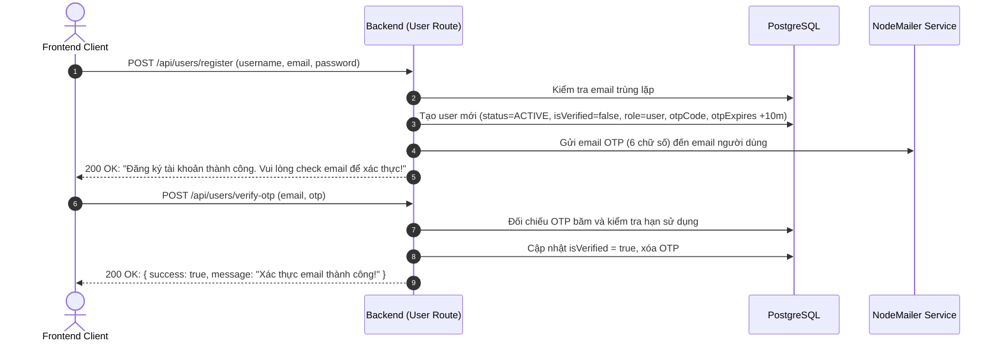
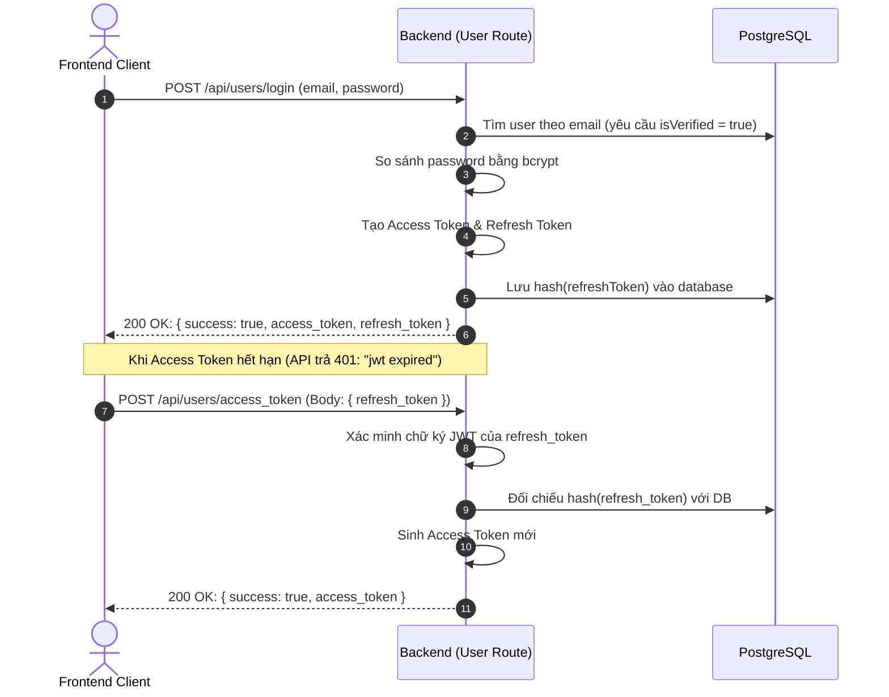

# TMDEMY — AUTHENTICATION & AUTHORIZATION FLOW

Tài liệu này giải thích chi tiết cơ chế Xác thực (Authentication) và Phân quyền (Authorization) đang vận hành trong backend TMDEMY để đội ngũ Frontend tích hợp chính xác và bảo mật.

---

## 1. Luồng Tổng quan (Authentication Architecture)

```text
HTTP Request
    │
    ▼
Header: Authorization: Bearer <ACCESS_TOKEN>
    │
    ▼
Middleware: verifyAccessToken (src/middlewares/verifyToken.ts)
    │
    ├── Token thiếu hoặc không đúng format "Bearer " ──> 401 Unauthorized: { success: false, error: "Access Token is missing!" }
    ├── Token hết hạn (TokenExpiredError) ──────────────> 401 Unauthorized: { success: false, error: "jwt expired" }
    ├── Chữ ký không hợp lệ (JsonWebTokenError) ────────> 401 Unauthorized: { success: false, error: "invalid token" }
    │
    ▼ Token hợp lệ
req.user = { userId: "uuid-v4", role: "user" | "teacher" | "admin" }
    │
    ▼
Role Middleware (src/middlewares/verifyRole.ts)
    │
    ├── isTeacher ────────> Yêu cầu req.user.role === "teacher" (Nếu sai: 403 Forbidden)
    ├── isAdmin ──────────> Yêu cầu req.user.role === "admin"   (Nếu sai: 403 Forbidden)
    └── isTeacherOrAdmin ─> Cho phép role "teacher" hoặc "admin" (Nếu sai: 403 Forbidden)
    │
    ▼
Controller Layer (src/controller/*.controller.ts)
Trích xuất an toàn: const { userId, role } = req.user
    │
    ▼
Service Layer (src/services/*.service.ts)
Kiểm tra Business Ownership: (ví dụ: course.authorId === userId)
```

---

## 2. JWT Tokens & Lifecycle

Hệ thống sử dụng cơ chế Dual-Token: **Access Token** (ngắn hạn) và **Refresh Token** (dài hạn).

### 2.1. Access Token
* **Ký bởi secret**: `process.env.JWT_SECRECT_ACCESS_TOKEN`
* **Payload cấu trúc**:
  ```json
  {
    "userId": "1b089c16-0be6-444f-9e7f-f7dcfbc3e9b1",
    "role": "teacher",
    "iat": 1728000000,
    "exp": 1728086400
  }
  ```
* **Định dạng header bắt buộc**:
  ```http
  Authorization: Bearer <ACCESS_TOKEN>
  ```
* **Lưu ý quan trọng**: Trường `role` luôn ở dạng **chữ thường** (`"user"`, `"teacher"`, `"admin"`).

### 2.2. Refresh Token & Cơ chế Chống Rò rỉ Database
* **Ký bởi secret**: `process.env.JWT_SECRECT_REFRESH_TOKEN`
* **Payload**:
  ```json
  {
    "userId": "1b089c16-0be6-444f-9e7f-f7dcfbc3e9b1",
    "iat": 1728000000,
    "exp": 1759536000
  }
  ```
* **Lưu trữ bảo mật**:
  Backend **không bao giờ lưu raw refresh token trong database**. Khi tạo token hoặc cấp mới token, backend dùng hàm `hashToken(refresh_token)` (SHA-256) rồi lưu vào cột `users.refresh_token` trong PostgreSQL.
* Khi Client gọi API cấp lại access token:
  Client gửi raw `refresh_token` trong request body. Middleware xác minh chữ ký, Service băm chuỗi này và so sánh với giá trị trong DB. Dù database có bị leak thì kẻ tấn công cũng không thể giả mạo refresh token hợp lệ.

---

## 3. Quy trình Đăng ký & Xác thực Tài khoản (Registration & OTP Flow)



> [!WARNING]
> Nếu OTP đã hết hạn sau 10 phút, backend sẽ tự động xóa bản ghi user chưa xác thực khỏi database để giải phóng email và tránh tài khoản rác. Client phải yêu cầu người dùng đăng ký lại.

---

## 4. Quy trình Đăng nhập & Duy trì Đăng nhập (Login & Token Refresh)



---

## 5. Quy trình Đăng xuất (Logout)

Khi đăng xuất:
1. Client gửi request:
   ```http
   POST /api/users/logout
   Authorization: Bearer <ACCESS_TOKEN>
   ```
2. Backend đặt lại `refreshToken = null` trong database của user tương ứng với `req.user.userId`.
3. Client hủy lưu trữ cả `access_token` và `refresh_token` trong localStorage/cookie.
4. Bất kỳ request refresh token nào sau đó bằng token cũ sẽ bị từ chối với lỗi `401 Refresh token không hợp lệ hoặc đã bị thu hồi`.

---

## 6. Quy tắc Bảo mật Bắt buộc cho Frontend

1. **Tuyệt đối không gửi `userId` hoặc `teacherId` từ Client**:
   * Tất cả các API yêu cầu định danh (lấy thông tin cá nhân, mua khóa học, xem tiến độ học, thống kê giảng viên) đều tự động trích xuất `req.user.userId` từ Access Token.
   * Client gửi trường `userId` hoặc `teacherId` trong request body/query sẽ bị backend bỏ qua hoặc từ chối để ngăn chặn giả mạo danh tính (ID Spoofing).
2. **Xử lý mã lỗi 401 thống nhất**:
   * Khi gặp `error: "jwt expired"`, Frontend thực hiện gọi API `POST /api/users/access_token` để lấy token mới rồi tự động retry request ban đầu.
   * Nếu API refresh token cũng trả `401`, chuyển hướng người dùng về trang Đăng nhập (`/login`).
3. **Phân quyền Route tại Frontend**:
   * Frontend có thể decode payload của Access Token (hoặc gọi `GET /api/users/me`) để đọc trường `role` (`"user"`, `"teacher"`, `"admin"`) phục vụ việc ẩn/hiện menu giao diện và bảo vệ route phía client.
