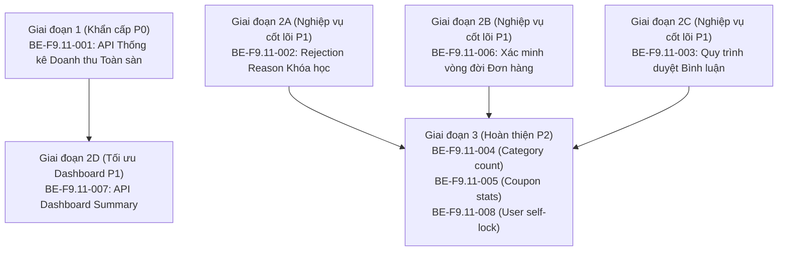

# BACKEND API IMPROVEMENT SPECIFICATION
## Yêu cầu Kỹ thuật Cải tiến Backend API Phục vụ Admin Portal TMdemy

> **Mã tài liệu:** SPEC-BE-F9.11  
> **Ngày ban hành:** 20/10/2026  
> **Đơn vị lập:** TMdemy Frontend AI Engineering Team  
> **Mục tiêu:** Chuyển giao các phát hiện kỹ thuật và khoảng trống API (Backend Gaps) từ quá trình thẩm định Admin Portal (Phase F9.11) thành đặc tả kỹ thuật chi tiết để nhóm phát triển Backend triển khai nâng cấp hệ thống.  
> **Quy tắc thực thi:** **TÀI LIỆU YÊU CẦU — KHÔNG THỰC HIỆN SOURCE CODE BACKEND TRONG PHASE NÀY.**

---

## 1. EXECUTIVE SUMMARY (TỔNG QUAN YÊU CẦU)

Qua quá trình rà soát tích hợp toàn diện 8 phân hệ Admin Portal và đối chiếu hợp đồng API tại thư mục `api/`, nhóm Frontend xác định được các điểm nghẽn kỹ thuật cần sự can thiệp từ phía Backend:

| Chỉ số tổng hợp | Số lượng | Chi tiết tóm tắt |
|---|---|---|
| **Tổng số API đề xuất tạo mới (NEW API)** | **4** | API thống kê tài chính sàn, API tóm tắt dashboard, API thống kê coupon, API cập nhật trạng thái bình luận |
| **Tổng số API cần chỉnh sửa / nâng cấp (MODIFY)** | **3** | Bổ sung `courseCount` cho Categories, lưu `rejectionReason` cho Courses, bổ sung filter trạng thái Comments |
| **Tổng số API cần xác minh hành vi (VERIFY)** | **1** | Xác minh vòng đời và tính chất lưu vết của Đơn hàng khi chuyển sang `rejected` |
| **Phân hệ chịu ảnh hưởng** | **7** | Dashboard, User, Course, Category, Coupon, Order, Comment |
| **Mức độ ưu tiên cao nhất** | **P0 (Critical)** | Cung cấp số liệu thống kê tài chính & doanh thu toàn sàn cho Admin |

### Phân bố mức độ ưu tiên (Priority Distribution):
- **P0 — Critical (Khẩn cấp, ảnh hưởng tính toàn vẹn số liệu):** 1 yêu cầu (`BE-F9.11-001`)
- **P1 — High (Quan trọng, ảnh hưởng nghiệp vụ cốt lõi):** 3 yêu cầu (`BE-F9.11-002`, `BE-F9.11-003`, `BE-F9.11-007`)
- **P2 — Medium (Cải thiện hiệu năng & trải nghiệm):** 4 yêu cầu (`BE-F9.11-004`, `BE-F9.11-005`, `BE-F9.11-006`, `BE-F9.11-008`)
- **P3 — Low (Tùy chọn nâng cao):** 0

---

## 2. API IMPROVEMENT BACKLOG (DANH MỤC YÊU CẦU CHI TIẾT)

---

### BE-F9.11-001: Bổ sung API Thống kê Tài chính & Doanh thu Toàn sàn cho Admin

- **Finding liên kết:** `F9.11-ISSUE-001` (Báo cáo F9.11 - Mục 13)
- **Phân loại:** **NEW API**
- **Mức độ ưu tiên:** **P0 — Critical**
- **Phân hệ ảnh hưởng:** Admin Dashboard & Admin Order Management

#### 1. Vấn đề hiện tại (Problem & Evidence)
- Backend hiện chỉ có API thống kê doanh thu theo giảng viên (`GET /api/teacher/statistics/revenue`), hoàn toàn **chưa có endpoint tổng hợp doanh thu sàn** dành cho Admin.
- Phía Frontend, `adminOrderService.getOrderKpis()` buộc phải gọi `GET /api/orders/?limit=100` rồi tự chạy vòng lặp tính tổng số tiền `price` của các đơn hàng có trạng thái `completed` trên trình duyệt.
- **Rủi ro:** Khi số lượng đơn hàng vượt quá 100, số liệu doanh thu trên Admin Dashboard và Order Management sẽ lập tức bị sai lệch vì chỉ phản ánh 100 giao dịch mới nhất thay vì toàn bộ lịch sử tài chính của nền tảng.

#### 2. Endpoint hiện tại
- Không có (`None`).

#### 3. Thay đổi yêu cầu (Required Change)
- Xây dựng endpoint mới `GET /api/admin/statistics/financial` cho phép Admin lấy các chỉ số tài chính được tổng hợp trực tiếp từ cơ sở dữ liệu (Database Aggregation / Prisma Aggregate).

#### 4. Đề xuất Hợp đồng API (Proposed API Contract)
> *Lưu ý: Đây là đề xuất hợp đồng (PROPOSED CONTRACT), backend developer có thể điều chỉnh tên trường cho phù hợp với schema hiện tại.*

- **Method:** `GET`
- **Proposed Endpoint:** `/api/admin/statistics/financial`
- **Query Parameters:**
  - `timeRange` (optional, string): `"7days"` | `"30days"` | `"1year"` | `"all"` (Mặc định: `"all"`).
  - `startDate` (optional, string ISO date): Lọc từ ngày.
  - `endDate` (optional, string ISO date): Lọc đến ngày.
- **Headers:** `Authorization: Bearer <admin_jwt_token>`
- **Response Structure (Proposed 200 OK):**
```json
{
  "success": true,
  "data": {
    "grossRevenue": 154500000,
    "netRevenue": 154500000,
    "totalOrders": 1250,
    "completedOrders": 1100,
    "pendingOrders": 120,
    "rejectedOrders": 30,
    "averageOrderValue": 140454,
    "revenueByMonth": [
      { "month": "2026-08", "revenue": 45000000, "orderCount": 350 },
      { "month": "2026-09", "revenue": 52000000, "orderCount": 420 },
      { "month": "2026-10", "revenue": 57500000, "orderCount": 480 }
    ]
  }
}
```
- **Error Responses:**
  - `401 Unauthorized`: Chưa đăng nhập hoặc token không hợp lệ.
  - `403 Forbidden`: Người dùng không có vai trò `admin`.
- **Authorization:** Bắt buộc JWT Role `admin`.

#### 5. Quy tắc nghiệp vụ (Business Rules)
- `grossRevenue` và `netRevenue` chỉ tính trên các đơn hàng có `status: "completed"`.
- Đơn hàng `pending` và `rejected` không được cộng vào doanh thu.

#### 6. Tiêu chí nghiệm thu (Acceptance Criteria)
- [ ] Truy vấn tổng hợp bằng câu lệnh SQL / Prisma `_sum` và `_count`, thời gian phản hồi < 200ms với tập dữ liệu 100,000 đơn hàng.
- [ ] Trả về mã lỗi 403 nếu tài khoản gọi API có vai trò `teacher` hoặc `student`.

#### 7. Tác động Frontend
- Frontend sẽ thay thế hoàn toàn logic tính tổng 100 đơn hàng trong `admin-order.service.ts` và `admin-dashboard.service.ts` bằng kết quả từ API này.

---

### BE-F9.11-002: Bổ sung & Lưu trữ Lý do Từ chối Khóa học (Course Rejection Reason)

- **Finding liên kết:** `F9.11-ISSUE-002` (Báo cáo F9.11 - Mục 13)
- **Phân loại:** **MODIFY EXISTING API / CONTRACT UPDATE**
- **Mức độ ưu tiên:** **P1 — High**
- **Phân hệ ảnh hưởng:** Admin Course Management & Teacher Course Management

#### 1. Vấn đề hiện tại (Problem & Evidence)
- Trong `ADMIN_API.md` (Dòng 319), endpoint duyệt khóa học được mô tả:
  - `PATCH /api/admin/courses/teacher/:id`
  - Body: `{ "status": "approved" | "rejected" }`
- Phía Frontend, khi Admin bấm "Từ chối khóa học", modal bắt buộc Admin nhập lý do và gửi kèm trường `reason?: string`.
- Chưa có xác nhận liệu Backend có lưu trường `reason` này vào cơ sở dữ liệu (Course table hoặc CourseAuditLog) hay không, và Giảng viên có xem được lý do từ chối để chỉnh sửa khóa học hay không.

#### 2. Endpoint hiện tại
- `PATCH /api/admin/courses/teacher/:id`

#### 3. Thay đổi yêu cầu (Required Change)
- Bổ sung trường `rejectionReason` (hoặc `reason`) vào Schema của Course (hoặc bảng Audit Log tương ứng).
- Khi Admin gửi `{ "status": "rejected", "rejectionReason": "..." }`, backend phải lưu vết lý do từ chối.
- Khi Giảng viên hoặc Admin gọi `GET /api/courses/:id` hoặc `GET /api/teacher/courses/:id`, response phải trả về trường `rejectionReason` nếu khóa học đang ở trạng thái `rejected`.

#### 4. Đề xuất Hợp đồng API (Proposed API Contract)
- **Method:** `PATCH`
- **Endpoint:** `/api/admin/courses/teacher/:id`
- **Request Body:**
```json
{
  "status": "rejected",
  "rejectionReason": "Chất lượng âm thanh bài học 3 và 4 quá rè, thiếu tài liệu đính kèm theo quy định."
}
```
- **Response (200 OK):**
```json
{
  "success": true,
  "message": "Cập nhật trạng thái khóa học thành công",
  "data": {
    "id": "course_123",
    "title": "React Masterclass",
    "status": "rejected",
    "rejectionReason": "Chất lượng âm thanh bài học 3 và 4 quá rè, thiếu tài liệu đính kèm theo quy định.",
    "updatedAt": "2026-10-20T19:30:00.000Z"
  }
}
```

#### 5. Tiêu chí nghiệm thu (Acceptance Criteria)
- [ ] Gửi request từ chối kèm lý do -> Lưu trữ thành công vào Database.
- [ ] Gọi `GET /api/courses/:id` lấy lại được `rejectionReason`.
- [ ] Giảng viên nhìn thấy lý do khóa học bị từ chối trên giao diện Teacher Portal để sửa đổi và nộp lại.

---

### BE-F9.11-003: Nâng cấp Quy trình & Trạng thái Kiểm duyệt Bình luận (Comment Moderation)

- **Finding liên kết:** `F9.11-ISSUE-003` (Báo cáo F9.11 - Mục 13)
- **Phân loại:** **NEW API + MODIFY EXISTING API**
- **Mức độ ưu tiên:** **P1 — High**
- **Phân hệ ảnh hưởng:** Admin Comment Management & Student Learning Classroom

#### 1. Vấn đề hiện tại (Problem & Evidence)
- Theo `COMMENT_API.md` (Dòng 54), khi tạo bình luận (`POST /api/comments/lessons/:lessonId`), trường `status` luôn mặc định được gán là `"APPROVED"`.
- Backend hiện chỉ có API xem danh sách (`GET /api/comments`) và xóa vĩnh viễn (`DELETE /api/comments/admin/:id`).
- Hệ thống hoàn toàn thiếu cơ chế: Ẩn tạm thời (`HIDDEN`), Cắm cờ báo cáo vi phạm (`FLAGGED`), hoặc Duyệt bình luận (`PENDING`). Admin chỉ có thể xóa hẳn bình luận khỏi database (mất dấu vết tranh chấp).

#### 2. Endpoint hiện tại
- `GET /api/comments`
- `DELETE /api/comments/admin/:id`

#### 3. Thay đổi yêu cầu (Required Change)
- Bổ sung trường `status` với các giá trị: `"PENDING" | "APPROVED" | "HIDDEN" | "FLAGGED"`.
- Tạo mới endpoint `PATCH /api/comments/admin/:id/status` cho phép Admin đổi trạng thái bình luận (ví dụ: chuyển sang `HIDDEN` để ẩn khỏi bài học mà không cần xóa dữ liệu).
- Nâng cấp `GET /api/comments` hỗ trợ query param `status`.

#### 4. Đề xuất Hợp đồng API (Proposed API Contract)
- **Method:** `PATCH`
- **Proposed Endpoint:** `/api/comments/admin/:id/status`
- **Request Body:**
```json
{
  "status": "HIDDEN",
  "moderationNote": "Chứa từ ngữ xúc phạm người học khác"
}
```
- **Response (200 OK):**
```json
{
  "success": true,
  "message": "Trạng thái bình luận đã được cập nhật thành công",
  "data": {
    "id": "cm_890",
    "status": "HIDDEN",
    "moderationNote": "Chứa từ ngữ xúc phạm người học khác",
    "updatedAt": "2026-10-20T19:35:00.000Z"
  }
}
```

#### 5. Tiêu chí nghiệm thu (Acceptance Criteria)
- [ ] Khi một bình luận bị chuyển sang `HIDDEN`, học viên trong phòng học `/learn/[slug]` không còn nhìn thấy bình luận đó.
- [ ] Admin có thể khôi phục lại bình luận thành `APPROVED` nếu sau đó xác minh nội dung hợp lệ.

---

### BE-F9.11-004: Bổ sung Số lượng Khóa học trực thuộc vào API Danh mục (Category Course Count)

- **Finding liên kết:** `F9.11-ISSUE-004` (Báo cáo F9.11 - Mục 13)
- **Phân loại:** **MODIFY EXISTING API**
- **Mức độ ưu tiên:** **P2 — Medium**
- **Phân hệ ảnh hưởng:** Admin Category Management & Student Catalog

#### 1. Vấn đề hiện tại (Problem & Evidence)
- Endpoint `GET /api/categories` và `GET /api/categories/:id` hiện chỉ trả về các trường: `id`, `name`, `slug`, `description`, `icon`, `parentId`, `createdAt`, `updatedAt`.
- Không có trường số lượng khóa học (`courseCount`).
- Phía Frontend không thể hiển thị số lượng khóa học của từng danh mục trên bảng Admin Categories, hoặc nếu muốn hiển thị phải gọi lặp N+1 request `GET /api/admin/courses?category=:id&limit=1`, gây quá tải hệ thống.

#### 2. Endpoint hiện tại
- `GET /api/categories`
- `GET /api/categories/:id`

#### 3. Thay đổi yêu cầu (Required Change)
- Bổ sung trường `courseCount: number` vào object category trả về (thực hiện qua `_count: { select: { courses: true } }` trong Prisma ORM).

#### 4. Đề xuất Hợp đồng API (Proposed API Contract)
- **Method:** `GET`
- **Endpoint:** `/api/categories`
- **Response Structure (Proposed 200 OK):**
```json
{
  "success": true,
  "data": [
    {
      "id": "cat_frontend",
      "name": "Lập trình Web",
      "slug": "lap-trinh-web",
      "description": "Các khóa học Frontend, Backend và Fullstack",
      "courseCount": 42,
      "createdAt": "2026-01-10T00:00:00.000Z"
    }
  ]
}
```

#### 5. Tiêu chí nghiệm thu (Acceptance Criteria)
- [ ] `courseCount` phản ánh chính xác số lượng khóa học đang liên kết với danh mục.
- [ ] Không làm suy giảm thời gian phản hồi của API `GET /api/categories` quá 50ms.

---

### BE-F9.11-005: Bổ sung API Thống kê Coupon Toàn sàn (Coupon Platform Analytics)

- **Finding liên kết:** `F9.11-ISSUE-005` (Báo cáo F9.11 - Mục 13)
- **Phân loại:** **NEW API**
- **Mức độ ưu tiên:** **P2 — Medium**
- **Phân hệ ảnh hưởng:** Admin Coupon Management & Admin Dashboard

#### 1. Vấn đề hiện tại (Problem & Evidence)
- Backend hiện chỉ cung cấp danh sách phân trang `GET /api/coupons`.
- Để hiển thị các chỉ số: Tổng số mã coupon, Số mã đang hoạt động, Tổng lượt đã sử dụng toàn sàn, Tỷ lệ kích hoạt, `adminCouponService.getCouponKpis()` hiện phải tự tính toán trên mảng 100 coupon đầu tiên.

#### 2. Endpoint hiện tại
- `GET /api/coupons`

#### 3. Thay đổi yêu cầu (Required Change)
- Tạo endpoint `GET /api/coupons/admin/statistics` tổng hợp số liệu coupon trên toàn hệ thống.

#### 4. Đề xuất Hợp đồng API (Proposed API Contract)
- **Method:** `GET`
- **Proposed Endpoint:** `/api/coupons/admin/statistics`
- **Headers:** `Authorization: Bearer <admin_jwt_token>`
- **Response (Proposed 200 OK):**
```json
{
  "success": true,
  "data": {
    "totalCoupons": 45,
    "activeCoupons": 28,
    "expiredCoupons": 12,
    "disabledCoupons": 5,
    "totalUsageCount": 1850,
    "totalDiscountAmount": 92500000
  }
}
```

---

### BE-F9.11-006: Xác minh & Quy chuẩn Vòng đời Đơn hàng khi Từ chối (Order Rejection Lifecycle)

- **Finding liên kết:** `F9.11-ISSUE-006` (Báo cáo F9.11 - Mục 13)
- **Phân loại:** **VERIFY EXISTING API / API DOCUMENTATION UPDATE**
- **Mức độ ưu tiên:** **P1 — High**
- **Phân hệ ảnh hưởng:** Admin Order Management & Kế toán / Kiểm toán

#### 1. Vấn đề hiện tại (Problem & Evidence)
- Khi gọi `PUT /api/orders/:id` với payload `{ status: "rejected" }`:
  - Tài liệu `ORDER_API.md` ghi nhận tác dụng phụ (side-effects): Tự động thu hồi quyền ghi danh (Enrollment) và hoàn lại số lượt đã dùng của mã giảm giá (Coupon).
  - Tuy nhiên tài liệu không ghi rõ: Bản ghi Order có bị xóa cứng (hard delete) khỏi DB hay vẫn được giữ lại với trạng thái `status: "rejected"`.
- Nếu đơn hàng bị xóa cứng, Admin sẽ không thể kiểm tra lại lịch sử các giao dịch bị từ chối/hủy thanh toán, gây thất thoát chứng từ đối soát.

#### 2. Yêu cầu xác minh & Chuẩn hóa (Verification & Standardization)
- **Xác minh trong Backend:** Kiểm tra controller `orders.controller.ts` và `orders.service.ts`. Đảm bảo đơn hàng được cập nhật `status: "rejected"` chứ **KHÔNG ĐƯỢC CHẠY LỆNH `prisma.order.delete()`**.
- **Cập nhật Hợp đồng:** Ghi rõ trong `ORDER_API.md` rằng bản ghi đơn hàng vẫn tồn tại và có thể truy vấn lại với bộ lọc `?status=rejected`.
- **Bổ sung trường:** Khuyến nghị lưu thêm `rejectedReason` và `rejectedAt` để phục vụ đối soát khi học viên thắc mắc.

---

### BE-F9.11-007: Cung cấp API Tổng hợp Admin Dashboard (All-in-one Dashboard Summary)

- **Finding liên kết:** `F9.11-ISSUE-007` (Báo cáo F9.11 - Mục 13)
- **Phân loại:** **NEW API**
- **Mức độ ưu tiên:** **P1 — High**
- **Phân hệ ảnh hưởng:** Admin Dashboard (`/admin/dashboard`)

#### 1. Vấn đề hiện tại (Problem & Evidence)
- Để hiển thị trang `/admin/dashboard`, Frontend hiện đang phải phát ra **6 API requests song song**:
  1. `GET /api/users/admin/users?limit=1`
  2. `GET /api/users/admin/users?role=teacher&limit=1`
  3. `GET /api/admin/courses?limit=1`
  4. `GET /api/admin/courses?status=pending&limit=1`
  5. `GET /api/orders/?limit=100`
  6. `GET /api/comments?limit=1`
- Việc này tạo áp lực băng thông lên server, tăng độ trễ tải trang và tạo nguy cơ trang Dashboard bị lỗi cục bộ nếu 1 trong 6 request gặp sự cố mạng hoặc bị giới hạn tốc độ (Rate Limiting).

#### 2. Thay đổi yêu cầu (Required Change)
- Xây dựng một endpoint duy nhất `GET /api/admin/dashboard/summary` trả về toàn bộ các con số tổng hợp của Admin Dashboard trong 1 payload.

#### 3. Đề xuất Hợp đồng API (Proposed API Contract)
- **Method:** `GET`
- **Proposed Endpoint:** `/api/admin/dashboard/summary`
- **Headers:** `Authorization: Bearer <admin_jwt_token>`
- **Response Structure (Proposed 200 OK):**
```json
{
  "success": true,
  "data": {
    "counts": {
      "totalUsers": 90,
      "totalStudents": 86,
      "totalTeachers": 3,
      "totalAdmins": 1,
      "totalCourses": 369,
      "pendingCourses": 23,
      "approvedCourses": 338,
      "rejectedCourses": 8,
      "totalOrders": 30,
      "pendingOrders": 9,
      "completedOrders": 21,
      "totalComments": 15
    },
    "financials": {
      "totalRevenue": 154500000,
      "conversionRate": 70.0
    },
    "pendingTasks": [
      { "type": "course_approval", "count": 23, "actionUrl": "/admin/courses?status=pending" },
      { "type": "order_fulfillment", "count": 9, "actionUrl": "/admin/orders?status=pending" }
    ],
    "recentUsers": [
      { "id": "u_1", "fullName": "Nguyen Van A", "email": "a@gmail.com", "role": "student", "createdAt": "2026-10-20T10:00:00Z" }
    ]
  }
}
```

---

### BE-F9.11-008: Bổ sung Kiểm tra Chống Tự Khóa Tài khoản ở cấp Backend (Server-side Self-Lockout Protection)

- **Finding liên kết:** `F9.11-ISSUE-008` (Báo cáo F9.11 - Mục 13)
- **Phân loại:** **MODIFY EXISTING API / SECURITY ENHANCEMENT**
- **Mức độ ưu tiên:** **P2 — Medium**
- **Phân hệ ảnh hưởng:** Admin User Management (`/admin/users`)

#### 1. Vấn đề hiện tại (Problem & Evidence)
- Phía Frontend đã thực hiện kiểm tra `currentUser.id === user.id` để vô hiệu hóa nút bấm Khóa tài khoản và Đổi vai trò đối với chính tài khoản Admin đang đăng nhập.
- Tuy nhiên, nếu một kẻ tấn công hoặc script tự động gửi trực tiếp request `PATCH /api/users/admin/lock/:myId` hoặc `PATCH /api/users/admin/role/:myId`, hiện tại Backend chưa tài liệu hóa rõ việc có chặn thao tác tự hại này hay không.

#### 2. Thay đổi yêu cầu (Required Change)
- Trong controller xử lý `PATCH /api/users/admin/lock/:id` và `PATCH /api/users/admin/role/:id`:
  - So sánh `req.user.id` (từ JWT) với `params.id`.
  - Nếu trùng nhau, lập tức trả về `400 Bad Request` kèm thông báo: `"Không thể tự khóa hoặc thay đổi vai trò của chính tài khoản quản trị đang đăng nhập"`.

---

## 3. NHÓM YÊU CẦU THEO MODULE (GROUPED BY MODULE)

| Module | Yêu cầu cải tiến | Mã Requirement | Mức độ ưu tiên |
|---|---|---|---|
| **1. Admin Dashboard** | API Tổng quan Dashboard tập trung | `BE-F9.11-007` | P1 — High |
| **2. User Management** | Chặn tự khóa tài khoản tại server-side | `BE-F9.11-008` | P2 — Medium |
| **3. Course Management** | Lưu trữ và phản hồi lý do từ chối khóa học | `BE-F9.11-002` | P1 — High |
| **4. Category Management** | Trả về `courseCount` trực thuộc danh mục | `BE-F9.11-004` | P2 — Medium |
| **5. Coupon Management** | API Thống kê sử dụng Coupon toàn hệ thống | `BE-F9.11-005` | P2 — Medium |
| **6. Order Management** | API Thống kê tài chính & Doanh thu sàn | `BE-F9.11-001` | P0 — Critical |
| **6. Order Management** | Xác minh không xóa cứng đơn hàng rejected | `BE-F9.11-006` | P1 — High |
| **7. Comment Management** | Bổ sung trạng thái duyệt & API đổi status | `BE-F9.11-003` | P1 — High |

---

## 4. BACKEND IMPLEMENTATION ORDER (THỨ TỰ TRIỂN KHAI ĐỀ XUẤT)

Nhóm Backend nên thực hiện theo thứ tự ưu tiên và sự phụ thuộc logic như sau:



1. **Bước 1 — Xử lý P0 (`BE-F9.11-001`):** Triển khai ngay câu truy vấn aggregate doanh thu sàn. Đây là dữ liệu tài chính quan trọng bậc nhất của nền tảng.
2. **Bước 2 — Xử lý P1:**
   - Hoàn thiện trường `rejectionReason` cho Course (`BE-F9.11-002`).
   - Kiểm tra và đảm bảo đơn hàng rejected không bị xóa mất (`BE-F9.11-006`).
   - Nâng cấp trạng thái bình luận (`BE-F9.11-003`).
   - Gộp các chỉ số trên vào API `GET /api/admin/dashboard/summary` (`BE-F9.11-007`).
3. **Bước 3 — Xử lý P2:** Bổ sung `courseCount` (`BE-F9.11-004`), thống kê coupon (`BE-F9.11-005`) và chặn tự khóa tài khoản (`BE-F9.11-008`).

---

## 5. BACKEND VERIFICATION CHECKLIST (DANH MỤC KIỂM TRA CHO BACKEND)

Trước và trong quá trình triển khai, kỹ sư Backend cần tuân thủ checklist sau:

- [ ] **Kiểm tra Schema hiện hành:** Đọc kỹ `prisma/schema.prisma` trong repository backend để xác định các model liên quan (`Order`, `Course`, `Category`, `Comment`, `Coupon`, `User`).
- [ ] **Kiểm tra Migration Database:** Nếu cần bổ sung trường mới (`rejectionReason` trong Course, `status` mới trong Comment), tạo migration an toàn không làm mất dữ liệu (`npx prisma migrate dev`).
- [ ] **Bảo vệ Phân quyền (RBAC):** Đảm bảo tất cả endpoint mới đều có middleware xác thực JWT và kiểm tra `role === 'admin'`.
- [ ] **Hiệu năng Truy vấn (Performance):** Sử dụng các hàm aggregate có sẵn của Prisma (`_sum`, `_count`), không được kéo toàn bộ records về RAM của NodeJS server để tính toán thủ công.
- [ ] **Bảo đảm Tính toàn vẹn Giao dịch (Transactions):** Các thao tác cập nhật đơn hàng hoặc xóa bình luận cascade cần được bọc trong `prisma.$transaction`.
- [ ] **Cập nhật Tài liệu Hợp đồng:** Sau khi triển khai xong, cập nhật tài liệu tương ứng tại thư mục `api/` trong repository frontend để đồng bộ hợp đồng giữa hai đội ngũ.

---

## 6. BACKEND SCOPE BOUNDARY (RANH GIỚI PHẠM VI CHO BACKEND)

Khi tiến hành phase cải tiến Backend trong tương lai, kỹ sư Backend bắt buộc phải tuân thủ nghiêm ngặt các ranh giới sau:

1. **Chỉ làm đúng các yêu cầu được phê duyệt:** Chỉ triển khai 8 yêu cầu từ `BE-F9.11-001` đến `BE-F9.11-008`. Tuyệt đối không tự ý thay đổi các endpoint khác đang hoạt động ổn định.
2. **Không tự ý Refactor diện rộng:** Giữ nguyên kiến trúc controller/service/repository hiện tại của backend.
3. **Bảo vệ Dữ liệu Tuyệt đối:** Không chạy lệnh `prisma migrate reset` làm mất dữ liệu người dùng, khóa học và đơn hàng đang chạy.
4. **Không chỉnh sửa Frontend:** Phase cải tiến Backend chỉ được phép thao tác trong repository `d:/e-learning_server`. Sau khi hoàn thành và test API bằng Postman/Curl, bàn giao lại để Frontend tiến hành tích hợp.
