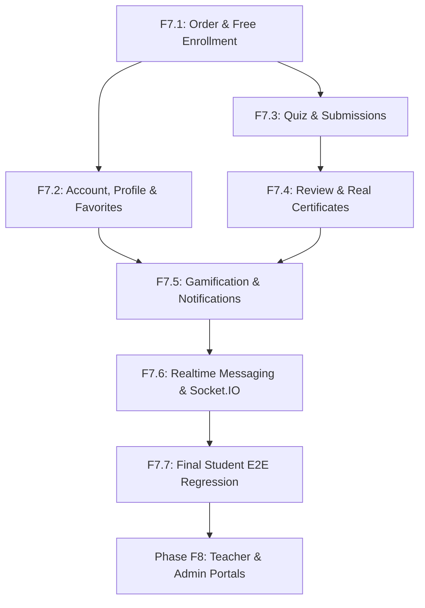

# LỘ TRÌNH TRIỂN KHAI HOÀN THIỆN CHỨC NĂNG HỌC VIÊN: F7.0.1 ROADMAP

> **Mã kế hoạch:** `F7_0_1_STUDENT_IMPLEMENTATION_ROADMAP`  
> **Dự án:** TMdemy E-learning Frontend (`d:/e-learning`)  
> **Nguyên tắc cốt lõi:** Ưu tiên hoàn thiện toàn bộ tính năng Học viên (Student Scope) trước; toàn bộ chức năng Quản trị và Giảng viên (Teacher & Admin Dashboard) được bảo lưu cho Phase F8+.  
> **Ngày lập:** 12/10/2026

---

## 1. PHẠM VI NGHIỆP VỤ HỌC VIÊN (STUDENT SCOPE)

Triển khai đầy đủ hành trình trải nghiệm của một người học (Student):
1. **Khám phá & Chọn khóa học**: Tìm kiếm, lọc danh mục, xem đề cương chi tiết.
2. **Ghi danh & Thanh toán**:
   - Đăng ký khóa học miễn phí: Tự động tạo Enrollment thật trên database.
   - Mua khóa học có phí: Trang `/checkout`, áp dụng mã coupon, hiển thị hướng dẫn chuyển khoản VietQR, quản lý trạng thái đơn hàng (`PENDING` -> `COMPLETED`).
3. **Quản lý tài khoản**: Cập nhật thông tin cá nhân, đổi mật khẩu, quản lý khóa học yêu thích.
4. **Học tập tương tác trong Classroom**:
   - Theo dõi tiến độ hoàn thành bài học.
   - Thảo luận, gửi câu hỏi, tương tác bình luận.
   - Làm bài kiểm tra trắc nghiệm (Quiz), nộp bài và xem điểm số chi tiết.
5. **Chứng chỉ & Tốt nghiệp**: Nhận chứng chỉ hoàn thành khóa học khi tiến độ đạt 100%.
6. **Đánh giá & Phản hồi**: Gửi review và xếp hạng sao khóa học sau khi học.
7. **Gamification & Thông báo**: Bảng xếp hạng học viên, theo dõi Streak ngày học liên tục, điểm XP, chuông thông báo hệ thống.
8. **Trao đổi tin nhắn**: Nhắn tin trực tiếp với giảng viên qua giao diện chat và Socket.IO realtime.

---

## 2. BẢN ĐỒ PHỤ THUỘC (DEPENDENCY MAP)

---

## 3. CÁC GIAI ĐOẠN TRIỂN KHAI CHI TIẾT (IMPLEMENTATION PHASES)

### PHASE F7.1: Ghi danh khóa học & Luồng Thanh toán (Order & Checkout Integration)
- **1. Objective**: Khắc phục lỗi chí mạng Free Course Bypass và tạo trang `/checkout` cho khóa học trả phí.
- **2. Scope**: 
  - Khắc phục nút "Đăng ký học miễn phí" gọi `POST /api/orders/` để tạo enrollment tự động.
  - Xây dựng trang `/checkout` hỗ trợ xem tóm tắt đơn, áp dụng mã Coupon, hiển thị mã QR thanh toán (VietQR) và trang theo dõi trạng thái đơn hàng (`PENDING` chờ duyệt).
- **3. Pages**: `src/app/checkout/page.tsx`, `src/app/courses/[slug]/page.tsx`, `src/app/my-courses/page.tsx`.
- **4. APIs**:
  - `POST /api/orders/`
  - `GET /api/orders/my-orders`
  - `GET /api/orders/:id`
  - `POST /api/coupons/apply`
  - `GET /api/enrollments/check/:courseId`
- **5. Services & Hooks**: Tạo mới `src/services/order.service.ts` và `src/services/coupon.service.ts`.
- **6. Components**: `CheckoutSummary`, `CouponForm`, `PaymentQRModal`, `OrderStatusBadge`.
- **7. State dependencies**: `AuthContext` (yêu cầu đăng nhập trước khi mua).
- **8. Backend dependencies**: Endpoint `/api/orders` và logic tự tạo enrollment cho đơn 0đ của Backend.
- **9. Risks**: Cần xử lý trường hợp học viên tạo đơn nhiều lần cho cùng một khóa học (Backend sẽ chặn duplicate order/enrollment).
- **10. Acceptance criteria**: 
  - Đăng ký khóa học free lập tức hiển thị trong `/my-courses` và không bị lỗi 403 khi hoàn thành bài học.
  - Khóa học có giá có luồng tạo Order `PENDING` rõ ràng, áp dụng coupon giảm giá đúng số tiền.
- **11. Complexity estimate**: Trung bình - Cao (3 - 4 ngày).
- **12. Validation plan**: Kiểm tra tạo đơn 0đ, tạo đơn có phí, nhập mã coupon hợp lệ/không hợp lệ, đối chiếu database qua Prisma Studio.

---

### PHASE F7.2: Quản lý Tài khoản, Hồ sơ & Khóa học Yêu thích (Account & Favorites)
- **1. Objective**: Thay thế dữ liệu mock trong Profile và Settings bằng API thật; kết nối tính năng Wishlist.
- **2. Scope**:
  - Cập nhật thông tin cá nhân (tên, tiểu sử, avatar).
  - Đổi mật khẩu học viên.
  - Nút tim Yêu thích khóa học (Favorite toggle) trên thẻ khóa học và trang chi tiết.
- **3. Pages**: `src/app/profile/page.tsx`, `src/app/settings/page.tsx`, `src/app/courses/page.tsx`, `src/app/courses/[slug]/page.tsx`.
- **4. APIs**:
  - `PUT /api/users/update-me`
  - `PUT /api/users/change-password`
  - `POST /api/favorites/`
  - `DELETE /api/favorites/:courseId`
  - `GET /api/favorites/my-favorites`
- **5. Services & Hooks**: Cập nhật `auth.service.ts`, tạo mới `src/services/favorite.service.ts`.
- **6. Components**: `ProfileForm`, `ChangePasswordForm`, `FavoriteButton`.
- **7. State dependencies**: Cập nhật `user` trong `AuthContext` sau khi cập nhật profile thành công.
- **8. Backend dependencies**: Không có rào cản, các API này đã có sẵn trong Backend.
- **9. Risks**: Đổi mật khẩu yêu cầu nhập đúng mật khẩu hiện tại, cần hiển thị lỗi chi tiết khi backend trả về 400/401.
- **10. Acceptance criteria**: Sửa thông tin thành công và reload trang dữ liệu vẫn giữ nguyên; đổi mật khẩu thành công và đăng nhập lại bằng mật khẩu mới được.
- **11. Complexity estimate**: Trung bình (2 ngày).
- **12. Validation plan**: Kiểm tra form validation, update avatar/name và verify qua `GET /api/users/me`.

---

### PHASE F7.3: Bài thi Trắc nghiệm trong Classroom (Quiz & Submissions)
- **1. Objective**: Cho phép học viên làm bài trắc nghiệm cuối bài học/cuối chương trực tiếp trong phòng học.
- **2. Scope**:
  - Tải câu hỏi trắc nghiệm của bài học.
  - Giao diện chọn đáp án trắc nghiệm, đếm thời gian làm bài.
  - Nộp bài thi, xem kết quả điểm số và giải thích đáp án.
- **3. Pages**: `src/app/learn/[slug]/page.tsx`.
- **4. APIs**:
  - `GET /api/quizzes/lesson/:lessonId`
  - `GET /api/questions/quiz/:quizId`
  - `POST /api/quiz-submissions/`
  - `GET /api/quiz-submissions/:id`
  - `GET /api/quiz-submissions/quiz/:quizId/my-latest`
- **5. Services & Hooks**: Tạo mới `src/services/quiz.service.ts`.
- **6. Components**: `QuizPlayer`, `QuizQuestionCard`, `QuizResultModal`.
- **7. State dependencies**: Trạng thái bài học hiện tại trong Classroom.
- **8. Backend dependencies**: Bài học phải có Quiz được liên kết và xuất bản.
- **9. Risks**: Xử lý tình trạng mất kết nối mạng khi đang làm bài.
- **10. Acceptance criteria**: Học viên chọn đáp án, bấm nộp bài nhận được điểm số chính xác và câu trả lời đúng từ Backend.
- **11. Complexity estimate**: Cao (3 ngày).
- **12. Validation plan**: Tạo submission mẫu qua UI, so sánh kết quả tính điểm với response từ server.

---

### PHASE F7.4: Đánh giá Khóa học & Cấp Chứng chỉ thật (Ratings & Real Certificates)
- **1. Objective**: Kết nối API gửi Review khóa học và thay thế dữ liệu chứng chỉ tĩnh bằng chứng chỉ thật.
- **2. Scope**:
  - Modal gửi đánh giá và nhận xét sao (chỉ cho phép học viên đã hoàn thành tối thiểu một phần khóa học).
  - Yêu cầu cấp chứng chỉ khi hoàn thành 100% khóa học.
  - Trang `/certificates` hiển thị các chứng chỉ thật với mã chứng chỉ và ngày cấp từ backend.
- **3. Pages**: `src/app/courses/[slug]/page.tsx`, `src/app/learn/[slug]/page.tsx`, `src/app/certificates/page.tsx`.
- **4. APIs**:
  - `POST /api/ratings/`
  - `PUT /api/ratings/:id`
  - `POST /api/certificates/`
  - `GET /api/certificates/my-certificates`
  - `GET /api/certificates/:id`
- **5. Services & Hooks**: Mở rộng `rating.service.ts`, tạo mới `src/services/certificate.service.ts`.
- **6. Components**: `RatingModal`, `CertificateCard`, `CertificateViewerModal`.
- **7. State dependencies**: Tiến độ 100% từ `progressService`.
- **8. Backend dependencies**: Endpoint `/api/certificates` yêu cầu kiểm tra tiến độ học viên phải đạt 100%.
- **9. Risks**: Backend từ chối cấp chứng chỉ nếu tiến độ thực tế chưa đạt 100%.
- **10. Acceptance criteria**: Gửi review hiển thị ngay trong danh sách đánh giá của khóa học; nhận và tải được chứng chỉ với mã định danh duy nhất.
- **11. Complexity estimate**: Trung bình (2 ngày).
- **12. Validation plan**: Kiểm tra học viên học xong 100% nhận chứng chỉ và hiển thị đúng thông tin tại `/certificates`.

---

### PHASE F7.5: Bảng Xếp hạng & Thông báo Học tập (Gamification & Notifications)
- **1. Objective**: Kết nối trang `/leaderboard` với dữ liệu điểm thật và tích hợp chuông thông báo trên Header.
- **2. Scope**:
  - Hiển thị bảng xếp hạng học viên theo tuần/tháng/tất cả từ API thật.
  - Hiển thị huy hiệu, điểm XP và chuỗi ngày học Streak trên Header / Dashboard.
  - Popover danh sách thông báo trên Header (đánh dấu đã đọc, đếm số chưa đọc).
- **3. Pages**: `src/app/leaderboard/page.tsx`, `src/components/layout/Header.tsx`.
- **4. APIs**:
  - `GET /api/gamification/leaderboard`
  - `GET /api/gamification/summary`
  - `GET /api/gamification/streak`
  - `GET /api/gamification/badges`
  - `GET /api/notifications/`
  - `GET /api/notifications/unread-count`
  - `PUT /api/notifications/:id/read`
  - `PUT /api/notifications/read-all`
- **5. Services & Hooks**: Tạo mới `src/services/gamification.service.ts` và `src/services/notification.service.ts`.
- **6. Components**: `LeaderboardTable`, `StreakWidget`, `NotificationDropdown`.
- **7. State dependencies**: Chu kỳ polling thông báo chưa đọc hoặc trigger khi có sự kiện.
- **8. Backend dependencies**: Bảng dữ liệu Gamification và Notifications của Backend.
- **9. Risks**: Leaderboard cần xử lý phân trang tốt khi danh sách học viên đông.
- **10. Acceptance criteria**: Hiển thị thứ hạng thật của học viên; chuông thông báo hiển thị đúng số lượng tin chưa đọc.
- **11. Complexity estimate**: Trung bình (2 - 3 ngày).
- **12. Validation plan**: Gửi notification thử nghiệm từ backend và xác nhận hiển thị trên UI.

---

### PHASE F7.6: Tin nhắn Thời gian thực & Socket.IO (Realtime Messaging)
- **1. Objective**: Biến trang `/messages` thành hệ thống chat hoạt động thật giữa Học viên và Giảng viên.
- **2. Scope**:
  - Cài đặt `socket.io-client` (đệ trình dependency request).
  - Tạo `SocketProvider` quản lý kết nối, token authentication và tái kết nối tự động.
  - Tích hợp 10 sự kiện Socket.IO (gửi, nhận, sửa, xóa tin nhắn, typing indicator).
  - Lịch sử cuộc trò chuyện và hội thoại qua REST API.
- **3. Pages**: `src/app/messages/page.tsx`.
- **4. APIs & Events**:
  - REST: `POST /api/conversations/`, `GET /api/conversations/`, `GET /api/messages/conversation/:id`.
  - Socket.IO: `join`, `sendMessage`, `receiveMessage`, `editMessage`, `messageEdited`, `deleteMessage`, `messageDeleted`, `typing`, `stopTyping`.
- **5. Services & Hooks**: Tạo mới `src/services/message.service.ts`, `src/context/SocketContext.tsx`, `src/hooks/use-socket.ts`.
- **6. Components**: `ChatSidebar`, `ConversationList`, `MessageThread`, `MessageInput`, `TypingIndicator`.
- **7. State dependencies**: Trạng thái kết nối Socket gắn với Access Token của `AuthContext`.
- **8. Backend dependencies**: Server Socket.IO tại port 3002.
- **9. Risks**: Rò rỉ kết nối (memory leak) nếu không cleanup listener đúng cách khi unmount component.
- **10. Acceptance criteria**: Hai tài khoản mở ở hai trình duyệt chat với nhau nhận tin nhắn ngay lập tức không cần reload trang.
- **11. Complexity estimate**: Rất cao (4 ngày).
- **12. Validation plan**: Mở 2 phiên ẩn danh (Học viên và Giảng viên) gửi tin nhắn qua lại và kiểm tra event payload.

---

### PHASE F7.7: Kiểm thử Toàn diện & Hồi quy Học viên (Final Student Regression & E2E)
- **1. Objective**: Đảm bảo toàn bộ luồng trải nghiệm học viên hoạt động mượt mà, không còn lỗi giao diện hay bất đồng bộ API.
- **2. Scope**: 
  - Chạy full test suite, `npx tsc --noEmit`, `npm run lint`, `npm run build`.
  - Kiểm thử toàn diện 100% các trang học viên từ Đăng ký -> Mua khóa học -> Học bài -> Thi Quiz -> Nhận chứng chỉ -> Đánh giá.
- **3. Pages**: Toàn bộ các route của ứng dụng.
- **4. Deliverable**: Báo cáo nghiệm thu `F7_7_STUDENT_COMPLETION_REPORT.md`.

---

## 4. BẢNG TỔNG HỢP TIẾN ĐỘ VÀ THỜI GIAN DỰ KIẾN

| Giai đoạn | Nội dung trọng tâm | Độ phức tạp | Số API tích hợp | Thời gian dự kiến |
|---|---|---|---|---|
| **Phase F7.1** | Order & Free Enrollment (`/checkout`) | Trung bình - Cao | 5 APIs | 3 - 4 ngày |
| **Phase F7.2** | Profile, Change Password & Favorites | Trung bình | 5 APIs | 2 ngày |
| **Phase F7.3** | Quiz & Submissions trong Classroom | Cao | 5 APIs | 3 ngày |
| **Phase F7.4** | Rating Submission & Real Certificates | Trung bình | 5 APIs | 2 ngày |
| **Phase F7.5** | Gamification & Notification Dropdown | Trung bình | 8 APIs | 2 - 3 ngày |
| **Phase F7.6** | Realtime Messaging & Socket.IO | Rất cao | 4 APIs + 10 Events | 4 ngày |
| **Phase F7.7** | E2E Testing & Student Completion | Trung bình | - | 2 ngày |
| **TỔNG CỘNG** | **Hoàn tất 100% phạm vi Học viên** | | **32 APIs + 10 Events** | **18 - 20 ngày** |

---

## 5. BẢO LƯU CHO CÁC PHASE TIẾP THEO (PHASE F8+)
Sau khi hoàn thành và nghiệm thu toàn bộ Phase F7 (Student), dự án sẽ bước vào:
- **Phase F8.1**: Teacher Course Creation & Curriculum Builder (Quản lý khóa học, bài học, upload video, tạo bài kiểm tra trắc nghiệm).
- **Phase F8.2**: Teacher Order Approval & Revenue Statistics (Duyệt đơn hàng chuyển khoản của học viên, biểu đồ doanh thu).
- **Phase F8.3**: Admin Portal & System Moderation (Quản lý tài khoản, phân quyền, kiểm duyệt nội dung, thống kê toàn hệ thống).
