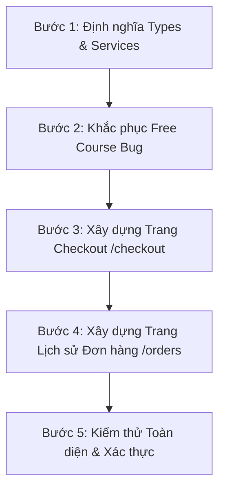

# BÁO CÁO F7.1.1: ORDER & ENROLLMENT CONTRACT VERIFICATION & IMPLEMENTATION PLAN

> **Mã kế hoạch:** `F7_1_1_ORDER_ENROLLMENT_CONTRACT_PLAN`  
> **Dự án:** TMdemy E-learning Frontend (`d:/e-learning`)  
> **Backend:** `d:/e-learning_server`  
> **Phạm vi kiểm toán:** Hợp đồng API & Quy tắc nghiệp vụ Order, Coupon, Enrollment, Course Access  
> **Chế độ:** **AUDIT ONLY** — *Không sửa source code, không tạo component, không can thiệp database*  
> **Ngày thực hiện:** 12/10/2026

---

## 1. EXECUTIVE SUMMARY

Kiểm toán F7.1.1 được thực hiện nhằm xác minh triệt để các hợp đồng API (`api/ORDER_API.md`, `api/COUPON_API.md`, `api/ENROLLMENT_API.md`) và logic backend thực tế (`d:/e-learning_server/src/`), giải quyết các mâu thuẫn trong các báo cáo trước đó và lập kế hoạch chi tiết cho việc triển khai phân hệ Đặt hàng & Ghi danh của Học viên.

### Các kết luận cốt lõi:
1. **Xác minh Endpoint chuẩn**:
   - Lịch sử đơn hàng: Endpoint chính xác là **`GET /api/orders/my`** (không phải `/my-orders`).
   - Kiểm tra mã giảm giá: Endpoint chính xác là **`POST /api/coupons/use`** (không phải `/apply`).
   - Tạo đơn hàng: **`POST /api/orders/`** nhận body `{ courseId, couponCode? }`.
   - Kiểm tra ghi danh: Backend **không có** endpoint `/api/enrollments/check/:courseId`. Frontend kiểm tra sở hữu khóa học thông qua **`GET /api/enrollments/my`**.
2. **Quy tắc phân loại trạng thái Đơn hàng (Order Status)**:
   - Backend chỉ hỗ trợ 3 trạng thái: **`pending`**, **`completed`**, **`rejected`**. Trong Prisma Schema và Backend **hoàn toàn không có trạng thái `cancelled`** cho Order.
3. **Hiện trạng Cổng thanh toán**:
   - Backend hiện tại **hoàn toàn chưa có cổng thanh toán tự động** (không có VNPay, MoMo, Stripe, PayOS).
   - Hệ thống vận hành theo nghiệp vụ: Học viên tạo đơn hàng -> Đơn hàng có phí rơi vào **`PENDING`** -> Giảng viên/Admin kiểm tra và duyệt thủ công -> Chuyển sang **`COMPLETED`** -> Tự động cấp **`Enrollment`**.
   - Đối với khóa học Miễn phí (`total === 0`): Backend tự động hoàn tất trong `prisma.$transaction`, chuyển ngay sang **`COMPLETED`** và cấp `Enrollment` lập tức.
4. **Hai lỗi nghiêm trọng trên Frontend**:
   - **Bug 1 (Free Course Bypass)**: Nút "Đăng ký học miễn phí" tại Course Detail (`src/app/courses/[slug]/page.tsx:1034`) dẫn thẳng sang `/learn/[slug]` mà không gọi `POST /api/orders/`. Hậu quả: Không có Enrollment, bài học không lưu được tiến độ (bị chặn 403 Forbidden) và khóa học không vào `/my-courses`.
   - **Bug 2 (Paid Course Dead Link)**: Nút "Mua khóa học ngay" (`src/app/courses/[slug]/page.tsx:1044`) dẫn sang `/checkout?course=slug` nhưng thư mục `src/app/checkout/` hiện đang rỗng (chưa có `page.tsx`), gây lỗi 404 Not Found.

---

## 2. BẢNG HỢP ĐỒNG API BACKEND CHÍNH XÁC (BACKEND API CONTRACT)

| API Endpoint | HTTP Method | Authentication & Role | Request Body / Query Params | Response Data Schema | Mục đích nghiệp vụ |
|---|:---:|:---:|---|---|---|
| **`/api/orders/`** | `POST` | `Bearer JWT` (All: `USER`, `TEACHER`, `ADMIN`) | Body: `{ "courseId": "uuid", "couponCode"?: "string" }` | `{ success: true, data: { id, userId, courseId, amount, discount, total, status: "pending" \| "completed", course: {...} } }` | Tạo đơn hàng mới. Tự động `COMPLETED` nếu `total === 0`, rơi vào `PENDING` nếu `total > 0`. |
| **`/api/orders/my`** | `GET` | `Bearer JWT` (All) | Query: `?page=1&limit=10&status=pending\|completed\|rejected` | `{ success: true, data: { orders: [...], pagination: { page, limit, total, totalPages } } }` | Học viên xem lịch sử các đơn hàng của mình kèm trạng thái xử lý. |
| **`/api/orders/:id`** | `PUT` | `Bearer JWT` (`TEACHER`, `ADMIN`) | Param: `id` (Order UUID)<br>Body: `{ "status": "completed" \| "rejected" }` | `{ success: true, message: "Order updated successfully", data: { id, status } }` | Giảng viên/Admin duyệt đơn (`COMPLETED`) hoặc từ chối đơn (`REJECTED`). *(Dành cho Teacher Phase)* |
| **`/api/orders/`** | `GET` | `Bearer JWT` (`TEACHER`, `ADMIN`) | Query: `?page=1&limit=10&status=&search=&sortBy=` | `{ success: true, data: { orders: [...], pagination: {...} } }` | Quản lý toàn bộ đơn hàng (Admin xem hết, Teacher xem đơn khóa học của mình). |
| **`/api/coupons/use`** | `POST` | `Bearer JWT` (All) | Body: `{ "code": "string", "courseId": "uuid" }` | `{ success: true, data: { courseId, coursePrice, discount, finalPrice, coupon: { id, title, code, type, value } } }` | Kiểm tra tính hợp lệ của mã giảm giá và tính trước số tiền giảm trước khi đặt hàng. |
| **`/api/enrollments/my`** | `GET` | `Bearer JWT` (All) | Không có body / query | `{ success: true, data: [ { id, userId, courseId, progress, status: "ACTIVE" \| "COMPLETED", course: {...} } ] }` | Lấy danh sách các khóa học học viên đã ghi danh để hiển thị trong My Courses và kiểm tra quyền học. |

---

## 3. QUY TẮC NGHIỆP VỤ ĐƠN HÀNG (ORDER BUSINESS RULES)

### 3.1 Quy trình Tạo Đơn hàng (`POST /api/orders/`)
1. **Kiểm tra tính hợp lệ cơ bản**:
   - `userId` và `courseId` phải là UUID hợp lệ.
   - Khóa học phải tồn tại, chưa bị xóa mềm (`!course.isDestroyed`) và ở trạng thái đã duyệt (`course.status === 'APPROVED'`).
   - **Chặn tự mua**: Tác giả không được phép mua khóa học của chính mình (`course.authorId !== userId`).
2. **Cơ chế Chống mua trùng lặp (Duplicate Prevention)**:
   - **Đã sở hữu (`COMPLETED`)**: Nếu học viên đã có đơn hàng `COMPLETED` cho khóa học này, trả về `400 Bad Request` (*"You already enrolled in this course"*).
   - **Đang chờ duyệt (`PENDING`)**: Nếu học viên đang có đơn hàng `PENDING` chưa xử lý cho khóa học này, trả về `400 Bad Request` (*"You already have a pending order for this course"*), kèm thông tin đơn hàng pending đang tồn tại.
3. **Tính toán giá phía Server (Server-side Integrity)**:
   - Server lấy trực tiếp `course.price` từ cơ sở dữ liệu. Không nhận bất kỳ giá trị tiền tệ nào do client gửi lên.
   - Nếu có `couponCode`: Server xác thực mã (thời hạn, lượt dùng, khóa học áp dụng) và tính toán:
     $$\text{total} = \max(\text{course.price} - \text{discount}, 0)$$

### 3.2 Phân nhánh Khóa học Miễn phí vs Khóa học Có phí
- **Trường hợp A: Khóa học Miễn phí hoặc Giảm 100% (`total === 0`)**:
  - Đơn hàng được thiết lập trạng thái **`COMPLETED`** ngay khi tạo.
  - Được thực thi trong `prisma.$transaction`:
    1. Tạo bản ghi `Order` với `status: 'completed'`.
    2. Tăng số lượng đã bán của khóa học: `course.sold = course.sold + 1`.
    3. Tạo bản ghi `Enrollment` (`status: 'ACTIVE'`, `progress: 0`).
    4. Thêm học viên vào cuộc trò chuyện nhóm của khóa học (`Conversation`).
    5. Tăng lượt dùng của coupon (nếu có áp dụng).
- **Trường hợp B: Khóa học Có phí (`total > 0`)**:
  - Đơn hàng được thiết lập trạng thái **`PENDING`**.
  - **Chưa tạo Enrollment**, chưa tăng `sold`, chưa thêm vào nhóm chat.
  - Học viên phải chờ Giảng viên hoặc Quản trị viên duyệt đơn qua `PUT /api/orders/:id`.

### 3.3 Bảng Chuyển Trạng thái Đơn hàng (Order Status Transition Table)

| Trạng thái hiện tại | Hành động (Action) | Trạng thái tiếp theo | Tác động phụ (Side Effects) | Phân quyền thực hiện |
|:---:|:---:|:---:|---|:---:|
| *(Chưa có)* | Học viên đặt khóa học 0đ | **`COMPLETED`** | Tạo Enrollment `ACTIVE`, tăng `sold + 1`, join chat nhóm, tăng coupon usage | Học viên (`POST /api/orders`) |
| *(Chưa có)* | Học viên đặt khóa học > 0đ | **`PENDING`** | Tạo Order mã `DH-xxxxx`, lưu thông tin chuyển khoản chờ duyệt | Học viên (`POST /api/orders`) |
| **`PENDING`** | Giảng viên/Admin xác nhận thanh toán | **`COMPLETED`** | Tạo Enrollment `ACTIVE`, tăng `sold + 1`, join chat nhóm, tăng coupon usage, gửi thông báo | Teacher sở hữu / Admin (`PUT /api/orders/:id`) |
| **`PENDING`** | Giảng viên/Admin từ chối đơn hàng | **`REJECTED`** | Đơn hàng đánh dấu từ chối, gửi thông báo tới học viên, học viên không được học | Teacher sở hữu / Admin (`PUT /api/orders/:id`) |
| **`COMPLETED`** | Giảng viên xóa học viên khỏi khóa | *(Hủy ghi danh)* | Xóa bản ghi `Enrollment`, xóa `Order`, giảm `sold - 1` | Teacher sở hữu / Admin (`DELETE /api/enrollments/...`) |

> **Lưu ý bảo vệ kiến trúc:** Frontend Học viên **tuyệt đối không được tự ý gửi status `COMPLETED`** hay tự tạo Enrollment. Frontend chỉ phản ánh trung thực trạng thái `PENDING` hoặc `COMPLETED` mà backend trả về.

---

## 4. QUY TẮC NGHIỆP VỤ GHI DANH & QUYỀN HỌC (ENROLLMENT & ACCESS RULES)

### 4.1 Khóa Composite & Ràng buộc toàn vẹn
- Trong cơ sở dữ liệu (`prisma/schema.prisma`): `@@unique([userId, courseId])`.
- Mỗi cặp học viên - khóa học chỉ có duy nhất **1 bản ghi Enrollment**. Không thể xảy ra ghi danh kép.

### 4.2 Ma trận Quyền Truy cập Bài học (Course Access Matrix)

| Đối tượng / Tình trạng học viên | Xem bài học Demo (`isDemo = true`) | Xem bài học tiêu chuẩn | Lưu tiến độ học tập (`/api/progress/complete`) |
|---|:---:|:---:|:---:|
| Khách vãng lai (Chưa đăng nhập) | Có thể xem | Bị khóa | Không (Trả 401 Unauthorized) |
| Đã đăng nhập, chưa có Order | Có thể xem | Bị khóa (Hiển thị CTA Mua khóa học) | Không (Trả 403 Forbidden) |
| Có Order trạng thái **`PENDING`** | Có thể xem | Bị khóa (Hiển thị badge "Đang chờ duyệt") | Không (Trả 403 Forbidden) |
| Có Order trạng thái **`REJECTED`** | Có thể xem | Bị khóa (Hiển thị badge "Đơn bị từ chối") | Không (Trả 403 Forbidden) |
| Có Enrollment **`ACTIVE`** (Đã COMPLETED) | Toàn quyền | Toàn quyền | **Có** (Cập nhật tiến độ % và lưu DB) |
| Có Enrollment **`COMPLETED`** (Đã học 100%)| Toàn quyền | Toàn quyền | **Có** (Có thể xem lại, cấp chứng chỉ) |
| Giảng viên sở hữu (`authorId === userId`) | Toàn quyền | Toàn quyền | Không cần enrollment |
| Quản trị viên (`role === 'ADMIN'`) | Toàn quyền | Toàn quyền | Không cần enrollment |

---

## 5. HỢP ĐỒNG MÃ GIẢM GIÁ (COUPON CONTRACT)

1. **Endpoint kiểm tra trước**: `POST /api/coupons/use`
   - Nhận vào: `{ "code": "GIAM20", "courseId": "uuid" }`
   - Backend kiểm tra:
     - `coupon.active === true`
     - Thời gian hiệu lực: `startDate <= now <= endDate`
     - Số lượt sử dụng: `used < limit` (nếu `limit` được thiết lập)
     - Khóa học áp dụng: Khóa học `courseId` phải thuộc danh sách `coupon.courses` (nếu danh sách không rỗng; nếu rỗng thì áp dụng toàn sàn).
   - Trả về: `{ courseId, coursePrice, discount, finalPrice, coupon: { id, title, code, type, value } }`
2. **Áp dụng khi Đặt hàng**:
   - Khi gọi `POST /api/orders/`, frontend truyền `couponCode`.
   - Backend tái kiểm tra lại toàn bộ điều kiện coupon từ database trước khi trừ tiền.
3. **Quản lý lượt dùng (Usage Tracking & Rollback)**:
   - Khi đơn hàng `COMPLETED`: `coupon.used = coupon.used + 1`.
   - Nếu đơn hàng bị `REJECTED`: Backend tự động giảm `coupon.used = max(0, coupon.used - 1)`.

---

## 6. HIỆN TRẠNG FRONTEND & CÁC LỖI TỒN TẠI (FRONTEND CURRENT STATE)

| Hạng mục | Đường dẫn file | Hiện trạng thực tế | Đánh giá & Rủi ro |
|---|---|---|:---:|
| **Trang Chi tiết Khóa học** | `src/app/courses/[slug]/page.tsx` | Đã tích hợp API hiển thị chi tiết, đề cương, reviews. Nút Mua/Đăng ký có lỗi điều hướng. | Cần điều chỉnh logic nút CTA |
| **Nút Đăng ký Miễn phí** | `src/app/courses/[slug]/page.tsx:1034` | Dẫn thẳng sang `/learn/${course.slug}` mà không gọi `POST /api/orders`. | 🔴 **CRITICAL BUG 1** (Thiếu Enrollment) |
| **Nút Mua Khóa học** | `src/app/courses/[slug]/page.tsx:1044` | Dẫn sang `/checkout?course=${course.slug}`. Thư mục `checkout` rỗng. | 🔴 **CRITICAL BUG 2** (404 Dead Link) |
| **Nút Thêm Giỏ hàng** | `src/app/courses/[slug]/page.tsx:1052` | Nút tĩnh không có sự kiện `onClick`. Backend không có bảng Cart. | Cần ẩn hoặc thay bằng thông báo |
| **Thư mục `/checkout`** | `src/app/checkout/` | Thư mục tồn tại nhưng **hoàn toàn trống rỗng** (không có `page.tsx`). | Cần tạo mới `page.tsx` |
| **Thư mục `/orders`** | `src/app/orders/` | Thư mục tồn tại nhưng **hoàn toàn trống rỗng** (không có `page.tsx`). | Cần tạo mới trang lịch sử đơn |
| **Order Service** | `src/services/order.service.ts` | Chưa tồn tại. | Cần tạo mới |
| **Coupon Service** | `src/services/coupon.service.ts` | Chưa tồn tại. | Cần tạo mới |
| **Kiểm tra Enrollment** | `src/services/enrollment.service.ts` | Đã có `getMyEnrollments()`. | Sẵn sàng tái sử dụng |

---

## 7. MÔ HÌNH LUỒNG NGƯỜI DÙNG CHUẨN (STUDENT ORDER FLOWS)

### Case A — Học viên Đăng ký Khóa học Miễn phí (0đ)
```text
[Course Detail Page] (price === 0)
       ↓
Học viên bấm "Đăng ký học miễn phí"
       ↓
(Nếu chưa đăng nhập: redirect sang /login?redirect=/courses/[slug])
       ↓
Hiển thị Modal/State xác nhận: "Xác nhận tham gia khóa học miễn phí"
       ↓
Gọi POST /api/orders/ { courseId }
       ↓
Backend thực thi prisma.$transaction:
  ├── Tạo Order (status = 'completed', total = 0)
  ├── Tạo Enrollment (status = 'ACTIVE', progress = 0)
  └── Tăng course.sold = sold + 1
       ↓
Nhận response statusCode 200/201 kèm status: 'completed'
       ↓
Toast: "Đăng ký khóa học thành công! Chào mừng bạn đến với khóa học."
       ↓
Điều hướng ngay vào Classroom: /learn/[slug]
```

### Case B — Học viên Mua Khóa học Có phí (> 0đ)
```text
[Course Detail Page] (price > 0)
       ↓
Học viên bấm "Mua khóa học ngay"
       ↓
Điều hướng sang: /checkout?course=[slug]
       ↓
Trang Checkout hiển thị:
  ├── Cột thông tin: Tóm tắt khóa học, Giảng viên, Học phí gốc
  ├── Ô nhập mã Coupon -> Bấm "Áp dụng" -> Gọi POST /api/coupons/use -> Hiển thị giảm giá
  └── Thông tin thanh toán: Hướng dẫn Chuyển khoản (Ngân hàng, Số TK, Tên chủ TK, Cú pháp chuyển khoản)
       ↓
Học viên bấm "Xác nhận đặt hàng"
       ↓
Gọi POST /api/orders/ { courseId, couponCode? }
       ↓
Backend lưu Order với status: 'pending' (Mã đơn DH-xxxxx)
       ↓
Chuyển sang màn hình "Đặt hàng thành công — Chờ xác nhận thanh toán" (/orders hoặc modal xác nhận)
       ↓
Hiển thị hướng dẫn: Đơn hàng đang được Giảng viên kiểm tra và xác nhận kích hoạt trong vòng 24h.
```

### Case C — Đơn hàng Bị từ chối (REJECTED)
```text
Giảng viên kiểm tra thấy chuyển khoản không hợp lệ -> Gọi PUT /api/orders/:id { status: 'rejected' }
       ↓
Trang /orders hiển thị badge màu đỏ: "Đã bị từ chối"
       ↓
Khi học viên vào lại trang khóa học /courses/[slug]: Nút hiển thị "Mua lại khóa học"
       ↓
Học viên được phép tạo đơn hàng mới cho khóa học này.
```

### Case D — Học viên Đã có Enrollment Hợp lệ
```text
Học viên truy cập Course Detail (/courses/[slug])
       ↓
Frontend gọi enrollmentService.getMyEnrollments()
       ↓
Phát hiện khóa học đã nằm trong danh sách ghi danh hợp lệ (status: 'ACTIVE' hoặc 'COMPLETED')
       ↓
Đổi nút CTA thành: "Vào học ngay" (Màu xanh Emerald)
       ↓
Bấm nút -> Dẫn thẳng sang Classroom /learn/[slug]
```

### Case E — Học viên Đang có Đơn hàng PENDING
```text
Học viên truy cập Course Detail (/courses/[slug])
       ↓
Frontend kiểm tra đơn hàng của user (hoặc khi bấm Mua, Backend trả về 400 kèm pending order)
       ↓
Hiển thị Badge / Nút thông báo: "Đơn hàng đang chờ duyệt" (Màu vàng/cam cảnh báo)
       ↓
Nút "Xem chi tiết đơn hàng" dẫn sang /orders (hoặc popup hiển thị mã đơn và thông tin chuyển khoản)
       ↓
Không cho phép bấm tạo thêm đơn hàng trùng lặp.
```

### Case F — Học viên Có Đơn hàng REJECTED (Xử lý Đăng ký lại)
- Khi đơn hàng trước đó đã chuyển sang `rejected`, hàm kiểm tra `checkExistingPendingOrder` và `checkExistingCompletedOrder` của backend **không còn khóa** user nữa.
- Học viên hoàn toàn có thể tạo lại một đơn hàng mới (`POST /api/orders/`) để thử thanh toán lại.

---

## 8. BẢNG MA TRẬN ĐỐI CHIẾU HỢP ĐỒNG (CONTRACT GAP MATRIX)

| Nghiệp vụ / Tính năng | Backend Sẵn sàng | Frontend Sẵn sàng | Khoảng cách (Gap) & Giải pháp triển khai |
|---|:---:|:---:|---|
| **Đặt hàng khóa học miễn phí** | Sẵn sàng (100%) | Lỗi (Bỏ qua gọi API) | Thay thế link tĩnh bằng hàm gọi `orderService.createOrder()` để kích hoạt enrollment tự động. |
| **Đặt hàng khóa học trả phí** | Sẵn sàng (100%) | Chưa có UI (404) | Tạo trang `/checkout/page.tsx` và `orderService.ts`. Hiển thị trạng thái `PENDING`. |
| **Kiểm tra mã giảm giá** | Sẵn sàng (`/coupons/use`) | Chưa có service & UI | Tạo `couponService.ts` và ô nhập mã giảm giá tại trang Checkout. |
| **Lịch sử đơn hàng học viên** | Sẵn sàng (`/orders/my`) | Chưa có UI | Tạo trang `/orders/page.tsx` hiển thị danh sách đơn `PENDING`, `COMPLETED`, `REJECTED`. |
| **Kiểm tra quyền học viên** | Sẵn sàng (`/enrollments/my`)| Đã có trong `my-courses`| Đồng bộ hóa việc kiểm tra enrollment tại trang Course Detail và Classroom. |
| **Cổng thanh toán tự động** | **Chưa có** | **Chưa có** | Áp dụng mô hình chuẩn: Hiển thị thông tin chuyển khoản thủ công, nhận trạng thái `PENDING` và chờ duyệt. |

---

## 9. KẾ HOẠCH TRIỂN KHAI CHI TIẾT (IMPLEMENTATION PLAN)

Kế hoạch triển khai phân hệ Order & Enrollment được chia thành 4 bước tuần tự, tôn trọng nghiêm ngặt các quy tắc kiến trúc Next.js App Router và Shadcn/UI:



### Bước 1: Định nghĩa TypeScript Interfaces & API Services
- Tạo `src/types/order.ts`: Các interface `Order`, `CreateOrderPayload`, `OrderResponse`, `GetMyOrdersResponse`, `OrderStatus` (`pending` | `completed` | `rejected`).
- Tạo `src/types/coupon.ts`: Các interface `Coupon`, `CheckCouponPayload`, `CheckCouponResponse`.
- Tạo `src/services/order.service.ts`:
  - `createOrder(payload: { courseId: string; couponCode?: string })` -> `POST /api/orders/`
  - `getMyOrders(params?: { page?: number; limit?: number; status?: string })` -> `GET /api/orders/my`
- Tạo `src/services/coupon.service.ts`:
  - `checkCoupon(payload: { code: string; courseId: string })` -> `POST /api/coupons/use`

### Bước 2: Khắc phục Lỗi Ghi danh Khóa học Miễn phí tại Course Detail
- Sửa đổi `src/app/courses/[slug]/page.tsx`:
  - Thay thế thẻ `<Link href={'/learn/' + course.slug}>` bằng nút bấm có xử lý `onClick`: `handleFreeEnroll()`.
  - Hiển thị trạng thái `isSubmitting` khi đang gọi API.
  - Gọi `orderService.createOrder({ courseId: course.id })`.
  - Nhận kết quả thành công -> Toast thông báo thành công -> Cập nhật `isEnrolled = true` -> Chuyển hướng sang `/learn/[slug]`.
  - Bắt lỗi: Nếu chưa đăng nhập, chuyển sang `/login?redirect=/courses/[slug]`. Nếu lỗi server, hiển thị toast tiếng Việt rõ ràng.

### Bước 3: Xây dựng Màn hình Thanh toán `/checkout`
- Tạo `src/app/checkout/page.tsx`:
  - Tiếp nhận query param `?course=[slug]`.
  - Tải thông tin khóa học qua `courseService.getCourseBySlug(slug)`.
  - Kiểm tra trạng thái: Nếu đã sở hữu (`isEnrolled`), hiển thị banner thông báo và nút "Vào học ngay".
  - Hiển thị tóm tắt đơn hàng (Thumbnail, Tiêu đề, Tên giảng viên, Giá tiền).
  - Component nhập mã coupon: Gọi `couponService.checkCoupon()`, hiển thị tiền giảm giá và tổng tiền cuối cùng.
  - Hiển thị hướng dẫn chuyển khoản ngân hàng (Tên ngân hàng, Số tài khoản, Chủ tài khoản, Nội dung chuyển khoản kèm mã tạm hoặc tên user).
  - Nút "Xác nhận đặt hàng": Gọi `orderService.createOrder()`.
  - Khi thành công: Chuyển sang màn hình xác nhận đơn hàng thành công kèm mã đơn `DH-xxxxx` và trạng thái `Đang chờ duyệt`.

### Bước 4: Xây dựng Trang Lịch sử Đơn hàng `/orders`
- Tạo `src/app/orders/page.tsx`:
  - Yêu cầu đăng nhập (bảo vệ bằng Auth Guard).
  - Gọi `orderService.getMyOrders()`.
  - Hiển thị danh sách các đơn hàng đã đặt với các tab lọc: *Tất cả*, *Đang chờ duyệt (Pending)*, *Đã hoàn tất (Completed)*, *Bị từ chối (Rejected)*.
  - Mỗi đơn hàng hiển thị: Mã đơn hàng, ngày đặt, tên khóa học, tổng tiền, trạng thái (badge màu tương ứng).

### Bước 5: Kiểm thử Toàn diện & Báo cáo Nghiệm thu
- Kiểm thử luồng miễn phí, luồng có phí, kiểm tra chống mua trùng lặp, kiểm tra bảo toàn quyền truy cập.

---

## 10. DANH SÁCH FILE DỰ KIẾN THAY ĐỔI & TẠO MỚI (FILES TO MODIFY)

*(Lưu ý: Đây chỉ là danh sách quy hoạch dự kiến cho phase implementation tiếp theo, KHÔNG thay đổi file trong phase audit hiện tại)*

| Đường dẫn File | Loại thao tác | Mục đích & Lý do thay đổi |
|---|:---:|---|
| `src/types/order.ts` | **Tạo mới** | Định nghĩa type chuẩn cho Order API contract theo `api/ORDER_API.md`. |
| `src/types/coupon.ts` | **Tạo mới** | Định nghĩa type chuẩn cho Coupon API contract theo `api/COUPON_API.md`. |
| `src/services/order.service.ts` | **Tạo mới** | Service giao tiếp với `POST /api/orders/` và `GET /api/orders/my`. |
| `src/services/coupon.service.ts` | **Tạo mới** | Service giao tiếp với `POST /api/coupons/use`. |
| `src/app/courses/[slug]/page.tsx` | **Chỉnh sửa** | Sửa nút Đăng ký học miễn phí để gọi API tạo Enrollment; xử lý chuyển hướng sang Checkout. |
| `src/app/checkout/page.tsx` | **Tạo mới** | Giao diện màn hình thanh toán, nhập mã giảm giá và hiển thị thông tin chuyển khoản. |
| `src/app/orders/page.tsx` | **Tạo mới** | Giao diện theo dõi lịch sử đơn hàng và trạng thái duyệt của học viên. |
| `src/components/layout/Header.tsx` | **Chỉnh sửa** | Bổ sung liên kết "Đơn hàng của tôi" vào User Dropdown menu để học viên dễ truy cập. |

---

## 11. TIÊU CHÍ NGHIỆM THU (ACCEPTANCE CRITERIA)

1. **Khóa học Miễn phí (0đ)**:
   - Học viên bấm "Đăng ký học miễn phí" -> Hệ thống gọi `POST /api/orders/`.
   - Backend phản hồi thành công và trả về trạng thái `completed`.
   - Khóa học lập tức xuất hiện trong `/my-courses`.
   - Vào Classroom `/learn/[slug]` đánh dấu hoàn thành bài học không bị lỗi 403 Forbidden.
2. **Khóa học Có phí (> 0đ)**:
   - Bấm "Mua khóa học ngay" dẫn tới `/checkout?course=[slug]` hiển thị đầy đủ thông tin khóa học.
   - Nhập mã coupon hợp lệ -> Số tiền giảm được cập nhật chính xác theo dữ liệu backend.
   - Bấm "Xác nhận đặt hàng" -> Tạo đơn thành công với trạng thái `PENDING` và hiển thị mã đơn `DH-xxxxx`.
   - Không cho phép người dùng bấm đặt hàng 2 lần liên tiếp gây trùng lặp request.
3. **Chống mua trùng lặp (Duplicate Prevention)**:
   - Nếu học viên đã sở hữu khóa học (`isEnrolled = true`), trang chi tiết và checkout hiển thị nút "Vào học ngay", không cho mua lại.
   - Nếu học viên đang có đơn hàng `PENDING`, hệ thống cảnh báo rõ ràng rằng đơn hàng đang chờ duyệt.
4. **Trang Lịch sử đơn hàng (`/orders`)**:
   - Hiển thị danh sách đơn hàng chính xác từ `GET /api/orders/my`.
   - Thể hiện rõ ràng các trạng thái `PENDING`, `COMPLETED`, `REJECTED`.

---

## 12. KỊCH BẢN KIỂM THỬ ĐỀ XUẤT (TEST PLAN)

| Mã Test | Kịch bản kiểm thử | Dữ liệu đầu vào / Điều kiện | Kết quả kỳ vọng |
|:---:|---|---|---|
| **TC-01** | Khách chưa đăng nhập bấm đăng ký khóa miễn phí | Guest user tại Course Detail | Chuyển hướng tới `/login?redirect=/courses/[slug]`, sau khi login quay lại đúng trang. |
| **TC-02** | Học viên đăng ký khóa học miễn phí | User đã đăng nhập, khóa học giá 0đ | Tạo đơn thành công, status `COMPLETED`, tự sinh Enrollment, chuyển vào `/learn/[slug]`. |
| **TC-03** | Khóa miễn phí xuất hiện trong My Courses | Học viên vừa đăng ký xong TC-02 | Truy cập `/my-courses`, khóa học xuất hiện trong danh sách kèm tiến độ 0%. |
| **TC-04** | Lưu tiến độ học tập khóa miễn phí | Học viên học bài trong Classroom | Bấm hoàn thành bài học, API `POST /api/progress/complete` trả về 200 OK (không bị 403). |
| **TC-05** | Học viên đặt mua khóa học có phí | Khóa học giá > 0đ, không coupon | Tạo đơn hàng thành công, nhận status `PENDING`, hiển thị mã đơn `DH-xxxxx`. |
| **TC-06** | Nhập mã giảm giá hợp lệ | Mã coupon còn hạn, đúng khóa học | Trả về số tiền giảm chính xác, tổng tiền giảm trừ đúng. |
| **TC-07** | Nhập mã giảm giá hết hạn hoặc sai khóa | Mã không hợp lệ | Báo lỗi tiếng Việt tương ứng, giữ nguyên giá gốc, không trừ tiền. |
| **TC-08** | Cố tình mua lại khóa học đã có đơn PENDING | Đang có đơn hàng PENDING chưa duyệt | Báo lỗi: "Bạn đang có đơn hàng chờ duyệt cho khóa học này", hiển thị thông tin đơn cũ. |
| **TC-09** | Cố tình mua lại khóa học đã COMPLETED | Đã có Enrollment hợp lệ | Nút chuyển thành "Vào học ngay", không cho phép submit đơn hàng mới. |
| **TC-10** | Học viên kiểm tra lịch sử đơn hàng | Truy cập `/orders` | Hiển thị danh sách các đơn đã đặt kèm trạng thái đúng màu sắc. |
| **TC-11** | Giảng viên/Tác giả tự mua khóa của mình | User là author của khóa | Bị chặn báo lỗi không thể mua khóa học của chính mình. |
| **TC-12** | Mất kết nối mạng khi đang đặt hàng | Ngắt kết nối mạng giả lập | Hiển thị thông báo lỗi mạng thân thiện, nút không bị treo vĩnh viễn. |

---

## 13. RỦI RO KIẾN TRÚC & KHOẢNG HỐNG BACKEND (RISKS & BACKEND GAPS)

1. **Không có Cổng thanh toán Tự động**:
   - Backend chưa hỗ trợ webhook thanh toán (VNPay/MoMo/PayOS).
   - **Tác động**: Mọi đơn hàng có phí đều phải chờ người có quyền (`TEACHER` hoặc `ADMIN`) duyệt thủ công.
   - **Xử lý trên Frontend**: Thiết kế UX minh bạch, giải thích rõ trạng thái "Đang chờ duyệt" để học viên không hoang mang.
2. **Mô hình Một Khóa học / Một Đơn hàng (Không có Cart)**:
   - Backend không hỗ trợ giỏ hàng đa sản phẩm.
   - **Xử lý trên Frontend**: Ẩn hoặc loại bỏ nút "Thêm vào giỏ hàng" tại Course Detail; tập trung toàn bộ vào trải nghiệm mua trực tiếp (Direct Checkout) từng khóa học.
3. **Giới hạn số lần dùng mã giảm giá cho từng học viên**:
   - Backend hiện chỉ quản lý tổng số lượt toàn sàn (`coupon.limit`), chưa có ràng buộc mỗi user chỉ được dùng 1 lần.
   - **Xử lý**: Tuân thủ theo API contract hiện có của Backend, không tự tạo logic chặn phía client nếu backend không yêu cầu.
