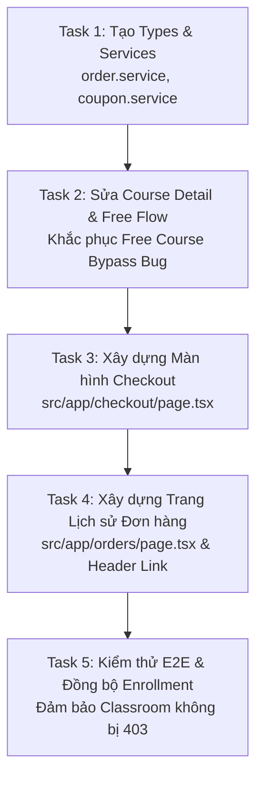

# BÁO CÁO F7.1 — ORDER & ENROLLMENT: FRONTEND AUDIT & IMPLEMENTATION PLANNING

> **Mã báo cáo:** `F7_1_ORDER_ENROLLMENT_FRONTEND_AUDIT`  
> **Giai đoạn:** Phase F7.1 — Order & Enrollment Subsystem  
> **Nhiệm vụ:** Task 1 — Frontend Audit & Implementation Planning  
> **Chế độ:** **AUDIT ONLY** *(Không chỉnh sửa source code, không tạo component/service, không can thiệp database)*  
> **Tài liệu căn cứ:**  
> - [`BACKEND_SYSTEM_HANDBOOK.md`](file:///d:/e-learning/BACKEND_SYSTEM_HANDBOOK.md)  
> - [`F7_1_ORDER_ENROLLMENT_BACKEND_VERIFICATION.md`](file:///d:/e-learning/F7_1_ORDER_ENROLLMENT_BACKEND_VERIFICATION.md)  
> - Thư mục API Contract: [`api/ORDER_API.md`](file:///d:/e-learning/api/ORDER_API.md), [`api/COUPON_API.md`](file:///d:/e-learning/api/COUPON_API.md), [`api/ENROLLMENT_API.md`](file:///d:/e-learning/api/ENROLLMENT_API.md)  
> - Toàn bộ mã nguồn Frontend tại `d:/e-learning/src/`  
> **Ngày thực hiện:** 12/10/2026

---

## 1. CURRENT IMPLEMENTATION STATUS (TỔNG QUAN HIỆN TRẠNG)

Dựa trên kết quả đối chiếu giữa tài liệu xác minh backend thực tế và toàn bộ source code frontend hiện tại:

1. **Order Subsystem (Hệ thống Đơn hàng)**:
   - **Tỷ lệ hoàn thành: 0%**.
   - Chưa có `order.service.ts`, chưa có `types/order.ts`, chưa có hooks hay state management cho Order.
   - Route `/checkout` và `/orders` đã được tạo thư mục trong Next.js App Router (`src/app/checkout/`, `src/app/orders/`) nhưng **cả 2 thư mục đều hoàn toàn trống rỗng** (chưa có `page.tsx`). Người dùng truy cập sẽ nhận mã lỗi 404 Not Found.
2. **Coupon Subsystem (Mã giảm giá)**:
   - **Tỷ lệ hoàn thành: 0%**.
   - Chưa có `coupon.service.ts`, chưa có `types/coupon.ts`. Giao diện chưa có ô nhập mã hay kiểm tra coupon với `POST /api/coupons/use`.
3. **Enrollment Subsystem (Ghi danh & Khóa học của tôi)**:
   - **Tỷ lệ hoàn thành: 65%**.
   - Đã có `src/services/enrollment.service.ts` gọi `GET /api/enrollments/my`.
   - Trang `/my-courses` (`src/app/my-courses/page.tsx`) đã kết nối API thật, lọc bỏ trạng thái `CANCELED`, tải song song tiến độ từ `progressService.getCourseProgress` và tính toán thanh % hoàn thành chính xác.
   - **Thiếu sót nghiêm trọng**: Chưa có cơ chế đồng bộ danh sách Enrollment sau khi học viên tạo đơn hàng mới (cả miễn phí và có phí).
4. **Course Detail Subsystem (Trang Chi tiết Khóa học)**:
   - **Tỷ lệ hoàn thành: 40%**.
   - Đã tải chi tiết khóa học, đề cương và review từ API thật.
   - **Lỗi chí mạng (Critical Bug)**:
     - Nút "Đăng ký học miễn phí" (`src/app/courses/[slug]/page.tsx:1034`) gắn link tĩnh nhảy thẳng sang `/learn/[slug]` mà không gọi `POST /api/orders`, dẫn đến không tạo Enrollment, gây lỗi 403 Forbidden khi học viên hoàn thành bài học.
     - Nút "Mua khóa học ngay" (`src/app/courses/[slug]/page.tsx:1044`) dẫn sang `/checkout?course=slug` dẫn đến trang 404.

---

## 2. EXISTING ROUTES / PAGES AUDIT (KIỂM TOÁN ROUTING)

| Route Path | Vị trí thư mục/file | Hiện trạng tồn tại | Phân loại trạng thái | Ghi chú kỹ thuật |
|---|---|---|---|---|
| `/courses/[slug]` | `src/app/courses/[slug]/page.tsx` | Đã tồn tại (1155 lines) | **Cần sửa đổi CTA** | Đang gọi API thật lấy chi tiết; nút Free và Paid đang có lỗi điều hướng. |
| `/checkout` | `src/app/checkout/` | Thư mục rỗng (0 file) | **Chưa implement (404)** | Cần tạo mới `page.tsx` tiếp nhận param `?course=[slug]`, hiển thị tóm tắt, coupon và xác nhận tạo order. |
| `/orders` | `src/app/orders/` | Thư mục rỗng (0 file) | **Chưa implement (404)** | Cần tạo mới `page.tsx` hiển thị danh sách đơn hàng từ `GET /api/orders/my`. |
| `/my-courses` | `src/app/my-courses/page.tsx` | Đã tồn tại (994 lines) | **Hoạt động tốt** | Đã gọi `GET /api/enrollments/my` thật; cần bổ sung trigger refetch khi vừa ghi danh thành công. |
| `/learn/[slug]` | `src/app/learn/[slug]/page.tsx` | Đã tồn tại | **Hoạt động tốt** | Phòng học tương tác video/bài học/tiến độ; yêu cầu học viên phải có Enrollment ACTIVE. |

---

## 3. EXISTING ORDER INTEGRATION AUDIT

- **Order API Client & Services**:
  - `src/services/order.service.ts`: **KHÔNG TỒN TẠI**.
  - `src/types/order.ts`: **KHÔNG TỒN TẠI**.
- **Tạo Order (`POST /api/orders`)**:
  - Chưa có bất kỳ đoạn code nào trong frontend gọi endpoint này.
- **Lấy danh sách đơn hàng (`GET /api/orders/my`)**:
  - Chưa được tích hợp.
- **Lấy chi tiết đơn hàng (`GET /api/orders/:id`)**:
  - `[FACT]` Theo báo cáo xác minh backend [`F7_1_ORDER_ENROLLMENT_BACKEND_VERIFICATION.md:L220-L230`](file:///d:/e-learning/F7_1_ORDER_ENROLLMENT_BACKEND_VERIFICATION.md#L220-L230), **Backend hoàn toàn không có endpoint `GET /api/orders/:id` cho Student**. Frontend không được phép giả định endpoint này tồn tại. Thông tin đơn hàng mới tạo được lấy trực tiếp từ response `POST /api/orders`.
- **Hành vi Từ chối Đơn hàng (Rejection Flow)**:
  - `[FACT]` Theo backend verification report, khi Teacher/Admin từ chối đơn hàng (`PUT /api/orders/:id` với `status = REJECTED`), backend thực thi **HARD DELETE (xóa bỏng vật lý khỏi PostgreSQL)**. Bản ghi đơn hàng bị xóa hoàn toàn khỏi DB. Do đó, đơn hàng sẽ biến mất khỏi kết quả `GET /api/orders/my`. Frontend **tuyệt đối không tự giả lập một danh sách REJECTED** hay lưu state rác. Người dùng được phép mua lại khóa học đó ngay lập tức.

---

## 4. EXISTING ENROLLMENT INTEGRATION AUDIT

- **Enrollment Service** (`src/services/enrollment.service.ts`):
  ```typescript
  export const enrollmentService = {
    async getMyEnrollments(options?: { signal?: AbortSignal }): Promise<GetMyEnrollmentsResponse> {
      return apiClient.get<GetMyEnrollmentsResponse>('/api/enrollments/my', {
        signal: options?.signal,
      });
    },
  };
  ```
  - Đã triển khai chuẩn xác theo `GET /api/enrollments/my`.
- **Enrollment Verification tại Course Detail** (`src/app/courses/[slug]/page.tsx:100-113`):
  - Hiện tại, trang Course Detail kiểm tra học viên đã đăng ký chưa bằng cách gọi `enrollmentService.getMyEnrollments()` rồi duyệt `enrollRes.data.some(...)`.
  - `[FACT]` Backend **không có endpoint `GET /api/enrollments/check/:courseId`**. Cơ chế lấy danh sách `getMyEnrollments()` hiện tại của frontend là hoàn toàn đúng đắn và chuẩn xác với backend contract.
- **Khoảng hổng (Gap)**:
  - Khi học viên bấm đăng ký khóa học miễn phí, frontend không gọi API tạo order -> không có Enrollment được tạo -> khi chuyển sang `/learn/[slug]`, component gọi `progressService.completeLesson` thì Backend chặn với lỗi **403 Forbidden: "You are not enrolled in this course"**.

---

## 5. EXISTING COUPON INTEGRATION AUDIT

- **Coupon Service**: `src/services/coupon.service.ts`: **KHÔNG TỒN TẠI**.
- **Coupon Types**: `src/types/coupon.ts`: **KHÔNG TỒN TẠI**.
- **Endpoint chuẩn**: `POST /api/coupons/use` nhận `{ code: string, courseId: string }`.
- **Hiện trạng trên UI**:
  - Course Detail và Header hoàn toàn chưa có ô nhập coupon hay preview giảm giá.
  - Cần xây dựng component `CouponInput` tại màn hình `/checkout`.

---

## 6. COURSE DETAIL INTEGRATION AUDIT (`src/app/courses/[slug]/page.tsx`)

Phân tích chi tiết khối CTA tại lines 1023–1075:

```tsx
{/* CTAs based on Enrollment & Ownership */}
<div className="flex flex-col gap-2.5">
  {isEnrolled || isAuthor ? (
    <Link href={`/learn/${course.slug}`}>Vào học ngay</Link>
  ) : course.price === 0 ? (
    <Link href={`/learn/${course.slug}`}>Đăng ký học miễn phí</Link> // <-- BUG 1
  ) : (
    <>
      <Link href={`/checkout?course=${course.slug}`}>Mua khóa học ngay</Link> // <-- BUG 2
      <button>Thêm vào giỏ hàng</button> // <-- BUG 3 (Không có action, backend không có Cart)
      <button onClick={() => setIsFavorited(!isFavorited)}>Yêu thích</button>
    </>
  )}
</div>
```

- **Bug 1 (Free Course Bypass)**: Nhảy thẳng sang `/learn/${course.slug}` mà không gọi `POST /api/orders/`. Bỏ qua transaction tạo Enrollment trong database.
- **Bug 2 (Dead Link /checkout)**: Dẫn sang route rỗng (404 Not Found).
- **Bug 3 (Cart Button)**: Nút "Thêm vào giỏ hàng" không có sự kiện. Backend TMdemy áp dụng mô hình Single Course per Order, **không có bảng Cart**. Cần ẩn nút giỏ hàng hoặc chuyển thành nút phụ để tránh gây hiểu nhầm.
- **Thiếu kiểm tra Order PENDING**: Nếu học viên đã tạo đơn hàng có phí và đơn đang ở trạng thái `PENDING`, trang Course Detail vẫn hiển thị nút "Mua khóa học ngay". Khi học viên bấm mua tiếp, Backend sẽ trả về lỗi `400 Bad Request: "You already have a pending order for this course"`. Cần xử lý UI hiển thị badge "Đơn hàng đang chờ duyệt" nếu phát hiện đơn pending.

---

## 7. CHECKOUT INTEGRATION AUDIT

- **Route**: `src/app/checkout/` là thư mục rỗng.
- **Kỳ vọng thiết kế**:
  - Nhận query param `?course=[slug]`.
  - Tải thông tin khóa học qua `courseService.getCourseBySlug(slug)`.
  - Nếu user chưa đăng nhập -> Chuyển hướng sang `/login?redirect=/checkout?course=[slug]`.
  - Nếu user đã sở hữu khóa học (`isEnrolled`) -> Hiển thị thông báo và nút "Vào học ngay".
  - Component tóm tắt đơn hàng (Tên, Ảnh, Giảng viên, Giá gốc).
  - Component Coupon: Nhập mã -> Gọi `POST /api/coupons/use` -> Hiển thị số tiền giảm `discount` và `finalPrice`.
  - Nút "Xác nhận đăng ký": Gọi `POST /api/orders` với `{ courseId, couponCode? }`.
  - **Không có cổng thanh toán online, không có VietQR hay chuyển khoản**: Hiển thị thông báo đơn hàng có phí đã được ghi nhận và đang chờ Giảng viên/Admin phê duyệt.

---

## 8. MY COURSES INTEGRATION AUDIT (`src/app/my-courses/page.tsx`)

- **Ưu điểm**:
  - Giao diện được xây dựng rất hoàn chỉnh, chuẩn UI/UX và responsive.
  - Đã tích hợp `enrollmentService.getMyEnrollments()` và `progressService.getCourseProgress()`.
  - Đã lọc bỏ bản ghi `status === 'CANCELED'`.
  - Đầy đủ các trạng thái loading skeleton, empty state thân thiện.
- **Điểm cần đồng bộ (Sync Point)**:
  - Cần đảm bảo sau khi học viên đăng ký thành công khóa học miễn phí (hoặc sau khi đơn hàng được duyệt), danh sách tại `/my-courses` được cập nhật ngay mà không cần hard refresh trình duyệt.

---

## 9. RELEVANT SERVICES, HOOKS, TYPES & ARCHITECTURE ASSETS

### A. Tái sử dụng 100% (Không cần tạo mới / không sửa đổi)
1. **API Client** (`src/lib/api/client.ts`):
   - Đã tích hợp Bearer token tự động qua `getAccessToken()`.
   - Đã xử lý interceptor silent refresh token khi gặp 401 qua `POST /api/users/access_token`.
   - Hàm `extractErrorMessage` đã chuẩn hóa toàn bộ lỗi từ Express Validator và Controller của Backend TMDEMY.
2. **Auth Context** (`src/contexts/auth-context.tsx` & `src/hooks/use-auth.ts`):
   - Cung cấp `isAuthenticated`, `user`, `status`, token lifecycle.
3. **Toast System** (`src/lib/toast.ts`):
   - `toast.success()`, `toast.error()`, `toast.warning()`, `toast.info()`.
   - Có cơ chế chống duplicate spam thông báo trong 1.5 giây.
4. **Layout Shell** (`src/components/layout/app-shell.tsx`, `dashboard-header.tsx`, `dashboard-sidebar.tsx`):
   - Sẵn sàng bọc các trang mới `/checkout` và `/orders`.

### B. Cần tạo mới (Trong phase Implementation)
1. `src/types/order.ts`: Types cho Order API response, Order status (`PENDING` | `COMPLETED` | `REJECTED`).
2. `src/types/coupon.ts`: Types cho Coupon check response (`discount`, `finalPrice`, `coupon`).
3. `src/services/order.service.ts`: `createOrder()`, `getMyOrders()`.
4. `src/services/coupon.service.ts`: `checkCoupon()`.
5. `src/app/checkout/page.tsx`: Màn hình Checkout chuẩn Next.js App Router.
6. `src/app/orders/page.tsx`: Màn hình Lịch sử Đơn hàng và trạng thái duyệt.

---

## 10. API CONTRACT MAPPING (ĐỐI CHIẾU HỢP ĐỒNG API)

| Nghiệp vụ | Backend Endpoint | Request Data từ Frontend | Phản hồi từ Backend | Trạng thái Frontend |
|---|---|---|---|:---:|
| **Kiểm tra Coupon** | `POST /api/coupons/use` | `{ "code": string, "courseId": string }` | `{ success: true, data: { courseId, coursePrice, discount, finalPrice, coupon: {...} } }` | Chưa tích hợp |
| **Tạo Order** | `POST /api/orders` | `{ "courseId": string, "couponCode"?: string }`<br>*(Không gửi amount/total)* | `{ success: true, statusCode: 201, data: { id, code, amount, discount, total, status: "PENDING" \| "COMPLETED", course: {...} } }` | Chưa tích hợp |
| **Lấy Đơn của tôi** | `GET /api/orders/my` | Query: `?page=1&limit=10&status=` | `{ success: true, data: { orders: [...], pagination: {...} } }` | Chưa tích hợp |
| **Lấy Khóa đã ghi danh** | `GET /api/enrollments/my`| Không có body | `{ success: true, data: [ { id, courseId, progress, status, course: {...} } ] }` | **Đã tích hợp** |
| **Lấy Tiến độ khóa học**| `GET /api/progress/:id` | Param: `courseId` | `{ success: true, data: { totalLessons, completedLessons, percent, lessons: [...] } }` | **Đã tích hợp** |

---

## 11. BUSINESS LOGIC GAPS (KHOẢNG HỐNG NGHIỆP VỤ CẦN BẢO VỆ)

1. **Khóa học Miễn phí (`total === 0`)**:
   - Backend chạy `prisma.$transaction` tạo Order `COMPLETED` + Enrollment `ACTIVE` + `sold + 1` ngay lập tức.
   - Frontend **không được** gọi bất kỳ API tạo Enrollment riêng nào; chỉ cần gọi `POST /api/orders` và hứng kết quả `status === 'COMPLETED'`.
2. **Khóa học Có phí (`total > 0`)**:
   - Backend chỉ tạo Order `PENDING`, **hoàn toàn không cấp Enrollment**.
   - Frontend **tuyệt đối không cho phép vào học bài học chính thức**, chỉ cho phép xem bài `isDemo === true`.
   - **Tuân thủ nghiêm ngặt yêu cầu**: Tuyệt đối **không tích hợp cổng thanh toán, chuyển khoản online hay VietQR**. Frontend chỉ thông báo đơn hàng đã được gửi và đang chờ Giảng viên/Admin phê duyệt thủ công.
3. **Xử lý Đơn hàng bị Từ chối (Rejection)**:
   - Backend thực hiện xóa cứng (Hard Delete) bản ghi Order khỏi database.
   - Frontend không tìm thấy đơn hàng này trong `GET /api/orders/my`. Học viên được phép thực hiện đặt lại khóa học đó.
4. **Không tin tưởng giá tiền từ Client**:
   - Mọi phép tính giảm giá chỉ mang tính chất hiển thị trước (preview) qua `POST /api/coupons/use`.
   - Khi gửi `POST /api/orders`, chỉ gửi `courseId` và `couponCode`. Backend chịu trách nhiệm 100% tính lại số tiền và lưu database.

---

## 12. FRONTEND BUGS IDENTIFIED (DANH SÁCH LỖI FRONTEND HIỆN TẠI)

1. **🔴 Lỗi Chí Mạng 1 (Free Course Enrollment Bypass)**:
   - File: `src/app/courses/[slug]/page.tsx:1034-1040`.
   - Hành vi: Nút "Đăng ký học miễn phí" là `<Link href={'/learn/' + course.slug}>`. Người dùng vào học mà không có Enrollment trong DB, dẫn đến lỗi 403 Forbidden khi lưu tiến độ.
2. **🔴 Lỗi Chí Mạng 2 (Dead Link /checkout)**:
   - File: `src/app/courses/[slug]/page.tsx:1044`.
   - Hành vi: Nút "Mua khóa học ngay" trỏ đến `/checkout?course=${course.slug}` nhưng route chưa tồn tại (thư mục rỗng), trả về lỗi 404.
3. **⚠️ Lỗi Nghiệp Vụ 3 (Không kiểm tra Pending Order tại Course Detail)**:
   - File: `src/app/courses/[slug]/page.tsx`.
   - Hành vi: Học viên đã có đơn hàng PENDING nhưng nút CTA vẫn hiển thị "Mua khóa học ngay", khi bấm vào sẽ nhận lỗi `400 Bad Request` từ backend.
4. **⚠️ Lỗi Điều Hướng 4 (Thiếu Link Lịch sử Đơn hàng)**:
   - File: `src/components/layout/dashboard-header.tsx:226-262`.
   - Hành vi: Menu dropdown của người dùng chưa có mục "Đơn hàng của tôi" (`/orders`).

---

## 13. BACKEND GAPS (KHOẢNG HỐNG BACKEND GHI NHẬN)

1. **`[BACKEND GAP]` Không có API lấy chi tiết 1 đơn hàng cho Student**:
   - Backend không có route `GET /api/orders/:id` cho role `USER` (chỉ có `PUT /api/orders/:id` cho Teacher/Admin).
   - *Cách giải quyết của Frontend*: Lấy dữ liệu đơn hàng trực tiếp từ response của `POST /api/orders` hoặc lọc từ mảng `GET /api/orders/my`.
2. **`[BACKEND GAP]` Không có API kiểm tra nhanh trạng thái đơn hàng của 1 khóa học**:
   - Backend không có endpoint `GET /api/orders/check/:courseId`.
   - *Cách giải quyết của Frontend*: Kiểm tra qua danh sách `GET /api/orders/my` hoặc bắt mã lỗi 400 từ `POST /api/orders` nếu có đơn pending.
3. **`[BACKEND GAP]` Cơ chế Hard Delete khi từ chối Order**:
   - Khi Teacher reject, đơn hàng bị xóa khỏi DB thay vì cập nhật trạng thái `status: 'REJECTED'`.
   - *Cách giải quyết của Frontend*: Không hiển thị danh sách đơn bị từ chối; học viên có thể đặt lại bình thường.

---

## 14. FILES TO CREATE / UPDATE (DANH SÁCH FILE KẾ HOẠCH TRIỂN KHAI)

*(Lập danh sách quy hoạch cho phase implementation tiếp theo — KHÔNG thực hiện thay đổi mã nguồn trong phase audit này)*

| STT | Đường dẫn File | Loại thao tác | Mục đích kỹ thuật |
|:---:|---|:---:|---|
| 1 | `src/types/order.ts` | **Tạo mới** | Định nghĩa interfaces `Order`, `CreateOrderPayload`, `OrderResponse`, `GetMyOrdersResponse`, `OrderStatus` (`PENDING`, `COMPLETED`). |
| 2 | `src/types/coupon.ts` | **Tạo mới** | Định nghĩa interfaces `CouponCheckPayload`, `CouponCheckResponse`, `Coupon`. |
| 3 | `src/services/order.service.ts` | **Tạo mới** | Service giao tiếp với `POST /api/orders` và `GET /api/orders/my`. |
| 4 | `src/services/coupon.service.ts` | **Tạo mới** | Service giao tiếp với `POST /api/coupons/use`. |
| 5 | `src/app/courses/[slug]/page.tsx` | **Cập nhật** | Sửa nút Free Course sang gọi `orderService.createOrder`; kiểm tra trạng thái Pending Order; xử lý redirect login nếu là khách. |
| 6 | `src/app/checkout/page.tsx` | **Tạo mới** | Xây dựng giao diện Checkout hoàn chỉnh: tóm tắt khóa học, kiểm tra coupon, tạo order PENDING, hiển thị thông báo chờ duyệt. |
| 7 | `src/app/orders/page.tsx` | **Tạo mới** | Xây dựng giao diện Lịch sử Đơn hàng của học viên: danh sách đơn, phân trang, lọc theo status PENDING/COMPLETED. |
| 8 | `src/components/layout/dashboard-header.tsx` | **Cập nhật** | Thêm mục "Đơn hàng của tôi" (`/orders`) vào User Dropdown Menu. |

---

## 15. STEP-BY-STEP IMPLEMENTATION PLAN (KẾ HOẠCH TRIỂN KHAI CHI TIẾT)

Quy trình triển khai Phase F7.1 được phân rã thành 5 task kỹ thuật tuần tự:



### Task 1.1: Định nghĩa Types & Core Services
- **Mục tiêu**: Thiết lập contract layer cho Order và Coupon.
- **Files**: `src/types/order.ts`, `src/types/coupon.ts`, `src/services/order.service.ts`, `src/services/coupon.service.ts`.
- **Logic**:
  - `createOrder`: POST `/api/orders` với `{ courseId, couponCode? }`.
  - `getMyOrders`: GET `/api/orders/my` với `{ page?, limit?, status? }`.
  - `checkCoupon`: POST `/api/coupons/use` với `{ code, courseId }`.
- **Độ phức tạp**: Thấp.

### Task 1.2: Khắc phục Luồng Đăng ký Khóa học Miễn phí tại Course Detail
- **Mục tiêu**: Xóa bỏ link tĩnh, thay bằng action gọi API tạo Order 0đ và tự động cấp Enrollment.
- **Files**: `src/app/courses/[slug]/page.tsx`.
- **Logic**:
  - Nếu khách chưa login: Bấm "Đăng ký học miễn phí" -> Redirect `/login?redirect=/courses/${slug}`.
  - Nếu đã login: Bấm nút -> Gọi `orderService.createOrder({ courseId })`.
  - Xử lý trạng thái loading `isSubmitting`, vô hiệu hóa nút để tránh spam.
  - Khi thành công (`status === 'COMPLETED'`): Bắn toast thành công -> Cập nhật `isEnrolled = true` -> Điều hướng ngay vào `/learn/${slug}`.
  - Bắt lỗi: Nếu trả về 400 đã enrolled -> Chuyển sang nút "Vào học ngay".
- **Độ phức tạp**: Trung bình.

### Task 1.3: Xây dựng Giao diện Checkout (`src/app/checkout/page.tsx`)
- **Mục tiêu**: Tạo màn hình thanh toán cho khóa học có phí theo đúng quy chuẩn TMdemy UI/UX.
- **Files**: `src/app/checkout/page.tsx`.
- **Logic**:
  - Đọc param `?course=[slug]`. Tải khóa học qua `courseService.getCourseBySlug`.
  - Nếu chưa đăng nhập -> Redirect login.
  - Nếu đã sở hữu (`isEnrolled`) -> Hiển thị thông báo và nút vào học.
  - Cột tóm tắt khóa học: Tiêu đề, ảnh, tên giảng viên, giá gốc.
  - Cột mã giảm giá: Ô nhập mã coupon -> Nút "Áp dụng" -> Gọi `couponService.checkCoupon` -> Hiển thị số tiền giảm và giá cuối cùng.
  - Nút "Xác nhận đăng ký": Gọi `orderService.createOrder({ courseId, couponCode })`.
  - Khi thành công (`status === 'PENDING'`): Hiển thị modal/màn hình xác nhận thành công kèm mã đơn `DH-xxxxx` và thông báo: *"Đơn hàng của bạn đã được ghi nhận và đang chờ Giảng viên/Admin phê duyệt"*.
  - Nút dẫn sang trang `/orders` để theo dõi tiến độ duyệt.
- **Độ phức tạp**: Cao.

### Task 1.4: Xây dựng Trang Lịch sử Đơn hàng (`src/app/orders/page.tsx`)
- **Mục tiêu**: Cho phép học viên theo dõi tất cả đơn hàng đã tạo và trạng thái duyệt.
- **Files**: `src/app/orders/page.tsx`, `src/components/layout/dashboard-header.tsx`.
- **Logic**:
  - Bọc trong `AppShell`. Bảo vệ bằng Auth Guard (yêu cầu đăng nhập).
  - Tải dữ liệu từ `orderService.getMyOrders({ page, limit, status })`.
  - Các tab lọc: *Tất cả*, *Đang chờ duyệt (PENDING)*, *Đã hoàn tất (COMPLETED)*.
  - Bảng / Thẻ danh sách hiển thị: Mã đơn hàng (`code`), Khóa học, Ngày đặt, Số tiền, Trạng thái (Badge cam cho PENDING, Badge xanh cho COMPLETED).
  - Thêm link "Đơn hàng của tôi" vào menu dropdown của `dashboard-header.tsx`.
- **Độ phức tạp**: Trung bình.

### Task 1.5: Đồng bộ Quyền Học & Kiểm thử Toàn diện
- **Mục tiêu**: Kiểm tra liên thông giữa Order -> Enrollment -> Classroom -> My Courses.
- **Kịch bản**: Đăng ký khóa miễn phí -> Kiểm tra xuất hiện trong `/my-courses` -> Vào `/learn/[slug]` bấm hoàn thành bài học không bị lỗi 403.
- **Độ phức tạp**: Trung bình.

---

## 16. ACCEPTANCE CRITERIA (TIÊU CHÍ NGHIỆM THU)

1. **Khóa học Miễn phí (Free Course Flow)**:
   - [ ] Bấm "Đăng ký học miễn phí" gọi API `POST /api/orders` thành công với `statusCode: 201`.
   - [ ] Backend phản hồi `status: "COMPLETED"`.
   - [ ] Học viên được chuyển hướng mượt mà vào Classroom `/learn/[slug]`.
   - [ ] Đánh dấu hoàn thành bài học trong Classroom gọi `POST /api/progress/complete` trả về 200 OK (không còn bị 403 Forbidden).
   - [ ] Khóa học hiển thị ngay trong danh sách `/my-courses`.
2. **Khóa học Có phí (Paid Course Flow)**:
   - [ ] Bấm "Mua khóa học ngay" dẫn tới `/checkout?course=[slug]` hoạt động tốt, không còn lỗi 404.
   - [ ] Nhập mã coupon hợp lệ gọi `POST /api/coupons/use` tính đúng số tiền giảm và giá cuối cùng.
   - [ ] Nhập mã sai/hết hạn hiển thị thông báo lỗi tiếng Việt rõ ràng, không trừ tiền sai.
   - [ ] Bấm "Xác nhận đăng ký" gọi `POST /api/orders` thành công với `status: "PENDING"`.
   - [ ] Hiển thị thông báo rõ ràng: Đơn hàng đang chờ phê duyệt. Không có nút chuyển khoản hay payment gateway giả.
   - [ ] Khóa học chưa được duyệt thì học viên không thể truy cập các bài học trả phí trong Classroom.
3. **Lịch sử Đơn hàng (`/orders`)**:
   - [ ] Hiển thị danh sách các đơn hàng đã đặt của học viên từ `GET /api/orders/my`.
   - [ ] Phân trang và bộ lọc trạng thái (PENDING, COMPLETED) hoạt động chính xác.
   - [ ] Có link truy cập `/orders` trong User Dropdown Menu trên Header.
4. **Bảo toàn Kiến trúc & Trải nghiệm Người dùng**:
   - [ ] Chống spam request: Vô hiệu hóa nút bấm và hiển thị spinner trong thời gian API đang xử lý.
   - [ ] Khách chưa đăng nhập bấm mua hoặc đăng ký được chuyển hướng tới trang Login kèm tham số `redirect` quay lại đúng trang.
   - [ ] Lệnh kiểm tra code quality: `npx tsc --noEmit` và `npm run lint` đạt 0 lỗi.

---

## 17. RISKS & DEPENDENCIES (RỦI RO VÀ PHỤ THUỘC)

1. **Rủi ro Mua trùng lặp (Duplicate Order Race Condition)**:
   - *Nguy cơ*: Người dùng click đúp (double-click) nút đăng ký có thể gửi 2 request song song tới backend. Request thứ 2 sẽ bị backend từ chối với lỗi 400.
   - *Giải pháp*: Frontend áp dụng cờ `isSubmitting` khóa nút bấm ngay từ click đầu tiên.
2. **Rủi ro Bất đồng bộ Cache giữa các trang**:
   - *Nguy cơ*: Vừa đăng ký khóa học xong ở Course Detail, khi bấm sang My Courses danh sách có thể chưa kịp nhận bản ghi mới nếu không refetch.
   - *Giải pháp*: Tại Course Detail và Checkout, sau khi nhận response thành công, kích hoạt cập nhật state hoặc điều hướng có trigger tải mới dữ liệu.
3. **Phụ thuộc Backend Server**:
   - Quá trình kiểm thử phụ thuộc vào backend Express đang chạy tại port 3002 và PostgreSQL. Cần đảm bảo tài khoản test có trạng thái hợp lệ.

---

## KẾT LUẬN AUDIT & ĐỀ XUẤT BƯỚC TIẾP THEO

- **Ước lượng hoàn thành hiện tại của Phase F7.1**: **~20%** *(Chỉ mới có `enrollment.service.ts` và trang `/my-courses`, toàn bộ phân hệ Order & Checkout đang ở mức 0%)*.
- **Các thành phần có thể tái sử dụng 100%**:
  - `src/lib/api/client.ts` (API client, token handling, error normalization).
  - `src/contexts/auth-context.tsx` & `src/hooks/use-auth.ts`.
  - `src/lib/toast.ts` (Notification toast).
  - `src/components/layout/app-shell.tsx` & Header/Sidebar layout.
  - `src/services/enrollment.service.ts`.
- **Các thành phần bắt buộc phải sửa/tạo mới**:
  - Tạo mới `types/order.ts`, `types/coupon.ts`.
  - Tạo mới `services/order.service.ts`, `services/coupon.service.ts`.
  - Sửa nút Free Course tại `src/app/courses/[slug]/page.tsx`.
  - Tạo mới `src/app/checkout/page.tsx`.
  - Tạo mới `src/app/orders/page.tsx`.
  - Cập nhật User Menu trong `src/components/layout/dashboard-header.tsx`.

- **Thứ tự triển khai đề xuất**:
  1. **Bước 1**: Tạo Types & API Services (`order.ts`, `coupon.ts`, `order.service.ts`, `coupon.service.ts`).
  2. **Bước 2**: Sửa lỗi chí mạng Free Course Bypass tại Course Detail (`src/app/courses/[slug]/page.tsx`).
  3. **Bước 3**: Triển khai màn hình Checkout (`src/app/checkout/page.tsx`).
  4. **Bước 4**: Triển khai màn hình Lịch sử Đơn hàng (`src/app/orders/page.tsx`) & gắn link vào Header.
  5. **Bước 5**: Kiểm thử tích hợp E2E và xác thực toàn diện.

- **Nhiệm vụ tiếp theo sau khi được phê duyệt**:
  - **PHASE F7.1 — TASK 2: IMPLEMENTATION OF ORDER & COUPON SERVICES + FREE COURSE ENROLLMENT FIX**.
