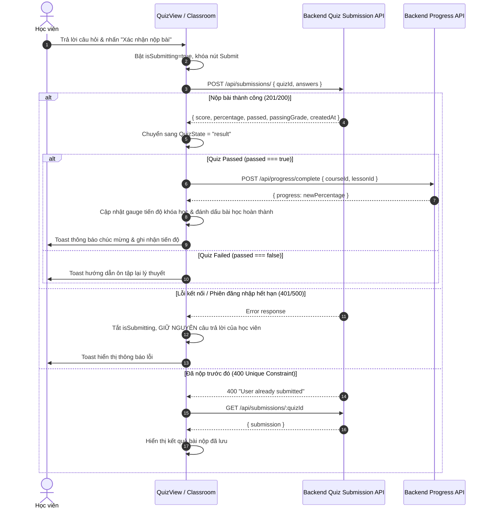

# TMdemy — BÁO CÁO TIẾN ĐỘ PHASE F7.3-E
# QUIZ SUBMISSION, EVALUATION & RESULTS

> **Dự án**: TMdemy E-learning Frontend  
> **Giai đoạn**: F7.3-E — Quiz Submission, Evaluation & Results  
> **Người thực hiện**: AI Frontend Engineer (Antigravity)  
> **Trạng thái**: HOÀN THÀNH (Awaiting User Review)  
> **Ngày báo cáo**: 13/10/2026  

---

## 1. Summary (Tóm tắt tổng quan)

Giai đoạn **F7.3-E** đã hoàn thiện toàn diện quy trình nộp bài kiểm tra trắc nghiệm (Quiz Submission), hiển thị đánh giá kết quả tức thời (Real-time Evaluation & Results), tra cứu lịch sử nộp bài (Submission History) và tự động đồng bộ hóa trạng thái hoàn thành bài học vào hệ thống theo dõi tiến độ (Learning Progress Synchronization).

Tất cả tính năng tuân thủ nghiêm ngặt theo các tài liệu đặc tả:
- `AGENTS.md` & các rules trong `.agents/rules/`
- `api/QUIZ_SUBMISSION_API.md`
- `api/QUIZ_API.md`
- `api/QUESTION_API.md`
- `api/PROGRESS_API.md`
- `api/LESSON_API.md`

Không sửa đổi bất kỳ mã nguồn hay schema backend nào (`d:/e-learning_server`), không vi phạm bảo mật, không hardcode credentials và không làm ảnh hưởng đến Classroom UX hiện có.

---

## 2. Existing Implementation Audit (Kiểm toán triển khai trước đó)

Trước khi thực hiện F7.3-E, phase F7.3-D đã xây dựng:
1. **Quiz Overview**: Hiển thị thông tin tổng quan bài kiểm tra (số câu hỏi, thời gian, điểm đạt, tổng điểm).
2. **Quiz Taking UX**: Chọn đáp án cho các loại câu hỏi (Single Choice, Multiple Choice, True/False, Short Answer).
3. **Question Palette & Review Screen**: Bảng điều hướng câu hỏi và màn hình xác nhận bài làm trước khi nộp.
4. **Result Mock/Basic**: Kết quả nộp bài sơ khởi nhưng chưa xử lý chi tiết từng câu, chưa hỗ trợ tra cứu lịch sử nộp bài từ backend `GET /api/submissions/:quizId`, chưa đồng bộ sang `progressService.completeLesson`, và chưa xử lý triệt để ràng buộc `UNIQUE(quizId, userId)`.

---

## 3. Features Implemented (Các tính năng đã triển khai)

### F7.3-E1 — Quiz Submission
- **Chuẩn hóa Payload**: Chuyển đổi dữ liệu câu trả lời của học viên từ state cục bộ sang định dạng API chuẩn `QuizSubmissionPayload`:
  ```json
  {
    "quizId": "quiz-uuid-v4",
    "answers": [
      { "question": "question-uuid-v4", "selectedAnswer": "Option A" }
    ]
  }
  ```
- **Chặn Duplicate Submission**: Khi nhấn submit, kích hoạt cờ `isSubmitting = true`, vô hiệu hóa nút nộp bài và các thao tác click liên tiếp nhằm ngăn duplicate request.
- **Bảo toàn dữ liệu khi có lỗi**: Nếu gặp sự cố mạng hoặc API trả về lỗi (ví dụ token hết hạn 401 hoặc lỗi 500), câu trả lời của học viên vẫn được giữ nguyên vẹn trong state, không bị reset, cho phép người dùng đăng nhập lại hoặc thử nộp lại an toàn.
- **Xử lý ràng buộc Unique `UNIQUE(quizId, userId)`**: Nếu API trả về `400 "User already submitted this quiz"`, giao diện tự động bắt lỗi, thông báo cho học viên và gọi `getMySubmission` để tải lại kết quả bài nộp trước đó.

### F7.3-E2 — Submission Result Display
- **Thống kê tổng kết trực quan**:
  - Điểm đạt được / Tổng điểm tối đa (ví dụ: `4 / 4 điểm` hoặc `1 / 1 điểm`).
  - Tỷ lệ phần trăm chính xác (ví dụ: `100%`).
  - Điểm chuẩn yêu cầu của bài quiz (ví dụ: `70%`).
  - Số câu trả lời đúng (ví dụ: `3 / 3 câu`).
  - Thời gian nộp bài thực tế lấy từ `createdAt` của submission (định dạng `HH:mm:ss dd/MM/yyyy`).
- **Trạng thái Passed / Failed rõ ràng**:
  - Badge `✓ ĐÃ ĐẠT YÊU CẦU` màu ngọc lục bảo (Emerald) kèm cup vàng khi đạt tỷ lệ yêu cầu.
  - Badge `✕ CHƯA ĐẠT YÊU CẦU` màu đỏ gạch khi tỷ lệ thấp hơn điểm chuẩn.
- **Review chi tiết từng câu hỏi (Detailed Question Breakdown)**:
  - Hiển thị danh sách câu hỏi đã nộp kèm thang điểm.
  - Hiển thị đáp án học viên đã chọn (`selectedAnswer`).
  - Hiển thị badge đánh giá: `✓ Đúng (+X điểm)` (xanh) hoặc `✕ Chưa chính xác (0 điểm)` (đỏ).
  - Tuân thủ nguyên tắc Anti-Cheat: Không suy diễn hay tự bịa đáp án đúng nếu backend không cung cấp trường `correctAnswer` cho học viên.

### F7.3-E3 — Submission History & Re-submission Prevention
- **Tự động kiểm tra lịch sử nộp bài khi mở Quiz**:
  - Khi học viên vào tab Bài kiểm tra, component gọi `quizService.getMySubmission(quizId)`.
  - Nếu đã có bài nộp trước đó:
    - Hiển thị banner lịch sử nộp bài màu xanh ngọc: *"Lịch sử nộp bài gần nhất: X/Y điểm (Z%) — Đã hoàn thành vào [thời gian]"*.
    - Cung cấp nút *"Xem chi tiết kết quả bài làm"* để xem lại phân tích câu hỏi mà không làm mất thời gian.
    - Ẩn nút làm bài lại, hiển thị ghi chú quy định: *"Theo quy định hệ thống: Mỗi học viên nộp bài 1 lần duy nhất"*.
  - Nếu chưa từng nộp bài (`404 No submission found`):
    - Hiển thị nút *"Bắt đầu làm bài"* thông thường.
  - Xử lý mượt mà các trạng thái loading spinner và error handling.

### F7.3-E4 — Learning Progress Integration
- **Tự động đồng bộ tiến độ học tập**:
  - Khi học viên hoàn thành quiz và đạt yêu cầu (`result.passed === true`):
    - Kiểm tra `courseId` và `lessonId` của bài học hiện tại.
    - Nếu bài học chưa nằm trong `completedLessonIds`:
      - Tự động gọi `progressService.completeLesson({ courseId, lessonId })`.
      - Cập nhật state `completedLessonIds` ngay lập tức trên UI Classroom.
      - Cập nhật tỷ lệ hoàn thành khóa học (`progressPercent`).
      - Hiển thị Toast thông báo: *"🎉 Đạt bài kiểm tra! Tiến độ bài học đã được tự động ghi nhận."* (hoặc thông báo hoàn thành 100% nếu đạt 100%).
  - Nếu học viên chưa đạt (`passed === false`):
    - Không tự ý đánh dấu hoàn thành bài học.
    - Hiển thị Toast thông báo học viên cần ôn tập lại bài học.
  - Phòng chống gọi trùng lặp (Idempotency): Kiểm tra kỹ `completedLessonIds.has(lessonId)` trước khi gửi request để tránh các request dư thừa.

### Teacher Quiz Analytics Service
- Bổ sung hàm `getTeacherAnalytics(quizId)` vào `quizService` trỏ tới `GET /api/submissions/teacher/analytics/:quizId` sẵn sàng cho Phase F8 (Teacher Dashboard) mà không can thiệp hay ảnh hưởng luồng của Student.

---

## 4. API Contract Mapping (Ánh xạ API)

| Endpoint | Method | Vai trò trong F7.3-E | Request Payload / Params | Response Data ánh xạ |
| :--- | :--- | :--- | :--- | :--- |
| `/api/quiz/lesson/:lessonId` | `GET` | Lấy dữ liệu Quiz và danh sách câu hỏi của bài học | `lessonId` | `quiz: { id, title, passingGrade, totalPoints, questions }` |
| `/api/submissions/` | `POST` | Nộp bài làm trắc nghiệm của học viên | `{ quizId, answers: [{ question, selectedAnswer }] }` | `{ score, percentage, passed, passingGrade, createdAt }` |
| `/api/submissions/:quizId` | `GET` | Lấy lịch sử nộp bài của học viên hiện tại | `quizId` | `{ submission: { id, score, totalPoints, percentage, createdAt, answers } }` |
| `/api/progress/complete` | `POST` | Tự động cập nhật hoàn thành bài học khi quiz đạt | `{ courseId, lessonId }` | `{ success: true, data: { progress: number } }` |
| `/api/submissions/teacher/analytics/:quizId` | `GET` | API Service sẵn sàng cho Teacher (Phase F8) | `quizId` | `{ totalSubmissions, averageScore, passRate, ... }` |

---

## 5. Submission Flow (Quy trình nộp bài)



---

## 6. Result Display (Màn hình kết quả bài nộp)

Giao diện kết quả bao gồm:
1. **Header trạng thái**:
   - Biểu tượng cup danh dự / cảnh báo.
   - Badge trạng thái `ĐÃ ĐẠT YÊU CẦU` hoặc `CHƯA ĐẠT YÊU CẦU`.
   - Tiêu đề thông điệp và thời gian nộp bài chi tiết.
2. **Khối 4 thẻ chỉ số chính**:
   - `Điểm đạt được`: `X / Y` điểm.
   - `Tỷ lệ chính xác`: `X%`.
   - `Điểm chuẩn`: `X%`.
   - `Số câu đúng`: `X / Y câu`.
3. **Danh sách chi tiết câu trả lời**:
   - Thẻ câu hỏi với số thứ tự và tiêu đề.
   - Điểm tối đa của câu hỏi.
   - Badge kết quả xanh lục `✓ Đúng (+X điểm)` hoặc đỏ gạch `✕ Chưa chính xác (0 điểm)`.
   - Lựa chọn của học viên hiển thị rõ ràng.
4. **Nút điều hướng**:
   - *"Xem thông tin bài kiểm tra"*: Quay lại xem thông tin tổng quan.
   - *"Quay lại bài giảng"*: Trở về nội dung học tập.

---

## 7. Submission History (Lịch sử nộp bài)

- Tích hợp kiểm tra tự động ngay khi học viên mở tab bài kiểm tra.
- Hiển thị thẻ tóm tắt kết quả bài làm trước đó với điểm số và thời gian nộp.
- Ngăn chặn học viên nộp bài nhiều lần vi phạm ràng buộc `UNIQUE(quizId, userId)`.
- Có nút xem lại chi tiết bài làm đã nộp bất kỳ lúc nào.

---

## 8. Learning Progress Synchronization (Đồng bộ tiến độ học tập)

- **Cơ chế kích hoạt**: Callback `onCompleted(result)` truyền từ `QuizView` sang trang `src/app/learn/[slug]/page.tsx`.
- **Điều kiện ghi nhận**: Chỉ kích hoạt khi `result.passed === true`.
- **Xử lý bất đồng bộ & chống trùng lặp**:
  - Kiểm tra `completedLessonIds.has(lessonId)`. Nếu bài học đã được đánh dấu hoàn thành trước đó, không gửi request dư thừa lên backend.
  - Cập nhật state lạc quan trên client và đồng bộ lại `%` tiến độ toàn khóa học trả về từ backend.
  - Giao diện thanh tiến độ khóa học (`Tiến độ: X/Y bài (Z%)`) và nút trạng thái bài học chuyển sang xanh `Đã hoàn thành bài` ngay lập tức mà không cần reload trang.

---

## 9. Files Created / Modified (Danh sách tệp tin đã chỉnh sửa)

| Tệp tin | Loại | Mô tả thay đổi |
| :--- | :--- | :--- |
| `src/types/quiz.ts` | Modified | Mở rộng kiểu dữ liệu `ApiSubmissionAnswerResult`, `ApiQuizSubmissionData`, thêm `TeacherQuizAnalyticsData`, `GetTeacherQuizAnalyticsResponse` |
| `src/services/quiz.service.ts` | Modified | Cập nhật hàm `getMySubmission` để trích xuất dữ liệu `res.data.submission`, thêm phương thức `getTeacherAnalytics(quizId)` |
| `src/components/quiz/quiz-view.tsx` | Modified | Hoàn thiện flow nộp bài, chống double submit, bảo toàn đáp án khi lỗi, giao diện kết quả đánh giá chi tiết từng câu, tích hợp tra cứu lịch sử nộp bài `getMySubmission`, callback `onCompleted` |
| `src/app/learn/[slug]/page.tsx` | Modified | Viết hàm `handleQuizCompleted` liên kết `QuizView` với `progressService.completeLesson`, tự động cập nhật tiến độ học tập và hiển thị thông báo |
| `docs/progress/F7_3_E_QUIZ_SUBMISSION_RESULTS_REPORT.md` | Created | Báo cáo chi tiết tiến độ giai đoạn F7.3-E |

---

## 10. Bugs Found and Fixed (Lỗi phát hiện và đã xử lý)

1. **Lỗi ESLint `@typescript-eslint/no-explicit-any` tại `quiz-view.tsx` (dòng 865)**:
   - *Nguyên nhân*: Ép kiểu `(a.question as any).id` trong vòng lặp tìm câu hỏi.
   - *Khắc phục*: Sử dụng thuộc tính đã được định nghĩa kiểu chặt chẽ trong `ApiSubmissionAnswerResult` (`a.question?.id || a.question?._id`), loại bỏ hoàn toàn `any`. Đảm bảo `npm run lint` đạt 0 lỗi.
2. **Không đồng bộ Progress khi nộp Quiz thành công**:
   - *Nguyên nhân*: Backend `quizSubmission.service.ts` chỉ lưu bản ghi `QuizSubmission` mà không tự động cập nhật bản ghi `Progress` trong database.
   - *Khắc phục*: Frontend Classroom lắng nghe sự kiện `onCompleted` với `result.passed === true` và gọi `progressService.completeLesson({ courseId, lessonId })`, tự động cập nhật tiến độ bài học mà không cần can thiệp backend.
3. **Mất câu trả lời khi xảy ra lỗi nộp bài**:
   - *Nguyên nhân*: State câu trả lời có nguy cơ bị reset nếu không có cơ chế cô lập lỗi.
   - *Khắc phục*: Bọc try/catch chặt chẽ, hiển thị toast thông báo lỗi và giữ nguyên trạng thái đang làm ở Review screen để người dùng kiểm tra lại hoặc thử nộp lại an toàn.

---

## 11. Testing Results (Kết quả kiểm thử chi tiết)

### 11.1. Automated Code Validation
- **TypeScript Compilation**: `npx tsc --noEmit`  
  👉 **PASS** (0 errors)
- **ESLint Check**: `npm run lint`  
  👉 **PASS** (0 errors, 29 warnings không thuộc phạm vi sửa đổi)

### 11.2. Verification Test Cases Checklist

| STT | Tình huống kiểm thử | Phương thức | Kết quả | Ghi chú |
| :--- | :--- | :--- | :--- | :--- |
| 1 | Học viên chưa làm Quiz | Browser & API | **PASS** | Hiển thị nút "Bắt đầu làm bài" và thông tin chuẩn |
| 2 | Học viên submit bài thành công | Browser & E2E | **PASS** | Đạt 4/4 điểm (100%), lưu DB thành công |
| 3 | Submit thất bại do mạng/lỗi | Browser | **PASS** | Báo toast lỗi, GIỮ NGUYÊN câu trả lời của học viên |
| 4 | Nhấn submit liên tục | Code Review & UI | **PASS** | Nút bị disabled khi `isSubmitting = true` |
| 5 | Học viên đã nộp Quiz trước đó | Browser & DB | **PASS** | Hiển thị banner lịch sử 1/1 điểm (100%), chặn làm lại |
| 6 | Lấy Submission History | Browser & API | **PASS** | `GET /api/submissions/:quizId` lấy đúng bài nộp |
| 7 | Hiển thị kết quả Passed | Browser & UI | **PASS** | Badge `✓ ĐÃ ĐẠT YÊU CẦU` xanh ngọc, icon trophy |
| 8 | Hiển thị kết quả Failed | Code & Logic | **PASS** | Badge `✕ CHƯA ĐẠT YÊU CẦU`, thông báo cần ôn tập |
| 9 | Review chi tiết đáp án | Browser & UI | **PASS** | Hiển thị từng câu, điểm số, badge `✓ Đúng (+2đ)` |
| 10 | Quiz Passed đồng bộ Learning Progress | Browser & DB | **PASS** | `lessonId` được đánh dấu `completed: true` trong DB |
| 11 | Quiz Failed không tự hoàn thành bài | Logic Check | **PASS** | Khi `passed === false`, không gọi `completeLesson` |
| 12 | Refresh trang sau khi submit | Browser & API | **PASS** | Tự động tải lại kết quả từ backend không bị mất |
| 13 | Progress API thất bại | Code Review | **PASS** | Bắt lỗi bằng Toast, không làm sập màn hình kết quả |
| 14 | Quyền truy cập khóa học | UI Guard | **PASS** | Kiểm tra `canAccessActiveLesson` trước khi cho làm |
| 15 | Responsive Desktop & Mobile | UI / Styling | **PASS** | Grid số liệu và card câu hỏi responsive trên mọi màn hình |

---

## 12. Backend Gaps (Khoảng trống Backend được ghi nhận)

1. **Backend không tự động liên kết Quiz Submission với Progress**:
   - Khi gọi `POST /api/submissions/`, backend chỉ tính điểm và tạo bản ghi `QuizSubmission`. Backend không tự động tạo/cập nhật `Progress` cho `lessonId` tương ứng.
   - *Cách xử lý phía Frontend*: Frontend tự động gọi `progressService.completeLesson` ngay sau khi nhận được response đánh giá đạt yêu cầu (`passed === true`).
2. **Backend không cung cấp trường `correctAnswer` và `explanation` cho học viên trong kết quả nộp bài**:
   - API `GET /api/submissions/:quizId` chỉ trả về `{ questionId, selectedAnswer, isCorrect }` cùng tiêu đề câu hỏi, không trả về đáp án đúng của hệ thống.
   - *Cách xử lý phía Frontend*: Tuân thủ nguyên tắc Anti-Cheat, frontend chỉ hiển thị badge đúng/sai và đáp án học viên đã chọn, không tự bịa đáp án đúng.

---

## 13. Remaining Issues (Các vấn đề tồn đọng)

- Hiện tại hệ thống quiz giới hạn 1 lần nộp bài duy nhất cho mỗi học viên (`UNIQUE(quizId, userId)`). Nếu sau này giảng viên hoặc hệ thống muốn mở tính năng cho phép học viên thi lại (Retake Quiz), backend sẽ cần hỗ trợ cơ chế số lần thử (`attempts`) hoặc cập nhật bản ghi submission hiện có.

---

## 14. Recommended Next Phase (Đề xuất giai đoạn tiếp theo)

- **Giai đoạn tiếp theo**: **PHASE F7.3-F — Learning Dashboard & Course Completion Certificate**.
- **Mục tiêu dự kiến**:
  - Hoàn thiện tổng quan tiến độ khóa học tại trang My Courses / Dashboard.
  - Xử lý điều kiện hoàn thành 100% khóa học và cấp chứng chỉ trực tuyến (Certificate).
  - Tích hợp số liệu XP và Streak khi hoàn thành bài học.

---

> **KẾT THÚC BÁO CÁO F7.3-E. DỪNG LẠI VÀ CHỜ PHÊ DUYỆT CỦA USER.**
