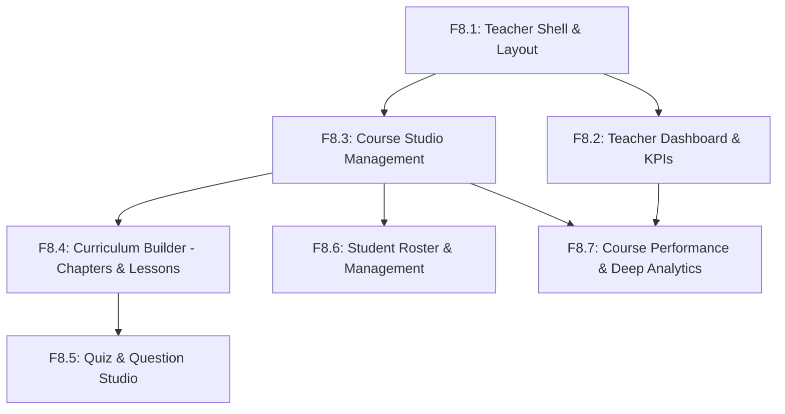

# BÁO CÁO KHẢO SÁT & KẾ HOẠCH TRIỂN KHAI PHÂN HỆ GIẢNG VIÊN (F8 TEACHER DISCOVERY & IMPLEMENTATION ROADMAP)

> **Mã tài liệu:** `F8_TEACHER_DISCOVERY_REPORT`  
> **Dự án:** TMdemy Frontend (`d:/e-learning`)  
> **Giai đoạn:** DISCOVERY & PLANNING (F8 — Teacher Experience)  
> **Tác giả:** Frontend Engineering AI Assistant  
> **Ngày lập:** 15/10/2026  
> **Trạng thái:** DRAFT HOÀN THÀNH — CHỜ PHÊ DUYỆT (STOP AT GATE)  

---

## 1. MỤC TIÊU VÀ PHẠM VI KHẢO SÁT

Giai đoạn **F8 Discovery** tập trung rà soát toàn bộ hiện trạng mã nguồn TMdemy Frontend, đối chiếu với Hợp đồng mạng (API Contract Source of Truth tại `api/`) và Hệ thống thiết kế Stitch (`tmdemy`) nhằm chuẩn bị kế hoạch kiến trúc và lộ trình triển khai chi tiết cho phân hệ **Giảng viên (Teacher Experience & Course Studio)**.

Phạm vi khảo sát bao gồm 7 mảng năng lực cốt lõi:
1. **Teacher Dashboard**: Bảng điều khiển trung tâm, tổng quan KPI tài chính và học thuật.
2. **Course Management**: Quản lý vòng đời khóa học (Tạo mới, chỉnh sửa thông tin, lọc theo trạng thái duyệt `PENDING` / `APPROVED` / `REJECTED`, xóa khóa học chờ duyệt).
3. **Chapter & Lesson Management**: Studio biên soạn giáo trình (Chương học, bài học Video / Text, học thử miễn phí `isDemo`, tính thời lượng và sắp xếp thứ tự).
4. **Quiz & Question Management**: Trình dựng bài kiểm tra trắc nghiệm (Tạo Quiz theo bài học, câu hỏi `multiple_choice` / `fill_in_blank`, thiết lập điểm đạt `passing_grade`, thời gian làm bài, phân tích kết quả).
5. **Student Management**: Danh sách học viên ghi danh theo khóa học, tra cứu tiến độ học tập, gỡ bỏ học viên vi phạm kèm giao dịch hoàn trả tự động.
6. **Teacher Statistics**: Phân tích tài chính và tuyển sinh (Doanh thu theo chu kỳ `7days`, `30days`, `12months`, `custom`, biến động ghi danh, tỷ lệ hoàn thành, cấp chứng chỉ).
7. **Course Performance**: Báo cáo phân tích chuyên sâu hiệu suất khóa học (Snapshot tài chính, phân bố đánh giá sao 1-5, thống kê Quiz và Phễu sụt giảm bài học `lessonsFunnel`).

---

## 2. HIỆN TRẠNG TRIỂN KHAI TEACHER TRÊN FRONTEND (CURRENT STATE SCAN)

### 2.1. Tuyến đường & Giao diện (Routes & Pages)
- **Tình trạng:** Hiện tại thư mục `src/app/` **chưa có bất kỳ trang nào thuộc nhóm `/teacher`**.
- Toàn bộ các trang hiện có tập trung vào phân hệ Khách vãng lai và Học viên (`/courses`, `/my-courses`, `/learn/[slug]`, `/roadmap`, `/leaderboard`, `/certificates`, `/messages`, `/profile`, `/settings`, `/orders`, `/checkout`).
- Trang `src/app/dashboard/page.tsx` hiện đóng vai trò chuyển hướng vĩnh viễn (`redirect('/')`) về trang chủ học viên.

### 2.2. Phân quyền & Điều hướng theo vai trò (Auth & Route Protection)
- **Điểm mạnh đã có:**
  - `src/components/auth/route-guard.tsx` đã cài đặt sẵn hàm `getDefaultRolePath(role)` chuyển hướng tài khoản `teacher` về `/teacher/dashboard`.
  - Component `<RouteGuard allowedRoles={['teacher']}>` đã hoàn thiện logic kiểm tra, hiển thị màn hình từ chối quyền truy cập (403 Forbidden) kèm nút quay về Dashboard phù hợp.
  - Hook `useAuth()` (`src/hooks/use-auth.ts`) trích xuất đầy đủ `user.role` từ Access Token JWT.
- **Điểm thiếu hụt:**
  - Trong `src/components/layout/dashboard-header.tsx`, menu thả xuống của người dùng (User Dropdown Menu) nhận diện được danh xưng vai trò `Giảng viên` (`formatRole(user.role)`), nhưng danh sách liên kết **hoàn toàn là các trang của Học viên**. Chưa có nút bấm chuyển sang "Kênh Giảng Viên" (`/teacher/dashboard`) khi người dùng đăng nhập tài khoản Teacher.
  - Chưa có layout riêng hoặc sidebar điều hướng dành riêng cho phân hệ Giảng viên (`TeacherSidebar`).

### 2.3. Lớp Dịch vụ Mạng (Services & API Clients)
- `src/lib/api/client.ts`: Đã hoàn thiện, tự động đính kèm `Authorization: Bearer <TOKEN>` cho mọi request xác thực, tự động refresh token qua interceptor khi gặp lỗi 401.
- `src/services/course.service.ts`: Hiện tại **chỉ phục vụ các endpoint công khai của Học viên** (`GET /api/courses/`, `GET /api/courses/:slug`). Hoàn toàn chưa tích hợp các endpoint quản lý khóa học của Giảng viên (`POST /api/teacher/courses/`, `PUT /api/teacher/courses/:id`, `DELETE /api/teacher/courses/:id`, `GET /api/teacher/courses/`).
- `src/services/quiz.service.ts`: Đã có phương thức `getTeacherAnalytics(quizId)` (`GET /api/submissions/teacher/analytics/:quizId`). Chưa có các hàm CRUD cho Quiz và Question (`POST /api/quiz/`, `PUT /api/quiz/:id`, `DELETE /api/quiz/:id`, `POST /api/questions/`, `PUT /api/questions/:id`, `DELETE /api/questions/:id`).
- `src/services/lesson.service.ts` & `chapter.service.ts`: Hiện tại chưa có file `chapter.service.ts`. `lesson.service.ts` chỉ có `getLessonsByChapter` dành cho học viên, chưa có hàm tạo/sửa/xóa bài học của giảng viên.
- Chưa có service thống kê: `teacher-statistics.service.ts` hoàn toàn chưa tồn tại.
- Chưa có service quản lý học viên: `enrollment.service.ts` mới chỉ có `getMyEnrollments()`, chưa có `getCourseStudents()` và `removeStudent()`.

---

## 3. BẢN ĐỒ TUYẾN ĐƯỜNG PHÂN HỆ GIẢNG VIÊN (TEACHER PAGE & ROUTE MAP)

Căn cứ theo `docs/ROLE_PERMISSIONS.md` và các quy chuẩn Next.js App Router:

```text
src/app/teacher/
├── layout.tsx ........................... Teacher Layout Shell (Sidebar riêng, Header chuyển đổi chế độ Học viên/Giảng viên)
├── dashboard/
│   └── page.tsx ......................... Bảng điều khiển Giảng viên (Tổng quan KPI, xu hướng doanh thu, phím tắt nhanh)
├── courses/
│   ├── page.tsx ......................... Studio Khóa học (Danh sách, lọc theo trạng thái Pending/Approved/Rejected, tìm kiếm)
│   ├── new/
│   │   └── page.tsx ..................... Form tạo khóa học mới (Khởi tạo trạng thái PENDING)
│   └── [id]/
│       ├── edit/
│       │   └── page.tsx ................. Chỉnh sửa thông tin tổng quan, giá bán, yêu cầu khóa học
│       ├── curriculum/
│       │   └── page.tsx ................. Studio Giáo trình: Quản lý Chương học & Bài học (Video/Text/Học thử)
│       ├── quizzes/
│       │   └── page.tsx ................. Studio Bài kiểm tra & Bộ câu hỏi trắc nghiệm
│       ├── students/
│       │   └── page.tsx ................. Quản lý học viên ghi danh, theo dõi tiến độ & gỡ bỏ học viên
│       └── performance/
│           └── page.tsx ................. Báo cáo Phân tích Chuyên sâu (Performance Snapshot & Funnel Drop-off)
└── analytics/
    └── page.tsx ......................... Trung tâm Phân tích Doanh thu & Học thuật đa chu kỳ (7 ngày, 30 ngày, 12 tháng, Custom)
```

---

## 4. MA TRẬN ÁNH XẠ HỢP ĐỒNG API (API DEPENDENCY & CONTRACT MAP)

Toàn bộ các endpoint đều tuân thủ nguyên tắc cách ly dữ liệu: **`teacherId` bắt buộc trích xuất từ JWT Access Token (`req.user.userId`), không bao giờ nhận từ client**.

| Phân hệ / Chức năng | Phương thức & Endpoint | Tài liệu Nguồn | Tham số & Request Body | Trạng thái Response & Cấu trúc DTO |
| :--- | :--- | :--- | :--- | :--- |
| **KPI Tổng quan** | `GET /api/teacher/statistics/overview` | `api/TEACHER_STATISTICS_API.md` | Headers: Bearer Token | `200 OK`: `revenue`, `students`, `courses`, `rating` |
| **Biểu đồ Doanh thu** | `GET /api/teacher/statistics/revenue` | `api/TEACHER_STATISTICS_API.md` | Query: `period` (`7days`/`30days`/`12months`/`custom`), `startDate`, `endDate`, `courseId` | `200 OK`: `summary` (tổng tiền, số đơn), `timeline[]` theo ngày/tháng |
| **Xếp hạng Khóa học** | `GET /api/teacher/statistics/courses` | `api/TEACHER_STATISTICS_API.md` | Query: `page`, `limit`, `sortBy` (`revenue`/`students`/`rating`), `order`, `status` | `200 OK`: `courses[]` kèm doanh thu, học viên, rating, phân trang `pagination` |
| **Thống kê Tuyển sinh**| `GET /api/teacher/statistics/enrollments`| `api/TEACHER_STATISTICS_API.md` | Query: `period`, `courseId` | `200 OK`: `summary` (active/completed/canceled), `timeline[]` |
| **Tiến độ Học tập** | `GET /api/teacher/statistics/learning` | `api/TEACHER_STATISTICS_API.md` | Query: `courseId` (tùy chọn) | `200 OK`: `averageProgress`, `completionRate`, `certificatesIssued` |
| **Danh sách Khóa học** | `GET /api/teacher/courses/` | `api/TEACHER_API.md` | Query: `page`, `limit`, `search`, `status` (`approved`/`pending`/`rejected`) | `200 OK`: `courses[]`, `pagination` |
| **Tạo Khóa học Mới** | `POST /api/teacher/courses/` | `api/TEACHER_API.md` | Body: `title`, `description`, `category`, `price`, `old_price`, `level`, `type`, `image`, `info` | `201 Created`: Khóa học mang trạng thái `PENDING`, tự động bắn notif cho Admin |
| **Cập nhật Khóa học** | `PUT /api/teacher/courses/:id` | `api/TEACHER_API.md` | Path: `id`, Body: các trường cần cập nhật | `200 OK`: Cấm đổi `status` và `author`. Bắt buộc kiểm tra quyền tác giả |
| **Xóa Khóa học** | `DELETE /api/teacher/courses/:id` | `api/TEACHER_API.md` | Path: `id` | `200 OK`: **Chỉ cho phép xóa khi status = PENDING** (`403` nếu đã approved/rejected) |
| **Thêm Chương học** | `POST /api/chapters/:courseId` | `api/CHAPTER_API.md` | Path: `courseId`, Body: `title`, `order` | `201 Created`: Tự động tính thứ tự kế tiếp nếu không truyền `order` |
| **Sửa Chương học** | `PUT /api/chapters/:id` | `api/CHAPTER_API.md` | Path: `id`, Body: `title`, `order` | `200 OK` |
| **Xóa Chương học** | `DELETE /api/chapters/:id` | `api/CHAPTER_API.md` | Path: `id` | `200 OK`: Xóa mềm chương và xóa kèm toàn bộ bài học bên trong |
| **Thêm Bài học** | `POST /api/lessons/` | `api/LESSON_API.md` | Body: `title`, `chapter`, `course`, `type` (`video`/`text`), `duration`, `videoUrl`, `content`, `isDemo` | `201 Created`: Kiểm tra tính toàn vẹn `chapter` thuộc `course`, tự gửi thông báo cho học viên |
| **Sửa Bài học** | `PUT /api/lessons/:id` | `api/LESSON_API.md` | Path: `id`, Body: các trường cập nhật, `order` | `200 OK` |
| **Xóa Bài học** | `DELETE /api/lessons/:id` | `api/LESSON_API.md` | Path: `id` | `200 OK`: Xóa mềm bài học |
| **Tạo Bài kiểm tra** | `POST /api/quiz/` | `api/QUIZ_API.md` | Body: `title`, `description`, `lesson`, `courseId`, `duration`, `passing_grade` | `201 Created`: **1 bài học chỉ được có tối đa 1 Quiz** (`400` nếu đã có) |
| **Cập nhật Quiz** | `PUT /api/quiz/:id` | `api/QUIZ_API.md` | Path: `id`, Body: `title`, `description`, `duration`, `passing_grade` | `200 OK` |
| **Xóa Quiz** | `DELETE /api/quiz/:id` | `api/QUIZ_API.md` | Path: `id` | `200 OK`: Xóa Quiz và toàn bộ câu hỏi liên quan |
| **Lấy Quiz bài học** | `GET /api/quiz/lesson/:lessonId`| `api/QUIZ_API.md` | Path: `lessonId` | `200 OK`: Trả về Quiz và danh sách câu hỏi |
| **Tạo Câu hỏi** | `POST /api/questions/` | `api/QUESTION_API.md` | Body: `quiz`, `type` (`multiple_choice`/`fill_in_blank`), `title`, `options[]`, `answer`, `points` | `200 OK` (hoặc `201`): Tự động lưu lựa chọn |
| **Sửa Câu hỏi** | `PUT /api/questions/:id` | `api/QUESTION_API.md` | Path: `id`, Body: `title`, `type`, `options`, `answer`, `points` | `200 OK` |
| **Xóa Câu hỏi** | `DELETE /api/questions/:id` | `api/QUESTION_API.md` | Path: `id` | `200 OK` |
| **Phân tích Quiz** | `GET /api/submissions/teacher/analytics/:quizId` | `api/QUIZ_SUBMISSION_API.md` | Path: `quizId` | `200 OK`: Lượt nộp, điểm trung bình, tỷ lệ đậu, phân tích từng câu hỏi |
| **Danh sách Học viên** | `GET /api/enrollments/course/:id` | `api/ENROLLMENT_API.md` | Path: `id` (courseId), Query: `page`, `limit`, `search` | `200 OK`: `students[]` (tiến độ, email, avatar, ngày tham gia), `pagination` |
| **Gỡ bỏ Học viên** | `DELETE /api/enrollments/course/:id/:userId` | `api/ENROLLMENT_API.md` | Path: `id`, `userId` | `200 OK`: Giao dịch nguyên tử xóa Enrollment, giảm số lượng đã bán `sold`, xóa Order |
| **Snapshot Hiệu suất** | `GET /api/teacher/statistics/course-performance/:courseId` | `api/COURSE_PERFORMANCE_API.md` | Path: `courseId` | `200 OK`: Phân tích chuyên sâu `revenue`, `students`, `engagement` (rating 1-5, chứng chỉ), `curriculum`, `quizzes`, `lessonsFunnel` |

---

## 5. TÀI NGUYÊN & COMPONENT CÓ THỂ TÁI SỬ DỤNG (REUSABILITY AUDIT)

1. **Hệ thống Design Tokens (Stitch Theme)**:
   - Primary Accent: `#7240b8` / `#8b5ad3` (Dark mode: `#a87ffb`).
   - Surfaces: Canvas `#fdf8ff` (Dark: `#131118`), Card `#ffffff` (Dark: `#17141f`), Viền `#f1ebff` (Dark: `#2b2438`).
   - Typography: `Plus Jakarta Sans` cho số liệu KPI, tiêu đề khóa học; `Be Vietnam Pro` cho nội dung tiếng Việt.
2. **Cơ chế Phân quyền (Security Primitives)**:
   - `<RouteGuard allowedRoles={['teacher']}>`: Đã hoàn thiện, tự động bọc mọi trang trong nhóm `/teacher`.
   - `useAuth()`: Cung cấp `user`, `role`, `status`, `isAuthenticated`.
3. **Thành phần Giao diện cơ bản (UI Elements)**:
   - Button (`src/components/ui/button.tsx`): Hỗ trợ đầy đủ variants `default`, `outline`, `ghost`, `secondary`, `destructive`.
   - Input (`src/components/ui/input.tsx`): Trường nhập văn bản, số tiền, URL.
   - Toast System (`src/lib/toast.ts`): Thông báo tức thời khi lưu, cập nhật, xóa thành công hoặc thất bại.
   - Theme Toggle (`src/components/common/theme-toggle.tsx`): Chuyển đổi Dark/Light mode nhất quán.
   - Image & Uploading (`src/app/api/uploadthing`): Có thể mở rộng để tải ảnh bìa khóa học nhanh chóng.
4. **Dịch vụ Hỗ trợ**:
   - `categoryService.getCategories()`: Tái sử dụng trực tiếp để nạp danh mục khi tạo hoặc sửa khóa học.

---

## 6. KHẢO SÁT MÀN HÌNH STITCH (STITCH SCREEN MAPPING)

- **Kết quả kiểm tra qua Stitch MCP Tool (`list_screens` cho dự án `projects/4018234784417032182` - `tmdemy`):**
  - Toàn bộ 13 màn hình hiện có trong dự án Stitch `tmdemy` đều thuộc nhóm trải nghiệm Học viên và Khách vãng lai (`Home`, `Courses`, `Course Detail`, `Classroom`, `My Courses`, `Roadmap`, `Leaderboard`, `Certificates`, `Messages`, `Profile`, `Settings`, `Login`, `Register`).
  - **Hiện tại chưa có màn hình Stitch nào được tạo riêng cho Phân hệ Giảng viên (Teacher Dashboard / Course Studio).**
- **Định hướng triển khai UI:**
  - Áp dụng nguyên tắc tuân thủ nghiêm ngặt **Stitch Design System Tokens** đã được thiết lập sẵn trong dự án: Card elevation tiers (Tier 1 border `#ECEAF3`, shadow mờ nhẹ), Metric Cards với số liệu to đậm `stat-lg`, Bảng dữ liệu tối giản (clean table design), Badges trạng thái chuẩn (`approved` xanh ngọc lục bảo `#10B981`, `pending` vàng hổ phách `#F59E0B`, `rejected` đỏ san hô `#BA1A1A`).

---

## 7. CÁC ĐIỂM HẠN CHẾ & LỖ HỔNG HỢP ĐỒNG (BACKEND GAPS & CONTRACT OBSERVATIONS)

1. `[BACKEND GAP]` **Thiếu Endpoint Liệt kê Mã giảm giá Giảng viên (`GET /api/teacher/coupons`)**:
   - `api/COUPON_API.md` định nghĩa `POST /api/coupons/` cho phép giảng viên tạo coupon cho các khóa học của mình, nhưng không có endpoint `GET` để giảng viên xem danh sách các mã giảm giá mình đã tạo. Trong giai đoạn F8 ban đầu, module Coupon sẽ được tách riêng hoặc chỉ hỗ trợ tạo mới nếu backend bổ sung endpoint liệt kê.
2. `[CONTRACT RULE]` **Quy định ngặt nghèo về Xóa Khóa học**:
   - Theo `api/TEACHER_API.md`, Giảng viên **chỉ được phép xóa khóa học khi đang ở trạng thái `PENDING`**. Nếu khóa học đã được duyệt (`APPROVED`) hoặc đã bị từ chối (`REJECTED`), cố tình gọi xóa sẽ nhận lỗi `403 Forbidden`. UI cần chủ động vô hiệu hóa nút Xóa và hiển thị tooltip giải thích rõ để tránh gây hiểu nhầm cho giảng viên.
3. `[CONTRACT RULE]` **Quy tắc 1-Kèm-1 của Quiz và Bài học**:
   - Mỗi bài học chỉ được gán đúng 1 bài Quiz duy nhất. Cố tình tạo thêm Quiz thứ 2 cho cùng 1 bài học sẽ nhận mã lỗi `400 Bad Request`. Giao diện Studio phải hiển thị nút "Chỉnh sửa Quiz" thay vì "Thêm Quiz" nếu bài học đã có bài kiểm tra.
4. `[TECHNICAL NOTE]` **Bản chất Drop-off trong Lesson Funnel**:
   - Theo đặc tả tại `api/COURSE_PERFORMANCE_API.md`, tỷ lệ sụt giảm bài học (`dropOffFromPrevious`) được tính toán dựa trên số lượng học viên hoàn thành bài học (`Progress.completed = true`). Đây không phải là log xem video từng giây (video telemetry). UI cần chú thích rõ ràng để giảng viên hiểu đúng ý nghĩa số liệu.

---

## 8. LỘ TRÌNH TRIỂN KHAI ĐỀ XUẤT (F8 IMPLEMENTATION ROADMAP: F8.1 – F8.7)

Để đảm bảo chất lượng, tính tách bạch và dễ dàng thẩm định theo quy chuẩn Antigravity IDE, toàn bộ phân hệ Giảng viên được chia thành 7 phase độc lập:



### Chi tiết từng giai đoạn:

#### 1. Phase F8.1: Teacher Layout Shell, Navigation & Route Guard
- **Mục tiêu:** Xây dựng khung sườn phân hệ Giảng viên, điều hướng và bảo vệ tuyến đường.
- **Phạm vi:**
  - Route layout: `src/app/teacher/layout.tsx`.
  - Component: `TeacherSidebar` (Tổng quan, Khóa học, Học viên, Doanh thu, Cài đặt, Nút quay lại Chế độ Học viên).
  - Tích hợp lối tắt "Kênh Giảng Viên" trên User Dropdown của `DashboardHeader` khi `user.role === 'teacher'`.
  - Cấu hình `<RouteGuard allowedRoles={['teacher']}>` bảo vệ toàn diện nhóm `/teacher/*`.
- **DoD:** Giảng viên đăng nhập có thể nhấn vào Kênh Giảng Viên trên Header, chuyển sang giao diện Teacher Shell với sidebar chuẩn, học viên thường truy cập bị chặn 403.

#### 2. Phase F8.2: Teacher Dashboard & Overview Statistics (`/teacher/dashboard`)
- **Mục tiêu:** Bảng điều khiển trung tâm với các chỉ số KPI trọng yếu.
- **APIs:**
  - `GET /api/teacher/statistics/overview`
  - `GET /api/teacher/statistics/revenue?period=30days`
  - `GET /api/teacher/statistics/courses?limit=5&sortBy=revenue`
- **Components:**
  - `TeacherKpiCard` (Doanh thu VND, Tổng học viên, Khóa học hoạt động, Đánh giá trung bình).
  - `RevenueQuickChart` (Biểu đồ đường/cột CSS tối giản theo thời gian).
  - `RecentCoursesTable` (Bảng top khóa học đạt doanh thu cao nhất).
  - Phím tắt tác vụ nhanh: "Tạo khóa học mới", "Xem báo cáo", "Quản lý học viên".
- **DoD:** Hiển thị số liệu thực tế từ tài khoản giảng viên đăng nhập với đầy đủ 6 trạng thái UX.

#### 3. Phase F8.3: Course Studio Management (`/teacher/courses`)
- **Mục tiêu:** Quản lý vòng đời khóa học (Tạo mới, Sửa thông tin, Xóa khóa học chờ duyệt).
- **APIs:**
  - `GET /api/teacher/courses/` (Phân trang, tìm kiếm, lọc `all`/`approved`/`pending`/`rejected`).
  - `POST /api/teacher/courses/` (Form tạo khóa học mới).
  - `PUT /api/teacher/courses/:id` (Cập nhật thông tin khóa học).
  - `DELETE /api/teacher/courses/:id` (Chỉ xóa khóa học `pending`).
- **Pages & Components:**
  - `/teacher/courses`: Studio danh sách khóa học dạng lưới và bảng, badge trạng thái màu sắc trực quan.
  - `/teacher/courses/new`: Trình tạo khóa học nhiều bước (Thông tin cơ bản, Giá & Giảm giá, Danh mục, Yêu cầu & Lợi ích).
  - `/teacher/courses/[id]/edit`: Màn hình chỉnh sửa thông tin.
- **DoD:** Giảng viên tạo được khóa học mới ở trạng thái `pending`, sửa đổi thông tin khóa học của mình, xóa được khóa học pending và bị chặn an toàn khi khóa học đã approved.

#### 4. Phase F8.4: Curriculum Builder — Chương học & Bài giảng (`/teacher/courses/[id]/curriculum`)
- **Mục tiêu:** Trình dựng giáo trình phân cấp (Chương -> Bài học).
- **APIs:**
  - `POST /api/chapters/:courseId`, `PUT /api/chapters/:id`, `DELETE /api/chapters/:id`.
  - `POST /api/lessons/`, `PUT /api/lessons/:id`, `DELETE /api/lessons/:id`.
- **Components:**
  - `CurriculumAccordion`: Danh sách chương học có thể thu gọn/mở rộng, sửa tiêu đề inline, đổi vị trí thứ tự `order`.
  - `LessonListRow`: Danh sách bài học trong chương, biểu tượng loại bài học (Video / Text), badge `Học thử` (`isDemo`), thời lượng.
  - `LessonEditorModal`: Modal thêm/sửa bài học (Tiêu đề, loại, link video, thời lượng giây, nội dung Markdown, nút bật/tắt cho phép học thử).
- **DoD:** Giảng viên thêm/sửa/xóa chương học và bài học mượt mà, tính toàn vẹn dữ liệu được backend xác thực chính xác.

#### 5. Phase F8.5: Quiz & Question Studio (`/teacher/courses/[id]/quizzes`)
- **Mục tiêu:** Trình biên soạn bài kiểm tra và câu hỏi trắc nghiệm đánh giá học viên.
- **APIs:**
  - `POST /api/quiz/`, `PUT /api/quiz/:id`, `DELETE /api/quiz/:id`, `GET /api/quiz/lesson/:lessonId`.
  - `POST /api/questions/`, `PUT /api/questions/:id`, `DELETE /api/questions/:id`.
  - `GET /api/submissions/teacher/analytics/:quizId`.
- **Components:**
  - `QuizConfigCard`: Cài đặt thời gian làm bài (phút), điểm đạt yêu cầu (% passing grade).
  - `QuestionItemCard`: Hiển thị nội dung câu hỏi, danh sách đáp án, tích xanh đáp án đúng, điểm số.
  - `QuestionEditorModal`: Soạn câu hỏi `multiple_choice` (thêm/bớt options, chọn đáp án đúng) hoặc `fill_in_blank`.
  - `QuizAnalyticsSummary`: Báo cáo tỷ lệ đậu và điểm số trung bình của học viên.
- **DoD:** Tạo được Quiz hoàn chỉnh cho bài học, thêm nhiều câu hỏi trắc nghiệm có đáp án chính xác, xem được báo cáo kết quả nộp bài của học sinh.

#### 6. Phase F8.6: Student Roster & Enrollment Management (`/teacher/courses/[id]/students`)
- **Mục tiêu:** Giám sát học viên theo học và xử lý sự cố ghi danh.
- **APIs:**
  - `GET /api/enrollments/course/:id` (Phân trang, tìm kiếm theo tên hoặc email).
  - `DELETE /api/enrollments/course/:id/:userId` (Gỡ học viên khỏi khóa học).
- **Components:**
  - `StudentRosterTable`: Bảng danh sách học viên (Avatar, họ tên, email, ngày tham gia, thanh tiến độ học tập %, trạng thái Active/Completed).
  - `RemoveStudentConfirmModal`: Modal xác nhận cảnh báo hoàn trả/xóa tiến độ trước khi thực hiện kick học viên.
- **DoD:** Hiển thị danh sách học viên thực tế của khóa học, tìm kiếm tức thì theo từ khóa, gỡ bỏ học viên thành công kèm cập nhật lại bảng danh sách.

#### 7. Phase F8.7: Course Performance Snapshot & Funnel Drop-off Analysis (`/teacher/courses/[id]/performance`)
- **Mục tiêu:** Đỉnh cao phân tích học thuật và kinh doanh khóa học.
- **APIs:**
  - `GET /api/teacher/statistics/course-performance/:courseId`
  - `GET /api/teacher/statistics/revenue?courseId=...`
  - `GET /api/teacher/statistics/learning?courseId=...`
- **Components:**
  - `PerformanceSnapshotOverview`: Doanh thu thực nhận, số đơn hoàn thành, giá trị trung bình đơn.
  - `RatingBreakdownWidget`: Điểm trung bình sao và biểu đồ phân bổ 5 cột tương ứng với mức sao 1 đến 5.
  - `CertificateIssuanceMetric`: Tỷ lệ học viên tốt nghiệp nhận chứng chỉ và điểm trung bình chứng chỉ.
  - `LessonFunnelChart`: Biểu đồ trực quan hóa phễu bài học từ đầu đến cuối khóa, làm nổi bật các bài học có tỷ lệ rơi rớt (`dropOffFromPrevious`) cao nhất giúp giảng viên cải thiện nội dung.
- **DoD:** Giảng viên xem được toàn bộ bức tranh hiệu quả của khóa học, nhận diện rõ điểm nghẽn học thuật thông qua Lesson Funnel.

---

## 9. ĐÁNH GIÁ RỦI RO & PHỤ THUỘC (RISKS & DEPENDENCIES)

| Rủi ro tiềm ẩn | Mức độ | Biện pháp giảm thiểu |
| :--- | :---: | :--- |
| **Lỗi 403 khi gọi API khóa học của giảng viên khác** | Cao | Toàn bộ các trang con đều yêu cầu `courseId` hợp lệ và đối chiếu quyền tác giả. Nếu gặp 403, hiển thị thông báo thân thiện và điều hướng về `/teacher/courses`. |
| **Xóa khóa học đã duyệt bị lỗi 403** | Trung bình | Khóa giao diện: Chỉ hiển thị nút Xóa khi `course.status === 'pending'`. Khóa học `approved` hoặc `rejected` hiển thị nhãn "Liên hệ Admin để xóa". |
| **State phức tạp trong Curriculum Builder** | Trung bình | Tách bạch state theo cấp độ: Chương học (Parent List) và Bài học (Child Rows). Sử dụng optimistic update kết hợp làm mới dữ liệu sau các thao tác tạo/sửa/xóa. |
| **Hiển thị biểu đồ không dùng thư viện ngoài** | Thấp | Tuân thủ chính sách Dependency: Tận dụng Tailwind CSS Flexbox/Grid, SVG thuần và các cột tiến độ CSS để dựng biểu đồ doanh thu và phễu rơi rớt, không tự ý cài đặt thêm npm package. |

---

## 10. KHUYẾN NGHỊ BƯỚC ĐI TIẾP THEO (RECOMMENDED NEXT STEP)

Sau khi báo cáo Discovery này được phê duyệt, bước triển khai đầu tiên được đề xuất là:

👉 **Kích hoạt Phase F8.1: Teacher Layout Shell, Navigation & Route Guard**  
- Xây dựng khung điều hướng `src/app/teacher/layout.tsx` và `TeacherSidebar`.
- Thêm đường dẫn truy cập "Kênh Giảng Viên" trên User Dropdown của `DashboardHeader`.
- Đảm bảo bảo mật truy cập bằng `<RouteGuard allowedRoles={['teacher']}>`.
- Xác thực toàn diện `npx tsc --noEmit`, `npm run lint` và `npm run build`.

---
*Báo cáo kết thúc tại đây. Hệ thống tạm dừng chờ người dùng rà soát và ra lệnh triển khai tiếp theo.*
